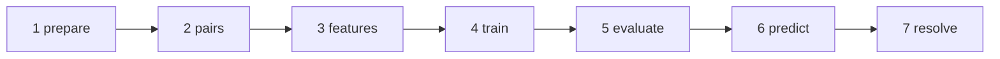
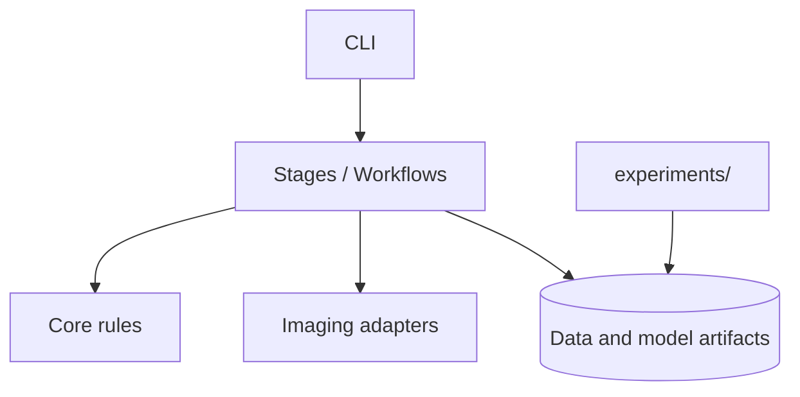

# Machine Learning Architecture

## Source of truth

โค้ดระบบหลักมีที่เดียวคือ `src/identity_resolution/`:

```text
src/identity_resolution/
├── cli.py                 # CLI เดียว: identity-ml
├── settings.py            # paths และ production defaults กลาง
├── core/                  # pure domain logic
│   ├── decisioning.py     # MATCH / REVIEW / NO_MATCH
│   ├── entities.py        # entity graph / canonical values
│   ├── pairs.py           # unordered pair identity
│   └── text.py            # shared normalization
├── stages/                # ML lifecycle ตามลำดับ
│   ├── prepare.py         # 1. raw profiles → cleaned profiles
│   ├── pairs.py           # 2. profiles → labeled pairs
│   ├── features.py        # 3. pairs → feature matrices
│   ├── train_base.py      # shared feature/model implementation
│   ├── train_multimodal.py# 4. train/select production model
│   ├── train_neural.py    # optional neural reference
│   └── evaluate.py        # 5. evaluation report
├── imaging/               # image ingestion and image feature adapters
└── workflows/
    ├── full_candidate.py  # 6. predict full candidate set
    └── crm.py             # 7. resolve entities + lead scoring
```

## ลำดับการทำงาน



| ขั้น | Input | Output | Command |
|---|---|---|---|
| prepare | LinkSocial JSON | cleaned profiles | `identity-ml prepare` |
| pairs | normalized profiles | labeled pair parquet | `identity-ml pairs` |
| features | profiles + pairs + images | split feature matrices | `identity-ml features` |
| train | train/val/test features | model, calibrator, reports | `identity-ml train` |
| evaluate | scored evaluation table | metrics JSON | `identity-ml evaluate` |
| predict | profiles + selected model | exact/candidate scores + decisions | `identity-ml predict` |
| resolve | decisions | review queue, unified profiles, lead scores | `identity-ml resolve` |

ใช้ `identity-ml <stage> --help` เพื่อดู option ของแต่ละขั้น ไม่จำเป็นต้องรันใหม่
ทั้งหมดถ้ามี artifact ของขั้นก่อนหน้าแล้ว

Stage Evaluate มี notebook ที่รันซ้ำได้ที่ `notebooks/05_evaluate.ipynb` โดยเลือก
threshold จาก validation เท่านั้น แล้วจึงวัด test เพื่อป้องกัน test leakage

## Dependency rules



- `core/` ห้าม import stage, workflow, research หรือ publication code
- production ห้าม import `experiments/` และ `pub_multi/`
- paths และ selected production run ต้องมาจาก `settings.py`
- `experiments/` ใช้สำหรับ R0–R6 เท่านั้น ไม่ใช่ implementation ของ production
- `pub_multi/` เป็น publication tooling; source snapshots สร้างใหม่จาก `src/` ได้
- output ใหญ่ยังเก็บที่ `data/`, `train_data/` และ `artifacts/`; โฟลเดอร์เหล่านี้ไม่ใช่ source code

## Model ที่ production เลือกอยู่

`settings.PATHS.production_model_run` ชี้ไปที่
`train_data/stage7_13_multimodal_suite/runs/image_context_r075_h20_s42` ซึ่งเป็น
multimodal image-context run ปัจจุบัน ส่วน decision policy ใช้ threshold
`MATCH >= 0.98` และ `REVIEW >= 0.95`

R3 (BERT + GA) เป็น research result ที่ดีที่สุดใน R-series แต่ยังไม่ใช่ production
model path จนกว่าจะมีการ integrate และ validate กับ full workflow โดยตรง

## สิ่งที่อยู่นอก production architecture

- `experiments/` — reproducible research R0–R6
- `pub_multi/` — สร้างรายงาน/เอกสารส่งงาน
- `presentation/` — presentation assets
- `archive/` — historical material
- `train_data/`, `image_process/` — data/model artifacts ที่คง path เดิมไว้

รายการ code เก่าที่ลบแล้วและสิ่งที่เก็บไว้อยู่ใน `docs/REMOVAL_CANDIDATES.md`
