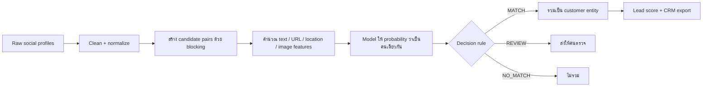

# เริ่มทำความเข้าใจโปรเจกต์นี้จากตรงไหน

## สรุปสั้นที่สุด

โปรเจกต์นี้ทำ **Identity Resolution**: รับ social profiles จาก Twitter,
Google+ และ Instagram แล้วหาว่า profile ใดเป็นคนเดียวกัน ก่อนรวมเป็น customer
entity และสร้าง lead score สำหรับ CRM

ภาพรวมการทำงานจริงคือ:



## ทำไม codebase ดูเหมือนมีหลาย pipeline

เพราะมีงานอยู่ 3 สายซ้อนกัน ไม่ควรอ่านปนกัน:

| สาย | ใช้ทำอะไร | ตำแหน่ง | สถานะ |
|---|---|---|---|
| Notebook รุ่นแรก | พัฒนาขั้นตอน Stage 7–17 แบบ exploratory | ลบแล้วหลังเก็บ artifacts | ไม่ใช่ execution path ปัจจุบัน |
| Main/production | prepare → pairs → features → train → evaluate → predict → resolve | `src/identity_resolution/` | canonical source |
| Research R0–R6 | ทดลอง representation และ decision rule แบบควบคุม | `experiments/code/` | ใช้ตอบคำถามงานวิจัย ไม่ได้แทน production ทั้งสาย |

auxiliary pipeline รุ่นเก่าถูกลบแล้วหลังตรวจว่าไม่มี production dependency;
ผลลัพธ์ที่ยังมีคุณค่าเก็บอยู่ใน `artifacts/decisioning/`

## สายระบบหลักทำงานอย่างไร

### 1. เตรียมข้อมูล

- Input หลัก: `data_for_project/normalized_profiles_with_profile_id.csv`
- Ground truth: `user_folder` เดียวกันหมายถึงเป็นคนเดียวกัน
- Cleaning: `src/identity_resolution/stages/prepare.py`
- ข้อมูลภาพ: `src/identity_resolution/imaging/`

### 2. สร้างคู่และ features สำหรับ train

- Pair builder: `src/identity_resolution/stages/pairs.py`
- Feature pipeline: `src/identity_resolution/stages/features.py`
- Output หลักอยู่ใต้ `train_data/stage9_pipeline_chunked/`

Feature มีทั้ง username, full name, bio, URL, location, platform metadata และ
image/context features ตาม experiment ที่เลือก

### 3. Train และประเมิน model

- Neural reference: `src/identity_resolution/stages/train_neural.py`
- Multimodal training: `src/identity_resolution/stages/train_multimodal.py`
- Canonical evaluation: `src/identity_resolution/stages/evaluate.py`
- Evaluation notebook: `notebooks/05_evaluate.ipynb`
- Run ที่ production pipeline โหลดอยู่:
  `train_data/stage7_13_multimodal_suite/runs/image_context_r075_h20_s42/`

### 4. รันกับ candidate จริงทั้งระบบ

- Canonical candidate generation + scoring:
  `src/identity_resolution/workflows/full_candidate.py`
- Canonical CRM entity merge + lead score:
  `src/identity_resolution/workflows/crm.py`
- Production code ปัจจุบันใช้ `MATCH >= 0.98`, `REVIEW >= 0.95`

ดังนั้น operational flow ปัจจุบันคือ **multimodal image-context model + manual
threshold 0.98/0.95**

## การทดลอง R0–R6 คืออะไร

ทุก experiment ใช้ entity-aware split และ evaluation harness เดียวกัน เพื่อไม่ให้
บุคคลเดียวกันรั่วข้าม validation/test

| Exp | เปลี่ยนอะไร | ต้อง train model ใหม่ | ผลสรุป |
|---|---|---:|---|
| R0 | 17 features เดิม + threshold มือ | ไม่ | Baseline สำหรับเทียบ |
| R1 | score เดิม แต่ให้ GA หา decision rule | ไม่ | ดีกว่า R0 และลด REVIEW |
| R2 | เพิ่ม MiniLM/BERT cosine เป็น feature ที่ 18 | ใช่ | threshold เดิมไม่เหมาะ ผลจึงตก |
| R3 | R2 + GA ปรับ decision rule ใหม่ | ใช่ | ดีที่สุดใน R-series, test F1 0.8373 |
| R4 | แทนข้อมูลชื่อด้วย Bloom-filter similarity | ใช่ | วัด privacy/accuracy trade-off |
| R5 | R4 + GA | ใช่ | ใกล้ R3; เหมาะเมื่อเน้น privacy |
| R6 | Transformer semantic blocking | ใช่ | ผลยังไม่พร้อมใช้; กู้ blocking-missed ได้ต่ำมาก |

ข้อสำคัญ: **R3 เป็น recommendation จากงานทดลอง แต่ยังไม่ได้ wire เข้า full
candidate/CRM pipeline** ปัจจุบัน production flow ยังใช้ threshold มือ 0.98/0.95

อ่านรายละเอียดและตัวเลขจาก:

- แผนทดลอง: `docs/plans/EXPERIMENT_PLAN.md`
- ผล R0–R6: `experiments/REPORT_R0_R5.md`
- โค้ดทดลอง: `experiments/code/`
- Output JSON: `experiments/*_results.json`

## ตัวเลขแต่ละชุดเทียบกันได้หรือไม่

repo รายงาน metric อยู่หลายระดับ จึงไม่ควรหยิบ F1 คนละระดับมาเทียบตรง ๆ:

| ระดับ | ตอบคำถาม | ตัวอย่างตัวเลข |
|---|---|---|
| Retrieval | blocking สร้าง candidate ครบแค่ไหน | coverage 88.67% |
| Model test | model แยกคู่ในชุดประเมินได้ดีแค่ไหน | multimodal test F1 ประมาณ 0.934 |
| Production decision | รวม exact, blocking miss, MATCH/REVIEW แล้วเป็นอย่างไร | baseline full F1 ประมาณ 0.788 |
| R-series test harness | เปรียบเทียบ R0–R6 แบบ apples-to-apples | R3 test F1 0.8373 |

`model F1 0.934` จึงไม่ได้ขัดกับ `production F1 0.788` เพราะวัดคนละขอบเขต
และ production ยังโดนผลจากคู่ที่ blocking หาไม่เจอ

## แนะนำลำดับการอ่าน code

ไม่ต้องอ่านทุกไฟล์ ให้เริ่มตามนี้:

1. ไฟล์นี้ เพื่อเข้าใจภาพรวม
2. `docs/ARCHITECTURE_TH.md` เพื่อดู stage และ dependency
3. `src/identity_resolution/stages/` ไล่ตั้งแต่ prepare ถึง evaluate
4. `src/identity_resolution/workflows/full_candidate.py`
   เพื่อดู candidate → score → decision
5. `src/identity_resolution/workflows/crm.py`
   เพื่อดู decision → entity → CRM
6. `experiments/REPORT_R0_R5.md` เพื่อดูว่าทดลองอะไรและสรุปอะไรได้
7. `experiments/code/exp_lib.py` เพื่อดู split และ evaluation harness กลาง
8. เปิด experiment เฉพาะตัวที่สนใจ เช่น R3 ใช้
   `exp_r2_bert_feature.py` + `run_ga_experiments.py`

## คำสั่งที่ปลอดภัยสำหรับทำความเข้าใจ

รันจาก repository root และใช้ Python 3.11 ตาม environment ของโครงการ:

```bash
# ตรวจว่า logic ที่มี test ยังผ่าน
python3.11 -m pytest -q tests

# ดูทุก stage
identity-ml --help

# สร้างรายงาน baseline จาก artifact ที่มีอยู่
identity-ml evaluate

# รัน GA experiment R1 โดยไม่ train representation ใหม่
python3.11 -m experiments.code.run_ga_experiments \
  --experiment r1 --seeds 7 42 123 999 2025
```

ยังไม่แนะนำให้เริ่มด้วยการรัน preprocessing, image pipeline หรือ full candidate
pipeline ใหม่ทั้งหมด เพราะใช้ข้อมูล/เวลาเยอะและอาจเขียนทับ artifact ที่ใช้อ้างอิงอยู่

## Source of truth

เมื่อเอกสารให้ข้อมูลไม่ตรงกัน ให้เชื่อตามลำดับนี้:

1. `src/identity_resolution/` สำหรับ production workflows และ core rules
2. `src/identity_resolution/settings.py` สำหรับ path/config ของ production run
3. JSON report ที่สร้างจาก run นั้น
4. `experiments/REPORT_R0_R5.md` สำหรับสาย R-series
5. เอกสารแผนและผลการทดลองที่เก็บไว้

เอกสารประวัติบางไฟล์ยังมีตัวเลข/threshold จากระบบเวอร์ชันเก่า จึงไม่ควรใช้เป็น
สถานะปัจจุบันโดยไม่ตรวจ code และ JSON artifact ของ run จริง
