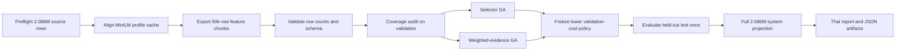

# แผนรัน Feature-Aware GA เต็ม 2.07 ล้านคู่ผ่าน WezTerm

## เป้าหมาย

รัน decision-policy experiment บน candidate population จริงทั้งหมด โดยคง frozen pair probability เดิม ไม่ retrain production model และไม่ใช้ test เลือก policy

| Population | จำนวน |
|---|---:|
| Full decision cache | 2,086,245 |
| Exact tier ที่ถือเป็นค่าคงที่ | 12,403 |
| Model-scored candidates ที่สร้าง evidence | 2,073,842 |

## สถานะการรัน

historical-cost run เสร็จแล้วด้วย 42 chunks และผ่าน sealed-test gate สูตรที่ใช้เลือก policy ในรอบนั้นคือ $5:1:0.02$; ตัวเลข cost ด้านล่างเป็น historical artifact ไม่ใช่ CRM-derived cost ปัจจุบัน:

| รายการ | ผล |
|---|---:|
| Validation winner | `selector:style` |
| Selector validation cost | 2,550.74 |
| Weighted validation cost | 2,625.44 |
| System test Precision / Recall / F1 | 0.9973 / 0.4995 / 0.6656 |
| Full Precision / Recall / F1 | 0.9937 / 0.4949 / 0.6607 |
| Full FP / FN / REVIEW | 92 / 6,284 / 34,955 |
| Full business cost | 7,443.10 |
| Test evaluation count | 1 |

ผลไม่ผ่าน promotion gate แม้ cost และ FP ลดลง เพราะ recall/F1 ลดลงมาก รายละเอียดอยู่ใน [`FULL_2M_REPORT_TH.md`](../../artifacts/decisioning/feature_aware_ga/full_2m/FULL_2M_REPORT_TH.md)

Runner: [`run_full_feature_aware_ga_pipeline.py`](../../experiments/code/run_full_feature_aware_ga_pipeline.py)  
Launcher: [`run_full_feature_aware_wezterm.sh`](../../experiments/automation/run_full_feature_aware_wezterm.sh)

## Execution graph



GA optimization เริ่มหลัง export ครบ เพราะทุก policy ต้องใช้ evidence cache เดียวกัน ส่วน WezTerm เปิด log และ status monitor แบบขนานกับ pipeline

## Preflight gates

runner จะหยุดทันทีเมื่อเงื่อนไขใดไม่ผ่าน:

1. source cache ไม่ครบ 2,086,245 แถว
2. scored candidates ไม่เท่ากับ 2,073,842 แถว
3. exact tier ไม่เท่ากับ 12,403 แถว
4. pair key ซ้ำ
5. MiniLM embedding กับ ID index ยาวไม่เท่ากัน
6. embedding ไม่มี eligible profile บางรายการ
7. chunk เดิมมี row count หรือ schema ไม่ตรง
8. feature row order ไม่ตรง frozen scored source ก่อนเปิด test

## Evidence version

`full_feature_aware_v1` ใช้:

- name: max ของ username/fullname Jaro, Levenshtein และ token-sort
- bio: max ของ TF-IDF cosine และ cached MiniLM cosine
- URL: max ของ domain/url Jaccard
- location: max ของ Jaro และ token-sort
- style: bio-length ratio และ inverted style differences
- image: pHash และ caption-to-opposite-name token similarity

historical caption embedding cache ไม่มี และ legacy path มี dimension 384/768 ไม่สอดคล้องกัน จึงไม่สร้างค่า caption-SBERT จำลอง ค่า unavailable ถูกแยกด้วย `*_available` mask

## เริ่มรัน

```bash
zsh experiments/automation/run_full_feature_aware_wezterm.sh
```

กำหนด output หรือ chunk size ได้:

```bash
CHUNK_SIZE=25000 zsh experiments/automation/run_full_feature_aware_wezterm.sh \
  artifacts/decisioning/feature_aware_ga/full_2m
```

launcher เปิด 3 panes:

| Pane | หน้าที่ |
|---|---|
| pipeline | export → audit → GA → sealed test → report |
| live log | `tail -F wezterm.log` |
| live status | `tail -F status.json` |

## Resume

เรียก launcher คำสั่งเดิมอีกครั้งได้ runner จะตรวจ parquet metadata/schema แล้วข้าม chunk ที่สมบูรณ์ การเขียน chunk ใหม่ใช้ temporary file แล้ว rename หลังเขียนสำเร็จ จึงไม่รับ partial parquet เป็น checkpoint

```bash
zsh experiments/automation/run_full_feature_aware_wezterm.sh
```

ไม่ต้องใช้ `--force` และไม่ต้องลบ output เดิม

## รันแยก stage

Export อย่างเดียว:

```bash
.venv/bin/python -m experiments.code.run_full_feature_aware_ga_pipeline \
  --stage export \
  --chunk-size 50000 \
  --output artifacts/decisioning/feature_aware_ga/full_2m
```

Optimize จาก chunks ที่ตรวจแล้ว:

```bash
.venv/bin/python -m experiments.code.run_full_feature_aware_ga_pipeline \
  --stage optimize \
  --output artifacts/decisioning/feature_aware_ga/full_2m
```

Smoke test ไม่มีสิทธิ์เปิด optimize:

```bash
.venv/bin/python -m experiments.code.run_full_feature_aware_ga_pipeline \
  --stage export \
  --max-rows 200 \
  --chunk-size 75 \
  --output /tmp/identity-full-ga-smoke
```

## Outputs

```text
artifacts/decisioning/feature_aware_ga/full_2m/
├── cache/sbert_embeddings_aligned.npy
├── feature_chunks/decisioning_features_*.parquet
├── full_feature_manifest.json
├── status.json
├── wezterm.log
├── coverage_reliability.csv
├── selector_leaderboard.csv
├── selector_generation_history.json
├── weighted_ga_history.json
├── frozen_policy.json
├── sealed_test_and_projection.json
└── FULL_2M_REPORT_TH.md
```

## Metric contract

- `scored_test_metrics`: เฉพาะ model-scored held-out pairs
- `system_test_metrics`: รวม exact TP/FP และ blocking-missed FN ของ test
- `full_projection_metrics`: exact + scored + blocking misses ทั้ง population
- `test_evaluation_count`: ต้องเท่ากับ 1

business cost:

$$
C_{crm}=2FP+FN+0.1REVIEW
$$

รอบ `crm_derived_v1` ต้องใช้ output แยกและ reuse feature cache เดิม:

```bash
.venv/bin/python -m experiments.code.run_full_feature_aware_ga_pipeline \
  --stage optimize \
  --feature-source artifacts/decisioning/feature_aware_ga/full_2m \
  --output artifacts/decisioning/feature_aware_ga/full_2m_crm_cost_v1
```

คำสั่งนี้เป็น validation-only โดย default และไม่เปิด test เดิม เพิ่ม `--evaluate-test` ได้เฉพาะเมื่อ protocol owner อนุมัติว่า evaluation set ยังเหมาะสม

ผลรอบ `crm_derived_v1`:

| Result | Value |
|---|---:|
| Winner | `selector:name` |
| Validation cost | 3,498.60 |
| Precision | 0.9853 |
| Recall | 0.6240 |
| F1 | 0.7641 |
| Test evaluated | `false` |

ผลนี้ไม่ผ่าน proposed promotion gates Precision ≥0.99 และ Recall ≥0.70 ขั้นถัดไปจึงเป็น constrained objective และ fresh audit test ไม่ใช่เปิด test เดิมซ้ำ

## Promotion gate

ผลจะยังเป็น research candidate จนกว่าจะผ่านทุกข้อ:

1. manifest เป็น `scope=full`
2. exported rows = 2,073,842
3. source SHA-256 ถูกบันทึก
4. masks ไม่มีค่านอก 0/1
5. winner มาจาก validation cost เท่านั้น
6. `test_evaluation_count=1`
7. precision/cost ผ่านเกณฑ์ธุรกิจ
8. มี cluster-level over-merge audit ก่อนเชื่อม CRM