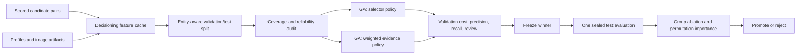

# แผนหลัก: Feature-Aware GA Decisioning และ Coverage-Aware Weights

## คำตอบของช่องว่างปัจจุบัน

GA R1 ปัจจุบัน **ไม่ได้เลือก** `name_sim` ว่าเป็น feature ที่ดีที่สุดจากข้อมูล
แต่รับมันเป็น argument ที่ hard-code อยู่ใน `decide_code(prob, nsim, genome)`:

```python
d[band & (nsim >= c_promote)] = MATCH
d[band & (nsim < c_demote)] = NO_MATCH
```

ดังนั้น R1 หาได้เพียง threshold ที่ดีสำหรับ `score + name_sim` เท่านั้น ไม่สามารถตอบว่า
bio, URL, location หรือ image ควรเป็น precision guard แทนหรือร่วมกับชื่อหรือไม่

เป้าหมายของแผนนี้คือทำให้ GA เลือก evidence policy จาก feature groups ที่มีจริง
โดยไม่ให้ missing value ถูกตีความว่าเป็นหลักฐานลบ และรายงานทั้ง predictive value,
coverage และ weight ที่ถูกเลือก

## สิ่งที่ต้องแยกให้ออก

| คำถาม | คำตอบที่ถูกต้อง |
|---|---|
| โมเดล pair score ควรให้น้ำหนัก feature เท่าไร | Gradient Boosting เรียน non-linear weighting อยู่แล้ว; ใช้ grouped permutation/ablation เพื่ออธิบาย |
| GA ควรใช้ evidence ใด guard precision | GA ต้องเลือก feature group, threshold และ operating rule จาก validation |
| field ขาดข้อมูลควรได้ weight ต่ำหรือไม่ | ไม่เสมอไป; signal ที่แม่นมากแต่อยู่แค่ 5% ต้องเป็น availability-gated evidence ไม่ใช่ zero ที่โดนเฉลี่ย |
| จะปิด gap ได้อย่างไร | เพิ่ม feature cache สำหรับ **candidate pairs ที่ GA ตัดสินจริง**, visibility mask และ optimize policy ที่ coverage-aware |

## Architecture ที่ต้องเพิ่ม



### New artifacts

```text
artifacts/decisioning/feature_aware_ga/
  decisioning_features.parquet     # every scored candidate pair + evidence + availability masks
  feature_manifest.json            # version, direction, group, normalization
  coverage_reliability.csv         # coverage / reliability / support by feature group
  selector_leaderboard.csv         # one-guard GA experiments
  weighted_ga_history.json         # GA generation history and selected weights
  validation_winner.json           # frozen policy; no test metrics here
  sealed_test_report.json          # written once after freeze
  feature_attribution.csv          # grouped permutation + leave-one-group-out
```

## Phase A: Build the Correct Decisioning Feature Cache

`experiments/scored_pairs_enriched.parquet` มีเพียง `score` และ `name_sim` จึงใช้ตอบ
คำถามนี้ไม่ได้ ต้องสร้าง cache ใหม่จาก **คู่ที่ production score จริง** และใช้ pair keys
เดียวกับ decisioning cache:

| Evidence group | Direction | Availability mask |
|---|---|---|
| `name` | higher is stronger | both username/full name present |
| `bio` | higher semantic/text similarity is stronger | both bio present |
| `url` | exact/domain overlap is stronger | at least one usable URL/domain |
| `location` | higher text/geo similarity is stronger | both usable locations |
| `image` | higher hash/caption similarity is stronger | both images/captions available |
| `style` | lower difference is stronger | both bios present |
| `platform` | contextual, not identity proof alone | always available |

Normalize all positive-evidence scores to $[0, 1]$. Convert distance features before GA,
for example $s_{style}=e^{-d}$; do not let a raw “difference” receive a positive weight.

The cache must store `feature_available_<group>` separately from score. Missing evidence is
`NaN` in raw data, score $0$ only in model matrix, and mask $0$ in GA policy.

## Phase B: Audit Coverage Before Optimizing

For each group and each subset (all, positive, negative, weak-name positive, platform pair),
report:

$$
coverage_g = \frac{\#\{i: availability_{i,g}=1\}}{N}
$$

$$
reliability_g = P(y=1 \mid availability_g=1, score_g \geq t_g)
$$

Keep a group as GA candidate only if it has at least 100 validation positives and at least 5%
coverage on candidate pairs. Groups below this threshold remain “override evidence” candidates
but may not get a global weight.

This audit prevents the false conclusion “URL has zero importance” when URL is highly precise
but nearly absent, and prevents a high-coverage but weak style feature from dominating.

## Phase C: GA Experiment 1 - Which Guard Replaces `name_sim`?

Test one guard group at a time, all with the same four-gene decision rule and validation split:

```text
G0: score only
G1: score + name guard              (current R1)
G2: score + bio guard
G3: score + URL guard, gated by URL availability
G4: score + location guard, gated by location availability
G5: score + image guard, gated by image availability
G6: score + style guard
```

For group $g$, the decision rule is:

$$
D_i =
\begin{cases}
MATCH & p_i \geq t_m \\
MATCH & t_r \le p_i < t_m \land a_{i,g}=1 \land s_{i,g} \geq c_p \\
NO\_MATCH & t_r \le p_i < t_m \land a_{i,g}=1 \land s_{i,g} < c_d \\
REVIEW & \text{otherwise} \\
NO\_MATCH & p_i < t_r
\end{cases}
$$

If $a_{i,g}=0$, the pair remains `REVIEW` in the band; it must not be demoted simply because
data is missing. The selector experiment directly answers why name similarity is or is not
the right precision threshold.

## Phase D: GA Experiment 2 - One-Stage Weighted Decision (Policy v2)

Policy v2 ตัด `c_promote` และ `c_demote` ออก เพื่อไม่ให้ `name_sim` มี cutoff สองขยักใน
review band แล้วให้ GA เรียน chromosome 10 ค่าโดยตรง:

```text
[t_match, t_review,
 w_probability, w_name, w_bio, w_url,
 w_location, w_social, w_image, w_style]
```

`probability` ต้องอยู่ในแปด weighted inputs เพื่อรักษาสัญญาณ non-linear ที่ frozen pair model
เรียนไว้ มิฉะนั้น policy ใหม่จะกลายเป็น linear evidence heuristic ที่ทิ้ง model เดิมทั้งหมด ส่วน
`social` นิยามเป็นค่าสูงสุดของ mention/hashtag Jaccard และต้องมี availability mask ของตัวเอง

Constraints:

- $0.05 \leq t_{review} \leq t_{match} \leq 0.999$
- $w_k \geq 0$ และ normalize global weights ให้ $\sum_k w_k=1$
- feature ที่ไม่ผ่าน coverage 5% หรือ positive support 100 คู่ถูก fix weight เป็นศูนย์
- feature ที่ `availability=0` สำหรับคู่ใดถูกตัดออกจากทั้ง numerator และ denominator ของคู่นั้น
- ถ้าคู่ใดไม่มี effective evidence เลย ให้คงเป็น `REVIEW`

สำหรับแต่ละคู่:

$$
S_i=\frac{w_p p_i+\sum_{k\in K}w_km_{ik}s_{ik}}
{w_p+\sum_{k\in K}w_km_{ik}},\qquad
K=\{name,bio,url,location,social,image,style\}
$$

จากนั้นตัดสินเพียงครั้งเดียว:

$$
D_i =
\begin{cases}
MATCH & S_i \geq t_{match} \\
NO\_MATCH & S_i < t_{review} \\
REVIEW & \text{otherwise}
\end{cases}
$$

Persist global weights, effective availability-conditioned weights, coverage/support และผลหลาย
seed แยกกัน น้ำหนักที่รายงานคือ **decision-policy weights** ไม่ใช่ feature importance ภายใน model

## Fitness and Promotion Rule

Optimize only on validation:

$$
cost = 2\cdot FP + 1\cdot FN + 0.1\cdot REVIEW
$$

Tie-break order: higher precision, lower false positives, higher recall, lower review count.
Compare every policy against G0 and current R1 on the same candidate pairs.

Promote a policy to one sealed test run only if validation cost decreases and all conditions
hold:

1. Precision does not drop by more than $0.005$ versus R1.
2. Recall increases by at least $0.01$, or false positives decrease by at least 10%.
3. No platform-pair with at least 100 positives loses more than $0.02$ precision.
4. Every nonzero global weight has coverage/support reported.
5. The policy does not demote unavailable evidence in the review band.

## Implementation Files

| File | Responsibility |
|---|---|
| `experiments/code/exp_ga_feature_cache.py` | join all scored candidate pairs to feature vectors and availability masks |
| `experiments/code/exp_ga_coverage_audit.py` | coverage/reliability table and candidate eligibility |
| `experiments/code/exp_ga_feature_selector.py` | G0-G6, generalized `decide_code` with one evidence guard |
| `experiments/code/exp_ga_weighted_evidence.py` | constrained weighted genome, validation GA and generation history |
| `experiments/code/exp_ga_attribution.py` | grouped permutation, leave-one-group-out and missingness slices |
| `tests/test_ga_feature_decisioning.py` | no demotion on missing evidence, genome constraints, deterministic seed |
| `experiments/code/run_one_stage_weighted_ga_experiment.py` | policy v2 แบบ validation-only, 10 seeds, baselines, bootstrap และ platform slices |
| `tests/test_feature_aware_ga.py` | contract ของ 10-gene genome, missingness, coverage gate และ deterministic seed |

## Execution Order

1. Stop name-only N6 as primary selection path; retain N1-N5 as representation evidence only.
2. Build decisioning feature cache and validate pair-key coverage is 100% for scored candidates.
3. Run coverage/reliability audit; exclude groups that fail support gates.
4. Run G0-G6 in parallel on validation; select the best guard by cost/precision gates.
5. Run policy v2 แบบ 2 thresholds + 8 fixed-order weights โดย force กลุ่มที่ไม่ eligible เป็นศูนย์.
6. เทียบ 10 seeds กับ score-only 2-threshold และ legacy name-guard 4-threshold บน validation เดียวกัน.
7. Freeze validation winner; ยังไม่เปิด historical test ซ้ำ และใช้ fresh audit test เมื่อพร้อม.
8. Run attribution and publish weights together with coverage, stability และ availability slices.

## Definition of Done

The gap is closed only when the report can state all of the following with validation/test
separation: which guard group beats or fails against `name_sim`; which evidence groups receive
nonzero availability-gated weights; their coverage and reliability; and whether the resulting
policy reduces decision cost without a material precision regression.
