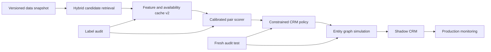
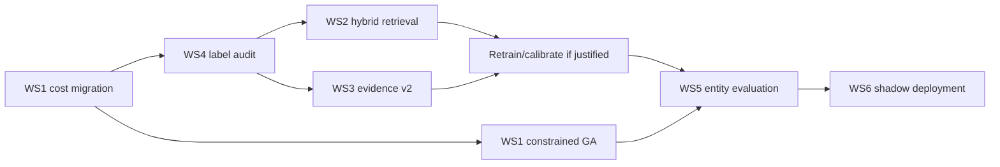

# Implementation Plan: แก้ข้อจำกัด Identity Resolution และเตรียม Production Evidence

## 1. เป้าหมายและขอบเขต

แผนนี้เปลี่ยนข้อจำกัดในรายงานข้อ 1-10 ให้เป็นงานที่ implement และตรวจรับได้ โดยไม่รวมการเปลี่ยน model แบบกว้างโดยไม่มีหลักฐาน งานทุก phase ต้องรักษา entity-aware split, immutable artifacts และแยก validation selection ออกจาก final evaluation

Business-cost policy รุ่นปัจจุบัน derive จากต้นทุน CRM:

| เหตุการณ์ | เวลา | ต้นทุนที่ 100 บาท/ชั่วโมง | Normalized weight |
|---|---:|---:|---:|
| แก้ false merge (FP) | 20 นาที | 33.33 บาท | 2.0 |
| จัดการ missed merge (FN) | 10 นาที | 16.67 บาท | 1.0 |
| ตรวจ REVIEW | 1 นาที | 1.67 บาท | 0.1 |

$$
C_{crm}=2FP+FN+0.1REVIEW
$$

Source of truth อยู่ที่ [`business_cost.py`](../../src/identity_resolution/core/business_cost.py) ภายใต้ version `crm_derived_v1` ผลเก่าที่ optimize ด้วย $5:1:0.02$ ต้องเก็บเป็น historical artifacts และห้ามเปลี่ยน metadata ย้อนหลัง

## 2. Architecture เป้าหมาย

หลัก ownership:

- `src/identity_resolution/core/`: cost, decisions, pair/entity metrics ที่เป็น pure domain logic
- `src/identity_resolution/stages/`: retrieval, features, calibration และ evaluation
- `src/identity_resolution/workflows/`: full candidate, entity simulation, shadow deployment
- `experiments/code/`: comparative research ที่อ่าน production artifacts แต่ไม่ควบคุม production runtime
- `artifacts/`: immutable run directories พร้อม manifest/checksum/protocol version

## 3. Traceability จากข้อจำกัดสู่งาน

| Limitation | Workstream | Deliverable หลัก | Exit metric |
|---:|---|---|---|
| 1 Retrieval ceiling | WS2 | hybrid lexical + semantic blocking | recall ≥ 0.95 และ candidate inflation ≤ 3x |
| 2 Evidence mismatch | WS3 | feature cache v2 schema เดียว | parity 100% ระหว่าง train/full |
| 3 Data age | WS3 | timestamped snapshots | freshness coverage report |
| 4 Image coverage | WS3 | image acquisition audit/gate | both-side usable ≥15% หรือ stop |
| 5 Sparse hard cases | WS4 | hard-case challenge set | ≥200 adjudicated positives |
| 6 Ground-truth proxy | WS4 | dual-review label audit | agreement/Kappa + conflict log |
| 7 Pair ≠ entity metric | WS5 | cluster evaluation harness | B-cubed + over/under-merge report |
| 8 Objective dependency | WS1 | versioned constrained policy | P/R constraints + cost frontier |
| 9 Projection ≠ sealed test | WS1/WS4 | fresh audit or temporal test | one evaluation after freeze |
| 10 No deployment evidence | WS6 | shadow CRM + monitoring | SLA/drift/review dashboard |

## 4. WS1: Cost Governance และ Constrained Decision Policy

### สถานะ

- เสร็จแล้ว: central cost module `crm_derived_v1`
- เสร็จแล้ว: active GA runners ใช้ $2:1:0.1$
- เสร็จแล้ว: full feature cache 2,073,842 คู่ reuse ข้าม policy run ได้
- เสร็จแล้ว: validation-only rerun ที่ `artifacts/decisioning/feature_aware_ga/full_2m_crm_cost_v1/`
- ผล: `name` selector ชนะด้วย cost 3,498.60, Precision 0.9853, Recall 0.6240 และ F1 0.7641
- protocol: `test_evaluated=false`; winner ยังไม่ผ่าน Precision ≥0.99 และ Recall ≥0.70 จึงไม่ promote

### งาน implement ต่อ

1. เพิ่ม `PolicyConstraints` ใน `src/identity_resolution/core/business_cost.py`:
   - `min_precision=0.99`
   - `min_recall=0.70`
   - `max_review_rate` จาก CRM capacity จริง
2. เพิ่ม lexicographic objective ใน `run_feature_aware_ga_pipeline.py`:
   - feasible policies: เลือก cost ต่ำสุด
   - infeasible policies: เรียง constraint violation ก่อน แล้วจึง cost
   - หลีกเลี่ยง penalty coefficient ที่ตีความยาก
3. สร้าง Pareto frontier ของ Precision, Recall, REVIEW และ cost
4. freeze policy จาก validation แล้วประเมินบน **fresh audit test** เท่านั้น
5. เก็บ `cost_policy_version`, constraints, source hash และ selection split ในทุก artifact

### Outputs

- `artifacts/decisioning/policy_crm_v1/pareto_frontier.csv`
- `artifacts/decisioning/policy_crm_v1/frozen_policy.json`
- `artifacts/decisioning/policy_crm_v1/validation_report.json`
- `artifacts/decisioning/policy_crm_v1/fresh_test_report.json`

### Tests

- unit: $FP=FN=REVIEW=1 \Rightarrow C=3.1$
- unit: feasible policy ชนะ infeasible policy แม้ raw cost สูงกว่า
- unit: policy metadata ต้องมี version/weights/constraints
- integration: เปลี่ยน test labels แล้ว validation winner ต้องไม่เปลี่ยน

### Promotion gate

- Precision ≥ 0.99
- Recall ≥ 0.70
- REVIEW rate ไม่เกิน capacity ที่ CRM owner ยืนยัน
- cost ต่ำกว่า R3 เมื่อคำนวณด้วย `crm_derived_v1`
- no platform pair ที่ support ≥100 มี Precision ต่ำกว่า 0.98

## 5. WS2: Hybrid Retrieval เพื่อแก้ Blocking Miss

### Design

ใช้ candidate union ไม่แทน lexical blocking เดิม:

$$
Candidates=B_{exact}\cup B_{lexical}\cup B_{semantic}\cup B_{url/location}
$$

### งาน implement

1. สร้าง `stages/semantic_blocking.py` ใช้ normalized MiniLM embeddings และ FAISS/ANN
2. mine hard negatives จากชื่อคล้ายแต่ต่าง entity และ semantic-neighbor ที่ label เป็น 0
3. tune `top_k`, cosine threshold และ optional hash radius บน retrieval validation
4. deduplicate ด้วย canonical unordered pair key
5. วัด candidate inflation, latency, memory และ recall แยก platform pair
6. score เฉพาะ candidate เพิ่มใหม่ด้วย frozen pair model ก่อนพิจารณา retrain

### Outputs

- `artifacts/pair_building/hybrid_v1/candidates.parquet`
- `retrieval_metrics.json`
- `blocking_miss_recovery.csv`
- `candidate_inflation_by_source.csv`

### Gate และ stop rule

- cross-platform retrieval recall ≥ 0.95
- กู้ blocking misses ≥50%
- candidate count ≤ 6.3M (ไม่เกิน 3 เท่าของ baseline)
- หาก semantic branch กู้ recall <2 จุดเปอร์เซ็นต์แต่เพิ่ม candidate >50% ให้หยุด branch นั้น

## 6. WS3: Evidence Cache v2, Image และ Data Freshness

### งาน implement

1. ประกาศ schema เดียวสำหรับ train/full พร้อม feature version และ availability masks
2. rebuild caption embeddings ด้วย model/version/dimension เดียวกับ profile embeddings
3. snapshot URL/image response status, capture time และ source platform
4. normalize location เป็น country/region/city พร้อม geocoder cache
5. ทำ coverage/reliability report แยก profile, pair, platform และ difficulty slice
6. เพิ่ม temporal delta feature เพื่อไม่จับข้อมูลคนละช่วงเวลาแบบเท่าเทียมกัน

### Data contracts

- missing evidence ต้องเป็น `available=0`; ห้ามแทนว่า similarity = 0 โดยไม่มี mask
- embedding artifact ต้องมี model ID, dimension, normalization flag และ row-ID checksum
- URL/image snapshot ต้องมี `captured_at`, HTTP status และ content checksum

### Gate และ stop rule

- train/full feature parity 100%
- embedding alignment missing IDs = 0
- both-side image coverage บน weak-name positives ≥15% จึงค่อย train image branch
- หาก image acquisition ต่ำกว่า 15% ให้เก็บเป็น optional evidence และหยุดเพิ่ม model complexity

## 7. WS4: Hard-Case Challenge Set และ Ground-Truth Audit

### Sampling strata

- exact collisions ที่ actual=0
- score ≥0.98 แต่ actual=0
- blocking misses
- weak-name scored FN
- cross-platform pairs จาก Google+ × Twitter
- large temporal gap และ missing-evidence pairs

### Label protocol

1. ผู้ตรวจสองคนให้ label อิสระ: MATCH / NO_MATCH / INSUFFICIENT
2. conflict ส่ง adjudicator คนที่สาม
3. เก็บ evidence reason code ไม่เก็บเพียง binary label
4. แยก audited labels จาก `user_folder` proxy

### Outputs และ gate

- `data/labels/audit_v1.parquet`
- `label_guideline_th.md`
- `agreement_report.json`
- hard positives ≥200 คู่
- Cohen's $\kappa\ge0.80$ หรือ revise guideline แล้ว relabel
- fresh audit test ถูก lock หลัง adjudication และเปิดครั้งเดียวต่อ protocol major version

## 8. WS5: Entity-Level Evaluation และ Merge Safety

### Metrics

- B-cubed Precision/Recall/F1
- pairwise cluster Precision/Recall
- over-merge rate และ under-merge rate
- component-size distribution
- largest erroneous component
- edge-removal sensitivity สำหรับ MATCH ที่ confidence ต่ำสุด

### งาน implement

1. เพิ่ม `core/entity_metrics.py`
2. เพิ่ม `workflows/entity_evaluation.py` ที่จำลอง Union-Find โดยไม่เขียน CRM
3. trace ทุก merged component กลับไปยัง edge ที่ทำให้ merge
4. เพิ่ม exact-collision secondary guard ก่อนสร้าง graph edge
5. ทำ threshold stress test รอบ policy winner

### Promotion gate

- over-merge rate ≤ business tolerance ที่อนุมัติ
- ไม่มี component โตผิดปกติโดยไม่มี shared evidence
- ทุก auto-merge edge audit/replay ได้
- pair-level gate และ entity-level gate ต้องผ่านพร้อมกัน

## 9. WS6: Shadow Deployment และ Monitoring

### Shadow mode

- อ่าน production-like batch แต่ไม่แก้ CRM จริง
- สร้าง proposed MATCH/REVIEW/NO_MATCH และ entity diff
- sampled review วัด realized precision/yield
- บันทึก latency และ resource usage ต่อ stage

### Monitoring contract

| Signal | Alert example |
|---|---|
| Retrieval coverage proxy | ลด >2 จุดเปอร์เซ็นต์จาก baseline |
| Score PSI/KS by platform pair | drift เกิน threshold สอง batchติด |
| Exact collision rate | เพิ่มเกิน 50% จาก baseline |
| Sampled MATCH precision | ต่ำกว่า 0.99 |
| REVIEW yield | ต่ำ/สูงผิดช่วง capacity |
| Entity component size | tail โตผิดปกติ |
| Field availability | ลด >10% relative |
| End-to-end latency | เกิน SLA |

### Outputs

- `artifacts/monitoring/batch_manifest.json`
- `decision_drift.json`
- `review_outcomes.parquet`
- `entity_health.json`
- rollback policy และ runbook

## 10. ลำดับดำเนินงาน

| Sprint | งาน | ระยะเวลาโดยประมาณ | Dependency |
|---|---|---:|---|
| 0 | Cost migration + validation-only rerun | 0.5 วัน | full cache เดิม |
| 1 | Constrained GA + Pareto frontier | 1-2 วัน | Sprint 0 |
| 2 | Label guideline + audit sample | 3-5 วัน | reviewer availability |
| 3 | Hybrid retrieval benchmark | 3-5 วัน | audited misses |
| 4 | Evidence v2 + freshness/image audit | 4-7 วัน | source access |
| 5 | Entity metrics + merge simulation | 2-3 วัน | frozen candidate policy |
| 6 | Shadow monitoring | 5-10 วัน | production-like feed |

## 11. Definition of Done

งานแก้ข้อจำกัดถือว่าเสร็จเมื่อ:

1. cost policy เป็น versioned source of truth และไม่มี active runner hard-code สูตรอื่น
2. candidate recall ผ่าน 0.95 โดยมี resource budget ชัดเจน
3. feature cache train/full ใช้ schema และ embedding provenance เดียวกัน
4. มี independently audited hard-case test
5. policy ผ่าน Precision/Recall/REVIEW constraints บน fresh test
6. entity-level over/under-merge ผ่าน gate
7. shadow run มี latency, drift และ human-review outcomes
8. มี rollback และ artifact lineage ที่ replay ได้

## 12. สิ่งที่ไม่ทำในรอบแรก

- ไม่ retrain deep encoder ก่อนพิสูจน์ retrieval/coverage gain
- ไม่ใช้ test เดิมเลือก constraint หรือ threshold เพิ่ม
- ไม่ promote policy เพียงเพราะ scalar cost ต่ำสุด
- ไม่สร้าง image branch เพิ่มหาก both-side coverage ไม่ถึง gate
- ไม่เขียนผลลง CRM ก่อนผ่าน entity-level และ shadow gates