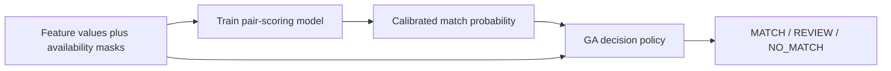

# แผนแยก: Train Model เพื่อเรียน Feature Weights

## แยกสองความหมายของ Weight

| ชั้น | สิ่งที่ weight ควบคุม | ผู้เรียน | ห้ามปนกัน |
|---|---|---|
| Pair-scoring model | ความน่าจะเป็นที่ pair เป็นคนเดียวกัน | Logistic Regression / Gradient Boosting | ไม่ใช้ GA ปรับแทน |
| GA decision policy | threshold, promotion/demotion guard, FP/FN/review cost | Genetic Algorithm | ไม่แก้น้ำหนักภายใน model |



model ตอบ “feature นี้ช่วยทำนาย identity เท่าไร” ส่วน GA ตอบ “เมื่อ probability อยู่ใน
review band ควรตัดสินอย่างไรภายใต้ต้นทุน FP/FN/review”

## Missing Data ก่อนเรียน Weight

ห้ามให้ missing URL/image/location ถูกแปลงเป็น similarity $0$ เพียงตัวเดียว เพราะ model
จะแยกไม่ออกระหว่าง “ไม่มีข้อมูล” กับ “ข้อมูลมีแต่ไม่เหมือนกัน” ทุก feature group ต้องมี
score และ availability mask:

```text
url_similarity, url_available
image_similarity, image_available
location_similarity, location_available
```

ให้ model เรียน interaction ระหว่าง signal และ availability. Linear model เพิ่ม
`similarity * available`; Gradient Boosting รับทั้ง score และ mask เข้า model โดยตรง.

## Model Experiment Matrix

ทุก run ใช้ entity-aware train/validation/test split เดิมและเลือก feature/model บน validation
เท่านั้น

| ID | Model / feature input | จุดประสงค์ |
|---|---|---|
| M0 | Current production feature set | baseline probability |
| M1 | Standardized Logistic Regression + score/mask/interactions | อ่าน signed coefficient ที่เปรียบเทียบได้ |
| M2 | Gradient Boosting + score/mask pairs | วัด missingness-aware representation |
| M3 | M2 + new name groups ที่ผ่าน N-series | วัด representation improvement แยกจาก GA |
| M4 | M2 minus one feature group ต่อ run | Group ablation: incremental predictive value |
| M5 | M2 with sparse groups removed | ตรวจ generalization ของ sparse signals |

## วิธีรายงาน “ควรให้น้ำหนักเท่าไร”

ไม่มีเลข weight เดียวที่ใช้ได้กับทุก model จึงต้องรายงานสามมุมมองร่วมกัน:

| Method | ใช้ตอบ | Output |
|---|---|---|
| Standardized logistic coefficient | ทิศทางและขนาดเชิงเส้น | coefficient, odds ratio, bootstrap CI |
| Grouped permutation importance | ถ้าทำลาย group นี้ AP/F1 ลดเท่าไร | mean delta + 95% CI |
| Leave-one-group-out retraining | group ให้ predictive value เพิ่มจริงเท่าไร | validation/test delta |
| SHAP สำหรับ GB | pair ใดถูกดัน/กด score เพราะ feature ใด | mean absolute SHAP + dependence plot |
| Coverage/reliability audit | weight นั้นใช้ได้กี่คู่และน่าเชื่อถือแค่ไหน | coverage, support, positive rate |

ตาราง final weight recommendation ต้องมี:

```text
feature_group | availability_coverage | logistic_coefficient | permutation_AP_delta
ablation_AP_delta | recommended_role | model_input
```

## กติกา Weight ต่อ Group

1. `global_model_signal`: coverage >= 5%, permutation CI lower bound > 0 และ ablation ไม่ regress.
2. `availability_gated_signal`: reliability สูงแต่ coverage ต่ำ; ใช้ score + availability mask,
   ไม่เพิ่ม raw global weight ด้วยมือ.
3. `decision_override_candidate`: precision สูงมากใน availability slice; ส่งต่อเป็น candidate
   ให้ GA selector แต่ไม่บังคับ model probability.
4. `exclude`: importance/ablation ไม่ดี, unstable ข้าม platform หรือไม่ผ่าน data-quality checks.

## Training Protocol

1. Build feature matrix ที่เก็บ score/mask เป็นคู่ และ persist feature manifest/version.
2. Fit M0-M3 บน train, select model/hyperparameters/calibration/threshold บน validation.
3. Freeze winning pair-scoring model และ write `model_feature_weight_report.json`.
4. Run M4/M5 ablation และ grouped permutation analysis.
5. Evaluate chosen model on test ครั้งเดียว.
6. ส่ง calibrated probability จาก model ที่ผ่าน gate ไปเป็น input ของ Feature-Aware GA.

GA ใช้ feature cache เดียวกันได้ แต่ห้าม refit model ขณะ GA เปลี่ยน genome มิฉะนั้นจะไม่รู้ว่า
ผลที่ดีขึ้นมาจาก model weights หรือ decision policy.

## Promotion Gates

1. validation AP ดีขึ้นอย่างน้อย $0.002$ เทียบ M0 หรือ recall ดีขึ้นอย่างน้อย $0.015$ โดย
   precision ลดไม่เกิน $0.005$.
2. test AP/F1 ไม่ regress เกิน $0.002$ หลัง freeze.
3. missingness masks ไม่ทำให้ platform pair ใดที่มี positive >=100 precision ลดเกิน $0.02$.
4. ทุก group ที่มี model importance สูงมี coverage/support และ error slice แนบ.

## Deliverables

```text
artifacts/evaluation/model_feature_weights/
  feature_manifest.json
  validation_leaderboard.csv
  model_feature_weight_report.json
  grouped_permutation_importance.csv
  group_ablation.csv
  coverage_reliability.csv
  calibration_report.json
  sealed_test_report.json
```

## Definition of Done

ปิด gap ฝั่ง model ได้เมื่อเราตอบด้วยตัวเลขได้ว่าแต่ละ feature group ควรเป็น global signal,
availability-gated signal, GA override candidate หรือ exclude และ probability model ที่เลือกถูก
freeze ก่อนเริ่ม GA decision optimization.