# แผนพัฒนา: Name Similarity Alternatives และ Feature Attribution

## เป้าหมาย

พิสูจน์ด้วยการทดลองที่ทำซ้ำได้ว่า representation ของชื่อแบบใดช่วยให้ระบบ
Identity Resolution แยกคู่ข้ามแพลตฟอร์มได้ดีขึ้นกว่าชุดปัจจุบัน และระบุได้ว่า
feature ใดมีผลต่อการตัดสินใจของโมเดลจริง

คำว่า “weight” ในเอกสารนี้หมายถึง **model-agnostic importance** ไม่ใช่แค่
coefficient เพราะ production candidate เป็น Gradient Boosting ซึ่งไม่มีค่าน้ำหนัก
เชิงเส้นที่แปลความหมายได้โดยตรง

ผลลัพธ์ที่ต้องได้:

1. ตารางเปรียบเทียบ baseline กับ name-sim alternatives บน split เดิม
2. permutation importance, grouped importance และ leave-one-group-out ablation
3. รายงานผลแยก name-strength slice, platform pair และ false-negative recovery
4. decision memo ว่าจะคง, เพิ่ม, หรือแทน feature ชื่อใดใน production

## ขอบเขตและข้อห้าม

- ใช้ entity-aware split เดิมจาก `train_base.assign_splits`; entity เดียวกันห้าม
  ข้าม train, validation และ test
- จูน feature set, model และ threshold บน validation เท่านั้น; เปิด test หลัง freeze
  candidate และ configuration แล้วหนึ่งครั้ง
- ใช้ labeled pairs และ negative sampling seed/ratio เดียวกับ baseline
  `image_context_r075_h20_s42` เพื่อให้เปรียบเทียบแบบ apple-to-apple
- ไม่แก้ `core/`, workflow หรือ production model path ระหว่างการทดลอง
- แยก report ออกตาม availability ของ field ชื่อ เพื่อไม่ตีความ missing-value เป็น
  negative evidence

## สถานะฐาน (Baseline)

ชุด feature ปัจจุบันใน `stages/train_base.compute_features` มี feature ชื่อ 6 ตัว:

| Field | Similarity ปัจจุบัน |
|---|---|
| `userName` | Jaro-Winkler, normalized Levenshtein, token-sort ratio |
| `fullName` | Jaro-Winkler, normalized Levenshtein, token-sort ratio |

multimodal suite สร้าง image-context features ต่อจากชุดนี้ และ train model candidates
`logreg`, `gb`, `rf` ก่อนเลือกด้วย validation AP/AUC แล้ว calibrate และเลือก threshold
จาก validation F1. ดังนั้น experiment ใหม่ต้องรักษา training/selection protocol นี้
หรือระบุ version ใหม่อย่างชัดเจน

**สมมติฐานที่ตรวจสอบได้:** feature ที่รองรับ typo, token reordering, handle formatting
และการเขียนชื่อไทย/Latin จะเพิ่ม validation average precision หรือ weak-name recall
โดยไม่ลด test precision เกินเกณฑ์ ขณะที่ grouped permutation importance จะบอกได้ว่า
ผลนั้นเป็น signal ใหม่ ไม่ใช่ feature ซ้ำซ้อนกับ Jaro-Winkler เดิม

## Architecture เป้าหมาย

```mermaid
flowchart LR
    Raw[Raw social profiles] --> Prepare[Prepare and normalize]
    Prepare --> Profiles[Canonical profiles]
    Profiles --> Pairing[Blocking and labeled pairs]
    Profiles --> Registry[Feature registry]
    Pairing --> Registry
    Registry --> Matrix[Versioned feature matrices]
    Matrix --> Train[Train, calibrate, choose threshold]
    Train --> Eval[Leak-safe evaluation harness]
    Eval --> Attribution[Permutation, ablation, error slices]
    Attribution --> Registry
    Eval --> Promotion{Promotion gate}
    Promotion -->|pass| ModelRegistry[Selected model, feature manifest, threshold]
    Promotion -->|fail| Research[Experiment reports only]
    ModelRegistry --> Predict[Candidate prediction]
    Predict --> Decision[MATCH / REVIEW / NO_MATCH]
    Decision --> Resolve[Entity resolution and CRM export]
```



### Ownership boundary

| Layer | Responsibility | Planned location |
|---|---|---|
| Feature primitives | normalize strings, calculate a single similarity | `src/identity_resolution/core/name_similarity.py` |
| Feature registry | names, groups, enabled feature sets, manifest validation | `src/identity_resolution/stages/feature_registry.py` |
| Pair feature matrix | call primitives for username/full name and persist schema version | `src/identity_resolution/stages/train_base.py` |
| Experiment runner | fit fixed protocol for each feature set | `experiments/code/exp_name_similarity_ablation.py` |
| Attribution runner | permutation/ablation/slice analyses on frozen model scores | `experiments/code/exp_feature_attribution.py` |
| Production lifecycle | consume only promoted manifest and artifacts | existing `stages/` and `workflows/` |

`core/name_similarity.py` must be pure and may not read datasets, fit models or import
`stages`, `workflows` or `experiments`. The registry owns schema compatibility so prediction
cannot silently use a model with a different feature order.

## Feature candidates

Normalize once before scoring: Unicode NFKC, case-fold, trim, collapse whitespace, remove
handle marker `@`, and retain two views: `display_name` and `handle`. Do not transliterate
Thai automatically in the first experiment; transliteration can create collisions and belongs
in a separately labeled experiment.

| Group | Candidate | Rationale |
|---|---|---|
| Existing | Jaro-Winkler, normalized Levenshtein, token-sort | Baseline reference |
| Edit robust | Damerau-Levenshtein normalized | Captures transposition typo |
| Character set | char 3-gram cosine TF-IDF | Captures partial overlap and formatting shifts |
| Token aware | token-set ratio | Ignores duplicated/reordered full-name tokens |
| Phonetic | Soundex agreement, Latin only | Tests English pronunciation variants; emit availability flag |
| Handle structure | stripped separator exact, prefix/suffix overlap, length ratio | Tests formatting variants |
| Cross field | max and mean username-to-fullname cross similarities | Captures handle/display-name swaps |

Each similarity must emit a value in $[0, 1]$. Empty-vs-empty must produce a separate
availability indicator and similarity $0$, never $1$. Each candidate belongs to one named
feature group so it can be permuted and ablated together.

## Reference Training Code

โค้ดด้านล่างคือ contract ของ implementation ที่จะเพิ่มใน Phase 1 ไม่ใช่โค้ดที่มีอยู่
แล้วใน repository. จุดสำคัญคือ runner รับ `feature_set` ชัดเจน, ใช้ split เดิม, เลือก
model/threshold บน validation เท่านั้น และเขียน feature manifest ไปพร้อม model.

```python
# src/identity_resolution/stages/feature_registry.py
from dataclasses import dataclass


@dataclass(frozen=True)
class FeatureSet:
  name: str
  enabled_groups: tuple[str, ...]


FEATURE_SETS = {
  "N0": FeatureSet("N0", ("name_existing", "bio", "url", "location", "style", "platform", "image")),
  "N1": FeatureSet("N1", ("name_existing", "name_damerau", "bio", "url", "location", "style", "platform", "image")),
  "N2": FeatureSet("N2", ("name_existing", "name_char_ngram", "bio", "url", "location", "style", "platform", "image")),
  "N3": FeatureSet("N3", ("name_existing", "name_token_set", "bio", "url", "location", "style", "platform", "image")),
  "N4": FeatureSet("N4", ("name_existing", "name_handle", "bio", "url", "location", "style", "platform", "image")),
  "N5": FeatureSet("N5", ("name_existing", "name_cross_field", "bio", "url", "location", "style", "platform", "image")),
}


def select_columns(feature_groups: dict[str, list[str]], feature_set: FeatureSet) -> list[str]:
  return [column for group in feature_set.enabled_groups for column in feature_groups[group]]
```

```python
# src/identity_resolution/core/name_similarity.py
import re
import unicodedata
from rapidfuzz.distance import DamerauLevenshtein


def normalize_name(value: object) -> str:
  text = "" if value is None else unicodedata.normalize("NFKC", str(value)).casefold()
  return re.sub(r"\s+", " ", text.strip().lstrip("@"))


def damerau_similarity(left: object, right: object) -> float:
  left_text, right_text = normalize_name(left), normalize_name(right)
  if not left_text or not right_text:
    return 0.0
  return 1.0 - DamerauLevenshtein.distance(left_text, right_text) / max(len(left_text), len(right_text))
```

```python
# experiments/code/exp_name_similarity_ablation.py
def train_feature_set(feature_df, feature_columns, seed):
  train_df = feature_df.query("split_name == 'train'")
  val_df = feature_df.query("split_name == 'val'")
  test_df = feature_df.query("split_name == 'test'")

  scaler = StandardScaler().fit(train_df[feature_columns].fillna(0.0))
  train_x = scaler.transform(train_df[feature_columns].fillna(0.0))
  val_x = scaler.transform(val_df[feature_columns].fillna(0.0))
  test_x = scaler.transform(test_df[feature_columns].fillna(0.0))

  candidates = {
    "logreg": LogisticRegression(max_iter=2000, class_weight="balanced", random_state=seed),
    "gb": GradientBoostingClassifier(n_estimators=300, learning_rate=0.05, max_depth=6, random_state=seed),
    "rf": RandomForestClassifier(n_estimators=400, max_depth=18, min_samples_leaf=2,
                   class_weight="balanced_subsample", n_jobs=1, random_state=seed),
  }
  model = max(
    candidates.items(),
    key=lambda item: average_precision_score(val_df.label, item[1].fit(train_x, train_df.label).predict_proba(val_x)[:, 1]),
  )[1]
  calibrator = IsotonicRegression(out_of_bounds="clip").fit(model.predict_proba(val_x)[:, 1], val_df.label)
  threshold = choose_threshold(val_df.label, calibrator.predict(model.predict_proba(val_x)[:, 1]))[0]
  return save_model_bundle(model, scaler, calibrator, threshold, feature_columns, test_x, test_df)
```

`save_model_bundle` ต้องเขียน `feature_manifest.json` ก่อนบันทึก test metrics; command
validation จะต้องไม่ serialize หรือแสดง test metrics จนกว่าจะเรียก `--evaluate-test`.

## Experiment Matrix

Run sequentially. Freeze the validation winner before moving to the next row.

| ID | Feature set compared with baseline | Purpose |
|---|---|---|
| N0 | Existing 6 name features | Reproduce baseline artifact and metrics |
| N1 | N0 + Damerau-Levenshtein | Isolate transposition tolerance |
| N2 | N0 + char 3-gram cosine | Test lexical partial-overlap signal |
| N3 | N0 + token-set ratio | Test token handling beyond token-sort |
| N4 | N0 + handle-structure features | Test username formatting changes |
| N5 | N0 + cross-field similarities | Test username/full-name swaps |
| N6 | Validation-selected additions from N1-N5 | Test combined incremental value |
| N7 | N6 + phonetic feature for Latin-available slice | Report limited-language value separately |

For every run, keep image-context features enabled, seed $42$, negative ratios $0.75/2.0$,
and the identical profile/pair split. Persist both the fixed baseline score and the new score
for the same rows.

## Commands to Run

ใช้ `python3.11` ตาม environment ของ project และรันจาก project root:

```zsh
cd "/Users/thawaree.kha/Project-for-Work"
python3.11 -m pytest tests/test_core_architecture.py -q
```

คำสั่งด้านล่างจะใช้ได้หลัง Phase 1 เพิ่ม `exp_name_similarity_ablation.py` และ
`exp_feature_attribution.py` แล้ว. เริ่มด้วย N0 เพียง job เดียวเพื่อพิสูจน์ว่า baseline
reproduce ได้ก่อน:

```zsh
python3.11 -m experiments.code.exp_name_similarity_ablation \
  --feature-set N0 --seed 42 --random-neg-ratio 0.75 --hard-neg-ratio 2.0 \
  --offline-text-only --output-root artifacts/evaluation/name_similarity
```

เมื่อ N0 validation metrics ต่างจาก baseline ไม่เกิน $0.001$ จึงเปิด N1-N5 พร้อมกันใน
WezTerm. คำสั่งนี้สร้าง tab ก่อน แล้วส่ง command เข้า shell ของ tab โดยตรง ซึ่งใช้ได้กับ
layout configuration นี้:

```zsh
ROOT="/Users/thawaree.kha/Project-for-Work"
for RUN in N1 N2 N3 N4 N5; do
  PANE_ID=$(wezterm cli spawn --cwd "$ROOT")
  COMMAND=".venv/bin/python -m experiments.code.exp_name_similarity_ablation \
    --feature-set $RUN --run-id $RUN --seed 42 \
    --random-neg-ratio 0.75 --hard-neg-ratio 2.0 --offline-text-only \
    --output-root artifacts/evaluation/name_similarity \
    2>&1 | tee artifacts/evaluation/name_similarity/$RUN/wezterm.log"
  wezterm cli send-text --pane-id "$PANE_ID" --no-paste "$COMMAND"$'\n'
done
```

เลือก winner จาก validation leaderboard แล้วค่อยรัน N6 และ attribution. ตัวอย่างนี้สมมติ
ว่า N2 และ N5 ผ่าน gate:

```zsh
python3.11 -m experiments.code.exp_name_similarity_ablation \
  --feature-set N6 --include-groups name_char_ngram,name_cross_field \
  --seed 42 --random-neg-ratio 0.75 --hard-neg-ratio 2.0 \
  --selection-split validation --output-root artifacts/evaluation/name_similarity

python3.11 -m experiments.code.exp_feature_attribution \
  --run-id N6 --repetitions 30 --seed 42 \
  --output-root artifacts/evaluation/name_similarity
```

หลัง freeze winner, threshold และ feature manifest แล้วเท่านั้น ให้เปิด test หนึ่งครั้ง:

```zsh
python3.11 -m experiments.code.exp_name_similarity_ablation \
  --feature-set N6 --run-id N6 --evaluate-test \
  --output-root artifacts/evaluation/name_similarity
```

ห้ามใช้ `--evaluate-test` กับ N1-N5 ระหว่างเลือก feature. ผลของแต่ละ job อยู่ใน
`artifacts/evaluation/name_similarity/<run_id>/validation_metrics.json` และ leaderboard
รวมต้องถูกสร้างที่ `artifacts/evaluation/name_similarity/validation_leaderboard.csv`.

## Evaluation and Attribution Protocol

### Primary metrics

Select candidates on validation with this order: average precision, F1 at validation-selected
threshold, ROC-AUC. Report test results only after selection. Always include precision,
recall, F1, AP, AUC, confusion matrix and selected threshold.

Report separately for:

- all test pairs
- positives with `name_max >= 0.5`, `0.3 <= name_max < 0.5`, and `name_max < 0.3`
- pairs with both names available, one side missing, and both name fields unavailable
- `googleplus-instagram`, `googleplus-twitter`, and `instagram-twitter`
- hard negatives and false negatives recovered versus N0

### Importance methods

Run all importance calculations on the held-out test matrix using the final frozen model and
report mean plus 95% bootstrap interval across 30 deterministic repetitions.

| Method | Unit permuted/removed | Measure | Interpretation |
|---|---|---|---|
| Permutation importance | one feature | decrease in AP and F1 | Marginal reliance, can dilute correlated features |
| Grouped permutation | feature group | decrease in AP and F1 | Importance of a correlated evidence family |
| Leave-one-group-out | retrain without group | delta validation AP/F1, then final test | Incremental predictive value |
| Logistic coefficients | standardized logreg only | signed coefficient | Directional sanity check, not GB “weight” |
| SHAP summary | optional GB model | mean absolute SHAP plus dependence plots | Local/global explanation; store sample/seed |

The authoritative conclusion comes from grouped permutation and leave-one-group-out. SHAP
and coefficients are supporting evidence only. Correlated features must not be ranked as
independent causal factors.

### Promotion gates

A feature group is eligible for production only when all conditions hold:

1. Validation AP improves by at least $0.002$ or weak-name recall improves by at least
   $0.015$ at precision no lower than baseline minus $0.005$.
2. Test AP and F1 do not regress by more than $0.002$ after the candidate is frozen.
3. Grouped permutation importance has a 95% interval whose lower bound is above zero for
   AP or F1, or leave-one-group-out shows a material regression.
4. No platform-pair precision drops more than $0.02$ with at least 100 positive supports.
5. Feature is deterministic, bounded, handles empty values, and has test coverage.

If no candidate passes, retain current name features and publish the negative result. That is a
valid proof that name representation is not the current bottleneck.

## Artifacts and Reproducibility Contract

Each run writes under `artifacts/evaluation/name_similarity/<run_id>/`:

```text
config.json                 # code version, seed, ratios, feature-set id
feature_manifest.json       # ordered columns, group, normalizer schema version
validation_metrics.json     # selection evidence and threshold
test_metrics.json           # frozen final metrics and confidence intervals
test_scores.parquet         # pair key, label, probability, decision, slices
permutation_importance.csv  # feature/group, metric, mean, CI, repetitions
ablation_results.csv        # run ID, omitted group, validation/test deltas
slice_metrics.csv           # platform, availability, name-strength breakdown
error_delta.csv             # N0 vs candidate FN/FP transitions
decision_memo.md            # promote/retain/reject conclusion
```

`feature_manifest.json` is bundled with `model.pkl`, scaler and calibrator. Prediction must
load its feature order from this manifest and fail closed when required columns are absent.

## Implementation Steps

### Phase 1: Establish the measurement harness

1. Add tests for existing and new similarity primitives: identical, empty, typo,
   transposition, token reorder, handle separator and Unicode normalization cases.
2. Implement `core/name_similarity.py`; initially move no existing production behavior.
3. Create `feature_registry.py` with N0 through N7 definitions and a schema-versioned manifest.
4. Add runner scaffolding that reproduces N0 exactly and compare its validation report with
   `image_context_r075_h20_s42` within $0.001$.

**Gate:** N0 cannot be reproduced means stop; diagnose input, split, sampling or feature-order
drift before evaluating N1.

### Phase 2: Run isolated representation experiments

1. Implement N1, validate, freeze result.
2. Repeat for N2-N5 one at a time; do not combine candidates early.
3. Create N6 only from candidates that pass validation gates.
4. Run N7 only on the Latin-available subset; never claim it improves Thai-name coverage.

**Gate:** Reject candidates that fail the validation criterion. Keep their reports to document
the proof rather than deleting them.

### Phase 3: Explain contribution and inspect failures

1. Freeze best candidate and its validation threshold.
2. Run feature and grouped permutation importance with 30 repeated permutations.
3. Run leave-one-group-out retraining for `name_existing`, each promoted name group,
   `bio`, `url`, `location`, `style`, `platform` and `image`.
4. Produce slice tables and list false-negative recoveries/false-positive regressions.
5. Review a stratified sample of 50 transitions: 25 recovered FN and 25 newly introduced FP.

### Phase 4: Promote or close the experiment

1. Perform the one-time test evaluation of the frozen winner.
2. Write `decision_memo.md` with gates, values and residual risks.
3. Only when all promotion gates pass, integrate the feature set through the production feature
   registry, retrain selected model, and run `identity-ml evaluate`, `predict` and `resolve`
   smoke tests.
4. Update `docs/ARCHITECTURE_TH.md` with the new schema version and selected feature groups.

## Delivery Order

| Day | Deliverable |
|---|---|
| 1 | similarity primitives, registry, tests, reproducible N0 |
| 2 | N1-N5 validation leaderboard |
| 3 | N6/N7, frozen candidate, attribution reports |
| 4 | test result, error review, decision memo |
| 5 | production integration only if promotion gate passes |

## Risks and Controls

| Risk | Control |
|---|---|
| Test leakage through repeated comparisons | select on validation, freeze once, inspect test once |
| Importance instability from correlated name features | use grouped permutation and ablation, not a single ranking |
| Gains caused by changed negative sample | reuse split, seed and ratios; save pair IDs |
| Thai/Latin unfairness | report script/language availability slices and do not overgeneralize phonetics |
| Schema drift at inference | persist ordered feature manifest with model and validate at load |
| Better pair score but worse entity merge | rerun resolve and measure component purity/merge FP before promotion |

## Definition of Done

The work is complete when N0-N6 have reproducible configs and validation reports, the selected
candidate has one frozen test report with attribution and error slices, and a decision memo
states whether production should change. A production change is complete only after its model,
feature manifest, evaluation report and end-to-end `predict -> resolve` outputs agree on the
same schema version.