# รายงานโครงการ Identity Resolution Pipeline

## การจับคู่บัญชีผู้ใช้ข้ามแพลตฟอร์ม การรวมตัวตน และการตัดสินใจด้วย Machine Learning

**สถานะเอกสาร:** Final technical and research report  
**วันที่สรุป:** 31 สิงหาคม 2026  
**ขอบเขตข้อมูล:** Twitter, Google+, Instagram  
**หน่วยวิเคราะห์:** คู่โปรไฟล์ข้ามแพลตฟอร์ม (cross-platform profile pair)

---

## บทคัดย่อ

โครงการนี้พัฒนาระบบ Identity Resolution เพื่อพิจารณาว่าบัญชี social media จากหลายแพลตฟอร์มเป็นบุคคลเดียวกันหรือไม่ แล้วรวมบัญชีที่เชื่อมโยงกันเป็น unified customer profile สำหรับงาน Customer 360, CRM และ lead scoring ระบบเริ่มจากโปรไฟล์ดิบ 36,807 แถว ครอบคลุม Twitter 13,960 แถว Google+ 11,890 แถว และ Instagram 10,957 แถว หลังตรวจสอบ identifier แล้วมี 36,804 แถวที่เข้าสู่ production-style evaluation ได้ คิดเป็น 15,297 entity ตาม `user_folder`

หากเปรียบเทียบทุกบัญชีข้ามแพลตฟอร์มโดยตรงจะเกิดคู่ทั้งหมด 449,149,239 คู่ ระบบจึงใช้ exact matching และ blocking ลดพื้นที่ค้นหาเหลือ 2,086,245 คู่ หรือประหยัดการเปรียบเทียบ 99.54% โดยครอบคลุม ground-truth cross-platform 25,931 จาก 29,243 คู่ คิดเป็น retrieval recall 88.67% โมเดลหลักเป็น Gradient Boosting บน 41 features ร่วมกับ isotonic calibration ให้ผลบน supervised test 8,313 คู่ที่ Precision 0.9507, Recall 0.9179, F1 0.9340 และ Average Precision 0.9789 อย่างไรก็ตาม เมื่อวัดในระดับ full candidate workflow ซึ่งรวมข้อจำกัดจาก blocking และ decision policy แล้ว baseline มี Precision 0.9550, Recall 0.6710 และ F1 0.7882 แสดงให้เห็นว่า model quality เพียงอย่างเดียวไม่เพียงพอต่อคุณภาพระบบปลายทาง

งานทดลอง R0-R6 พบว่า R3 ซึ่งเพิ่ม BERT cosine แล้วปรับ decision rule ด้วย Genetic Algorithm (GA) ให้ผลดีที่สุดในชุดทดลองที่ Test F1 0.8373 และ full projection F1 0.8345 พร้อมลด review queue จาก 86,296 เหลือ 2,751 คู่ งาน ablation ด้านชื่อพบว่า char 3-gram ร่วมกับ handle features (N6) ให้ Validation F1 0.9553 เทียบ baseline N0 ที่ 0.9410 ส่วน feature-aware GA บน labeled population 58,696 คู่พบว่า `bio` guard ชนะ แต่เมื่อขยาย evidence cache ครบ 2,073,842 scored candidates historical-cost run เลือก `style` guard และเสีย recall มากเกินไป เมื่อ re-optimize ด้วย CRM-derived cost $2FP+FN+0.1REVIEW$ แบบ validation-only `name` guard ชนะที่ cost 3,498.60, Precision 0.9853 และ Recall 0.6240 ซึ่งยังไม่ผ่าน promotion gates จึงไม่เปิด test เดิมซ้ำ

ข้อสรุปหลักคือระบบมีความแม่นยำสูงในคู่ที่มี lexical evidence ชัด แต่ performance ปลายทางถูกจำกัดด้วยสามส่วน ได้แก่ blocking miss, weak/missing evidence และ decision thresholds การพัฒนาต่อควรแยกการปรับ representation, model scoring, retrieval และ decision policy ออกจากกัน ใช้ availability mask กับข้อมูลที่หาย และประเมินบน population ที่ตรงกับการใช้งานจริง

---

# 1. บทนำ

## 1.1 ที่มาและความสำคัญ

บุคคลหนึ่งอาจมีบัญชีอยู่บนหลายแพลตฟอร์ม แต่ข้อมูลแต่ละบัญชีไม่สมบูรณ์และไม่สอดคล้องกัน เช่น username ต่างกัน ชื่อเต็มใช้คนละภาษา bio ถูกย่อ URL หมดอายุ location ว่าง หรือรูปโปรไฟล์เปลี่ยนไป การใช้ exact match เพียงอย่างเดียวจึงจับคู่ได้เฉพาะกรณีง่าย ขณะที่การใช้ fuzzy matching แบบกว้างเกินไปสร้างความเสี่ยงจากการรวมคนละคนเข้าด้วยกัน

ความผิดพลาดสองประเภทมีต้นทุนไม่เท่ากัน:

- **False positive (FP):** รวมคนละคนเข้าด้วยกัน กระทบข้อมูล CRM ความเป็นส่วนตัว และการตัดสินใจทางธุรกิจ
- **False negative (FN):** ไม่รวมบัญชีของคนเดียวกัน ทำให้ customer view แตกเป็นหลาย entity

โครงการนี้จึงออกแบบเป็นระบบหลายชั้น: retrieval ด้วย blocking, pair scoring ด้วย machine learning, policy decision แบบ MATCH/REVIEW/NO_MATCH และ entity resolution ด้วย graph connectivity

## 1.2 วัตถุประสงค์

1. สร้าง candidate pairs จากข้อมูลข้ามแพลตฟอร์มโดยลด search space อย่างมากแต่รักษา ground-truth coverage
2. สร้าง features จากชื่อ ข้อความ URL location รูปภาพ และ metadata
3. train และเปรียบเทียบโมเดลภายใต้ entity-aware split ที่ป้องกัน identity leakage
4. calibrate probability และกำหนด decision policy ที่สมดุล Precision, Recall และ manual review cost
5. วิเคราะห์ false positive, false negative, blocking miss และ hard cases อย่างเป็นระบบ
6. ทดลอง representation และ decision strategy เพิ่มเติม ได้แก่ name-similarity ablation, BERT, Bloom filter, semantic blocking และ feature-aware GA
7. ออกแบบทางเชื่อมจากผลจับคู่ไปสู่ unified profile และ CRM

## 1.3 คำถามวิจัย

- RQ1: blocking ลดจำนวนคู่ได้มากเพียงใด และแลกกับ ground-truth coverage เท่าใด
- RQ2: feature group และ model family ใดเหมาะกับ pair-level identity classification
- RQ3: เหตุใด pair-model F1 สูง แต่ end-to-end decision F1 ต่ำกว่า
- RQ4: GA ช่วยลด business cost และ review workload ได้หรือไม่
- RQ5: `name_sim` ควรเป็น guard แบบ hard-coded หรือมี feature อื่นที่เหมาะกว่า
- RQ6: missing evidence และ data quality จำกัด performance มากเพียงใด
- RQ7: แนวทางใดพร้อมใช้ แนวทางใดยังเป็นงานวิจัย และต้องทำอะไรต่อก่อน production promotion

## 1.4 ขอบเขต

งานหลักวัดการจับคู่ **ข้ามแพลตฟอร์ม** เท่านั้น ข้อมูลมี ground truth จาก `user_folder` ไม่ได้อ้างว่าระบบถูก deploy ใน production จริง และไม่ได้สรุปว่าคู่ที่ไม่ถูกสร้างโดย blocking ได้รับการประเมินโดย model แล้ว

---

# 2. ภาพรวมสถาปัตยกรรม

## 2.0 End-to-end architecture ภาพเดียว

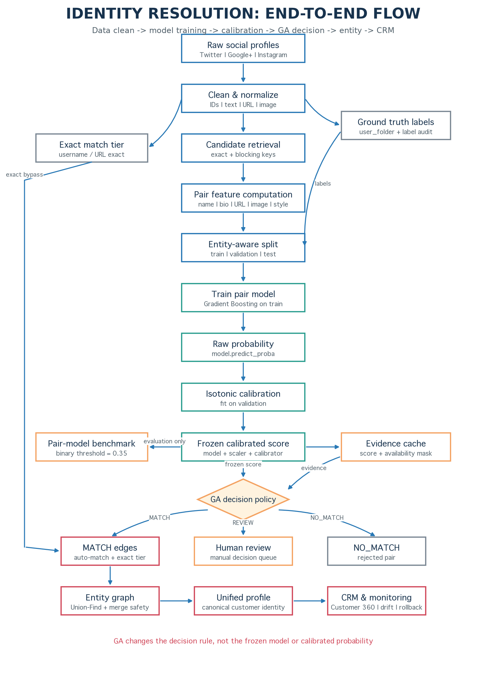

**รูปที่ 0** ภาพรวมงานทั้งหมดตั้งแต่รับข้อมูล social profiles, clean/normalize, สร้าง ground truth และ candidate pairs, คำนวณ features, train และ calibrate model, ส่ง frozen probability เข้า GA decision policy, รวม MATCH edges เป็น customer entity แล้วส่งออก CRM พร้อม monitoring

ให้อ่านภาพจากบนลงล่างตามเส้นกลาง: เตรียมข้อมูลและ candidate pairs ก่อนแบ่ง entity-aware split เพื่อ train และ calibrate model จากนั้น freeze calibrated score แล้วส่งเข้า GA decision policy แขนงด้านข้างแสดง ground-truth labels, exact matches, pair-model benchmark และ evidence cache ส่วนปลายทางแตกเป็น MATCH/REVIEW/NO_MATCH ก่อนนำ MATCH edges ไปสร้าง unified profile และ CRM จุดสำคัญคือ GA รับ **calibrated probability จาก model ที่ freeze แล้ว** ร่วมกับ evidence/availability masks ไม่ได้กลับไปเปลี่ยน model weights

## 2.1 Canonical lifecycle

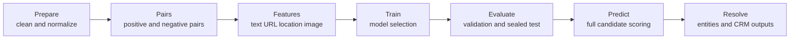

โค้ด production-oriented อยู่ใต้ [`src/identity_resolution/`](../src/identity_resolution/) และเปิดผ่าน [`cli.py`](../src/identity_resolution/cli.py) ตามลำดับ `prepare → pairs → features → train → evaluate → predict → resolve` ส่วน [`experiments/`](../experiments/) เป็น research harness ซึ่งไม่ควรถูก import กลับเข้า production core

## 2.2 Architecture layers

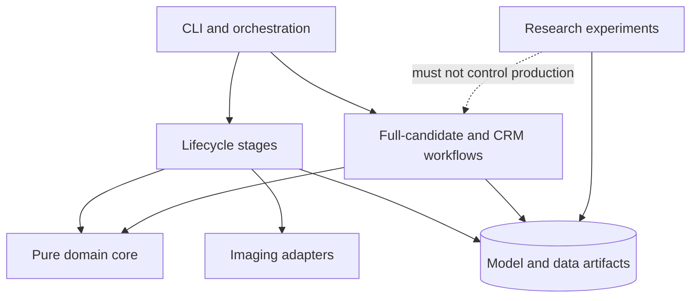

| Layer | หน้าที่ | Source of truth |
|---|---|---|
| Core | pair identity, threshold policy, text normalization, entity graph | [`core/`](../src/identity_resolution/core/) |
| Stages | data preparation, pair building, features, train, evaluate | [`stages/`](../src/identity_resolution/stages/) |
| Workflows | full candidate prediction และ CRM resolution | [`workflows/`](../src/identity_resolution/workflows/) |
| Imaging | image normalization, embeddings, pair features | [`imaging/`](../src/identity_resolution/imaging/) |
| Research | R0-R6, GA, ablation และ diagnostics | [`experiments/`](../experiments/) |
| Publication | benchmark tables และ report snapshots | [`pub_multi/`](../pub_multi/) |

## 2.3 Data flow ตั้งแต่ profile ถึง customer entity

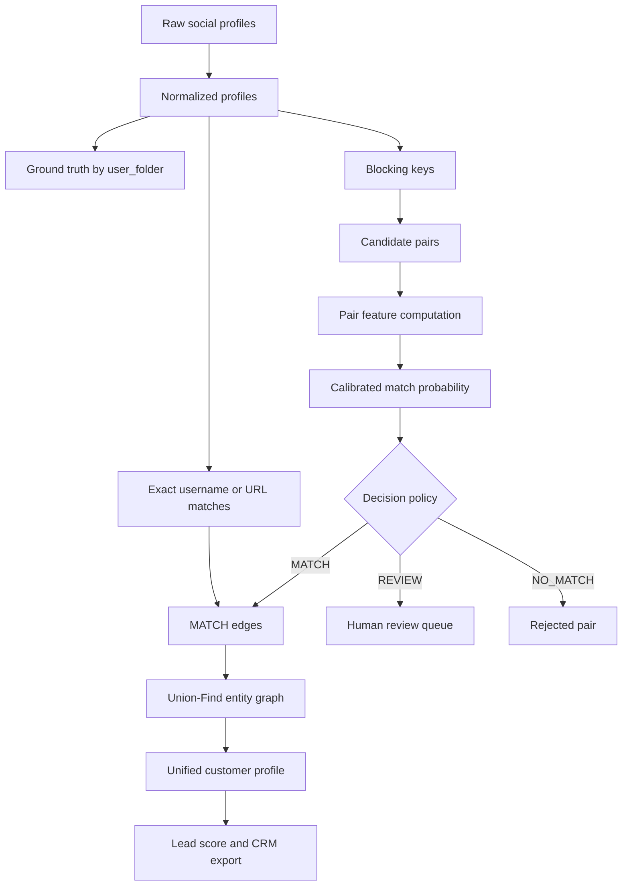

## 2.4 Development และ deployment boundary

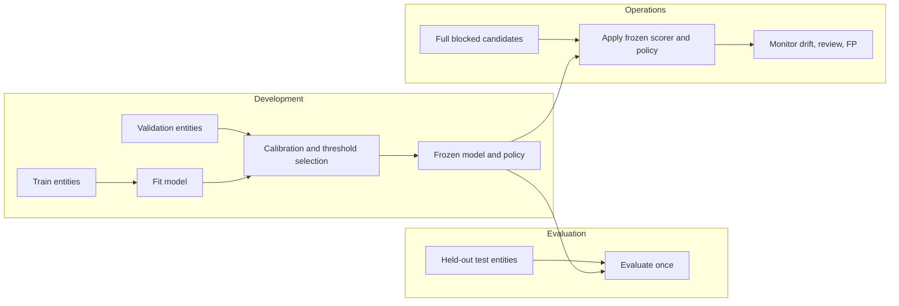

หลักสำคัญคือห้ามใช้ test เลือก model, threshold, feature guard หรือน้ำหนัก GA historical run เปิด test หลัง freeze เพียงครั้งเดียว ส่วน CRM-cost rerun รุ่นล่าสุดเลือก policy จาก validation และยังไม่เปิด test เดิมซ้ำ

---

# 3. ข้อมูลและคุณภาพข้อมูล

## 3.1 ชุดข้อมูลหลัก

ไฟล์หลักคือ [`normalized_profiles_with_profile_id.csv`](../data_for_project/normalized_profiles_with_profile_id.csv)

| รายการ | จำนวน |
|---|---:|
| แถว input | 36,807 |
| แถวที่มี `profile_row_id` และ `profile_id` ใช้งานได้ | 36,804 |
| แถวที่ถูกตัดเพราะ identifier ไม่สมบูรณ์ | 3 |
| Entity (`user_folder`) | 15,297 |
| Twitter (input / eligible) | 13,960 / 13,959 |
| Google+ (input / eligible) | 11,890 / 11,889 |
| Instagram (input / eligible) | 10,957 / 10,956 |

ความแตกต่างระหว่างตัวเลข 36,807 กับ 36,804 ในเอกสารเดิมจึงไม่ใช่ความขัดแย้ง: ค่าแรกคือจำนวนแถว input ส่วนค่าหลังคือจำนวนที่ผ่าน eligibility filter ของ production workflow

## 3.2 Ground truth

กำหนดคู่เป็น positive เมื่อ `user_folder` เดียวกันและเป็นคนละ profile:

$$
y_{ij} = \begin{cases}
1, & \text{เมื่อ } folder_i = folder_j \\
0, & \text{เมื่อ } folder_i \ne folder_j
\end{cases}
$$

| Scope | Positive pairs |
|---|---:|
| ทุกคู่ภายใน entity | 29,247 |
| Cross-platform ตาม research scope | 29,243 |
| Same-platform ที่ไม่รวมใน primary evaluation | 4 |

ตัวเลข 29,247 ที่พบใน experiment harness และ 29,243 ใน production blocking report จึงต่างกันจาก scope 4 คู่ ไม่ใช่การคำนวณผิด

## 3.3 ความสมบูรณ์ของ field

| Field | Non-empty | Coverage |
|---|---:|---:|
| username | 36,723 | 99.77% |
| full name | 35,952 | 97.68% |
| bio | 30,167 | 81.96% |
| external URL/domain | 30,580 | 83.08% |
| location | 12,794 | 34.76% |

coverage ระดับ profile ไม่เท่ากับ coverage ระดับ pair เพราะ pair feature ต้องการข้อมูลจากทั้งสองฝั่ง ตัวอย่างเช่น feature-aware validation มี location evidence ที่ใช้ได้ 0% แม้ profile-level location จะไม่เป็นศูนย์ สาเหตุคือคู่ที่เลือกอาจไม่มี location ครบสองฝั่งหรือ preprocessing ไม่สร้าง usable match signal

## 3.4 ข้อมูลภาพ

รอบดาวน์โหลดล่าสุดใน [`download_report.json`](../image_process/download_report.json) พยายาม 998 URL แต่ดาวน์โหลดใหม่สำเร็จ 0 รายการ ขณะเริ่ม run มีไฟล์เก่าใน cache 4,248 ไฟล์ ปัญหาหลักคือ archival URLs คืน HTTP 404 และ proxy บางเส้นทางคืน HTTP 429 ดังนั้นรายงานไม่อ้างว่าระบบ image ingestion ปัจจุบันมี coverage สูง

ผล model comparison สอดคล้องกับข้อจำกัดนี้:

| Model configuration | Features | Test F1 | Test AP |
|---|---:|---:|---:|
| text attributes | 23 | 0.9330 | 0.9782 |
| image statistics | 37 | 0.9340 | 0.9789 |
| image context | 41 | 0.9340 | 0.9789 |

image context เพิ่ม F1 จาก text-only ประมาณ 0.001 จุด จึงควรสรุปว่า “ทดลองและพบประโยชน์เล็กน้อยในข้อมูลนี้” ไม่ใช่ “ภาพเป็นสัญญาณหลัก”

## 3.5 ความเสี่ยงด้านข้อมูล

1. Google+ เป็นข้อมูล archive จึงอาจมี temporal mismatch กับแพลตฟอร์มอื่น
2. ค่า URL และรูปภาพอาจหมดอายุ แม้ field เดิมไม่ว่าง
3. ground truth จาก folder มีความน่าเชื่อถือเชิงโครงสร้าง แต่ยังอาจมี label noise
4. exact username ไม่ได้หมายถึงบุคคลเดียวกันเสมอ พบ false positive ใน exact tier 63 คู่
5. hard cases บางคู่ไม่มี lexical หรือ contextual evidence เพียงพอ จึงเป็น data ceiling มากกว่าปัญหา model

---

# 4. Candidate Generation และ Blocking

## 4.1 เหตุผลที่ต้อง blocking

จำนวนคู่ข้ามแพลตฟอร์มทั้งหมดคำนวณจากผลคูณระหว่างจำนวนบัญชีของแต่ละแพลตฟอร์ม:

$$
N_{all}=N_{TW}N_{GP}+N_{TW}N_{IG}+N_{GP}N_{IG}=449{,}149{,}239
$$

การคำนวณ feature ราคาแพงบนทุกคู่ไม่เหมาะกับเครื่อง RAM 16 GiB จึงใช้ blocking key เช่น username prefix, fullname prefix และ external domain เพื่อสร้าง candidate set

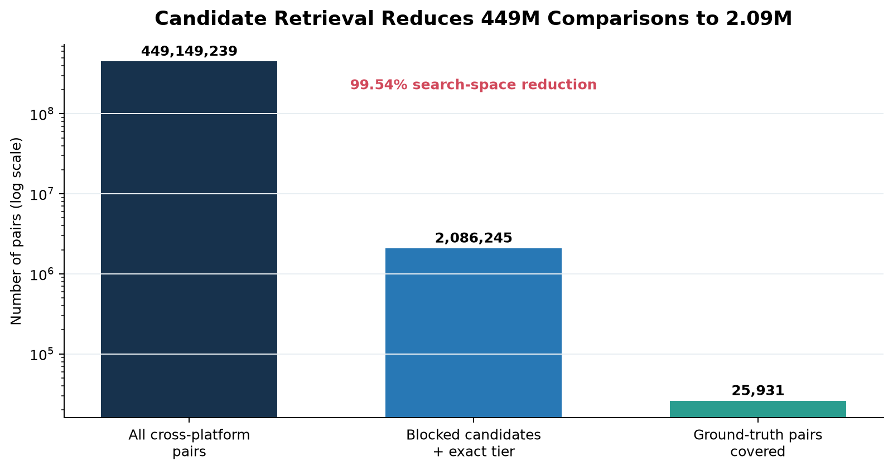

**รูปที่ 1** การลด search space จาก 449.15 ล้านคู่เหลือ 2.086 ล้านคู่

## 4.2 ผล retrieval

| รายการ | จำนวน/ค่า |
|---|---:|
| All cross-platform pairs | 449,149,239 |
| Exact tier | 12,403 |
| Model-scored candidates | 2,073,842 |
| รวม candidate workflow | 2,086,245 |
| Search-space reduction | 99.5355% |
| Cross-platform GT covered | 25,931 / 29,243 |
| Retrieval recall | 88.6742% |
| Cross-platform blocking miss | 3,312 |

research harness รุ่น R0-R6 รายงาน blocking miss 3,316 จาก positive 29,247 เพราะรวม same-platform 4 คู่ไว้ใน denominator เมื่อตีความผลจึงต้องระบุ scope เสมอ

## 4.3 Recall ceiling

หาก candidate generation ไม่สร้างคู่ใดขึ้นมา model และ GA จะไม่มีโอกาสแก้คู่นั้น เพดาน recall ของ R0-R5 ตาม research scope จึงเป็น:

$$
Recall_{ceiling}=\frac{29{,}247-3{,}316}{29{,}247}=0.8866
$$

การปรับ threshold หรือเปลี่ยน classifier แก้ได้เฉพาะ scored false negatives แต่ไม่แก้ blocking misses

---

# 5. Feature Engineering

## 5.1 Feature groups

| Group | ตัวอย่าง features | แนวคิด |
|---|---|---|
| Name | Jaro-Winkler, normalized Levenshtein, token sort, char n-gram, handle | วัดรูปแบบชื่อที่สะกดหรือจัดลำดับต่างกัน |
| Bio | TF-IDF cosine, SBERT cosine | lexical และ semantic similarity ของคำอธิบาย |
| URL | domain/url Jaccard, counts | shared web identity และ external links |
| Location | Jaro, token sort | ความคล้ายของตำแหน่งที่ตั้ง |
| Style | capitalization, punctuation, word length, bio length ratio | writing-style consistency |
| Social context | mention/hashtag overlap | shared social vocabulary |
| Image | pHash, dHash, image statistics, caption cross-features | visual/context similarity |
| Platform metadata | platform pair code | ให้ model เรียนรู้ distribution shift ระหว่างคู่แพลตฟอร์ม |

## 5.2 Similarity functions

Normalized Levenshtein similarity:

$$
s_{lev}(a,b)=1-\frac{d_{lev}(a,b)}{\max(|a|,|b|,1)}
$$

Cosine similarity สำหรับ vector representation:

$$
s_{cos}(x,y)=\frac{x\cdot y}{\|x\|_2\|y\|_2}
$$

Jaccard similarity สำหรับ set ของ URL/domain/mention:

$$
s_J(A,B)=\frac{|A\cap B|}{|A\cup B|}
$$

## 5.3 Missingness-aware representation

คะแนน similarity เป็นศูนย์อาจหมายถึง “ต่างกันจริง” หรือ “ไม่มีข้อมูล” ซึ่งเป็นคนละสถานการณ์ ระบบ feature-aware จึงใช้ mask $m_k\in\{0,1\}$ แยกจาก score $s_k$ และคำนวณ weighted evidence ต่อคู่เป็น:

$$
E_{ij}=\frac{\sum_k m_{ijk}w_ks_{ijk}}{\sum_k m_{ijk}w_k}
$$

เมื่อ denominator เป็นศูนย์ คู่จะไม่มี evidence สำหรับ promotion/demotion และคงอยู่ใน REVIEW แทนการถูกตีความเป็น NO_MATCH

## 5.4 Feature importance ของ production model

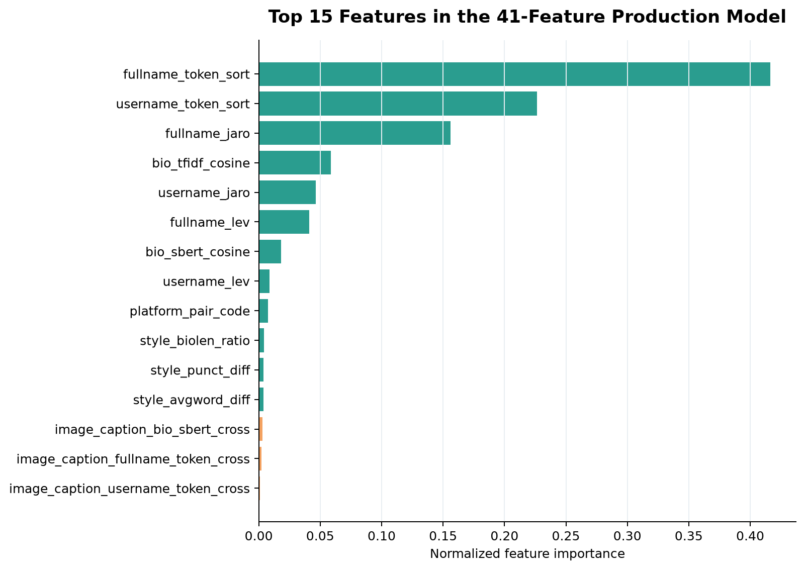

**รูปที่ 2** Top-15 feature importance ของ model 41 features

| อันดับ | Feature | Normalized importance |
|---:|---|---:|
| 1 | fullname_token_sort | 0.4165 |
| 2 | username_token_sort | 0.2263 |
| 3 | fullname_jaro | 0.1561 |
| 4 | bio_tfidf_cosine | 0.0588 |
| 5 | username_jaro | 0.0464 |
| 6 | fullname_lev | 0.0409 |
| 7 | bio_sbert_cosine | 0.0183 |

name-related features รวมกันครองสัดส่วนสูงสุด ขณะที่ image features ส่วนใหญ่ต่ำมาก ผลนี้สอดคล้องกับ data coverage และไม่ได้หมายความว่าภาพไม่มีประโยชน์ใน dataset ที่สมบูรณ์กว่า

---

# 6. Pair Construction และ Leakage Control

## 6.1 ประเภทคู่สำหรับ train

- **Positive pairs:** `user_folder` เดียวกันและข้ามแพลตฟอร์ม
- **Random negatives:** ต่าง entity และสุ่มจาก profile pool เดียวกัน
- **Hard negatives:** ต่าง entity แต่มีชื่อหรือข้อมูลบางส่วนคล้ายกัน

การมี hard negatives สำคัญเพราะ random negatives ส่วนใหญ่แยกง่ายเกินไปและทำให้ metric สูงโดยไม่สะท้อนความเสี่ยง false merge

## 6.2 Entity-aware split

split ถูกทำในระดับ entity ไม่ใช่ระดับ pair เพื่อป้องกัน profile ของบุคคลเดียวกันไปอยู่ทั้ง train และ test:

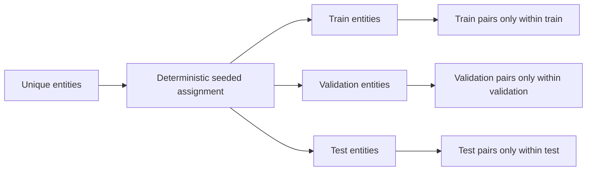

N-series artifacts ยืนยัน component overlap เป็นศูนย์ทุกคู่ split:

| Check | Result |
|---|---:|
| Train-Val entity overlap | 0 |
| Train-Test entity overlap | 0 |
| Val-Test entity overlap | 0 |
| Self pairs | 0 |

## 6.3 Split sizes ของ feature matrix

| Split | Pairs | Positive | Negative |
|---|---:|---:|---:|
| Train | 41,803 | 20,470 | 21,333 |
| Validation | 8,580 | 4,386 | 4,194 |
| Test | 8,313 | 4,387 | 3,926 |
| รวม | 58,696 | 29,243 | 29,453 |

## 6.4 Sealed-test rule

1. train model บน train
2. เลือก model/calibrator/threshold/policy บน validation
3. freeze configuration
4. ประเมิน test หนึ่งครั้ง
5. ห้ามย้อนกลับไปปรับจาก test แล้วอ้าง test เดิมเป็น unbiased result

---

# 7. Model Training และ Calibration

## 7.1 Model families

ระบบเปรียบเทียบ Logistic Regression, Random Forest, Gradient Boosting, neural MLP และ reference models อื่น โดย production-selected run เป็น Gradient Boosting เพราะให้ validation composite score และ test balance ดีที่สุดใน multimodal suite

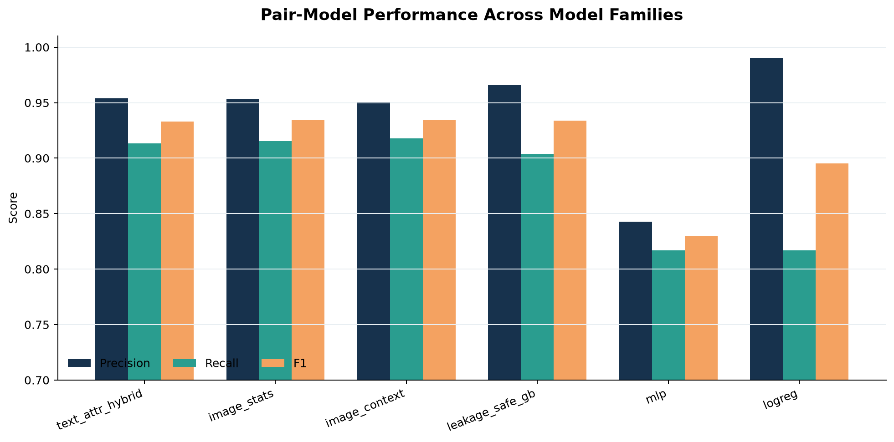

**รูปที่ 3** Precision, Recall และ F1 ของ model configurations ที่มี artifact เปรียบเทียบได้

ข้อควรระวัง: แถว `strict_*` ใช้ protocol/reference ที่ต่างจาก multimodal suite บางส่วน จึงใช้เป็น diagnostic ไม่ใช่ ranking เดียวกันทั้งหมด

## 7.2 Calibration

หลัง Gradient Boosting fit เสร็จ จะไม่มีการเปลี่ยนพารามิเตอร์ของ classifier ในขั้น GA ลำดับจริงคือ:

1. fit classifier บน train แล้วสร้าง raw probability
2. fit isotonic calibrator บน validation เพื่อแปลง raw probability เป็น calibrated probability
3. เลือก threshold `0.35` บน validation เพื่อประเมิน **binary pair classifier** ด้วย F1 โดยใช้ Precision เป็น tie-break
4. freeze และบันทึก model, scaler, calibrator, feature schema และ calibrated probabilities
5. ส่ง calibrated probability เดิมเข้าสู่ downstream decision policy

Isotonic calibration เป็น post-training mapping ที่เรียนจาก validation จึงนับเป็นส่วนหนึ่งของ frozen scoring pipeline แต่ไม่ได้ retrain Gradient Boosting หลังเห็นผล GA

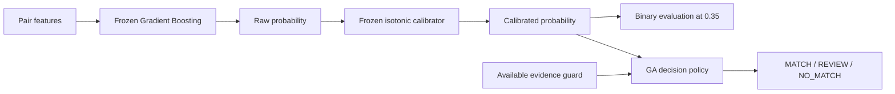

เส้นทาง `0.35` และ GA จึงเริ่มจาก probability เดียวกันแต่ตอบคนละคำถาม: `0.35` ใช้วัดความสามารถจำแนกคู่แบบ MATCH/NO_MATCH ส่วน GA ใช้สร้าง operating policy สามระดับตาม business cost และ quality constraints

| Threshold/policy | เลือกจาก | ใช้ทำอะไร | เปลี่ยน model หรือไม่ |
|---|---|---|---|
| `0.35` | Validation F1 | binary pair-model benchmark บน test | ไม่เปลี่ยน |
| `0.98/0.95` | Manual operational baseline | แบ่ง MATCH/REVIEW/NO_MATCH ใน baseline | ไม่เปลี่ยน |
| GA genome | Validation decision cost + gates | เลือก MATCH/REVIEW/NO_MATCH โดยใช้ probability และ evidence | ไม่เปลี่ยน |

## 7.3 Pair-model result

บน test 8,313 คู่ เมื่อ apply frozen calibrated probability ที่ binary threshold `0.35`:

| Metric | Value |
|---|---:|
| Average Precision | 0.9789 |
| Precision | 0.9507 |
| Recall | 0.9179 |
| F1 | 0.9340 |
| False positive | 209 |
| False negative | 360 |

$$
Precision=\frac{TP}{TP+FP},\quad Recall=\frac{TP}{TP+FN},\quad F_1=\frac{2PR}{P+R}
$$

ตัวเลขนี้วัด **pair classification บน labeled test set** ไม่รวมคู่ที่ blocking พลาด จึงไม่ควรถูกเรียกว่า end-to-end production F1

ตัวเลขนี้เป็น benchmark ของ scoring model และไม่ใช่ผลหลัง GA เมื่อเข้าสู่ GA:

- model/scaler/calibrator และ probability ถูก freeze ไม่เปลี่ยน
- GA ไม่เรียก `.fit()` และไม่แก้ model weights
- GA เรียน threshold `[t_match,t_review,c_promote,c_demote]` จาก validation
- evidence เช่น name/bio/URL/image/style ใช้เฉพาะคู่ที่มี availability mask
- ผลลัพธ์เปลี่ยนจาก binary prediction เป็น `MATCH`, `REVIEW` หรือ `NO_MATCH`

ดังนั้น GA อาจให้ Precision/Recall ต่างจากตารางนี้ได้ แม้ใช้ probability ชุดเดิม เพราะเปลี่ยน operating rule ไม่ได้เปลี่ยน pair model

---

# 8. ผลตาม Platform และ Difficulty

## 8.1 Platform-pair performance

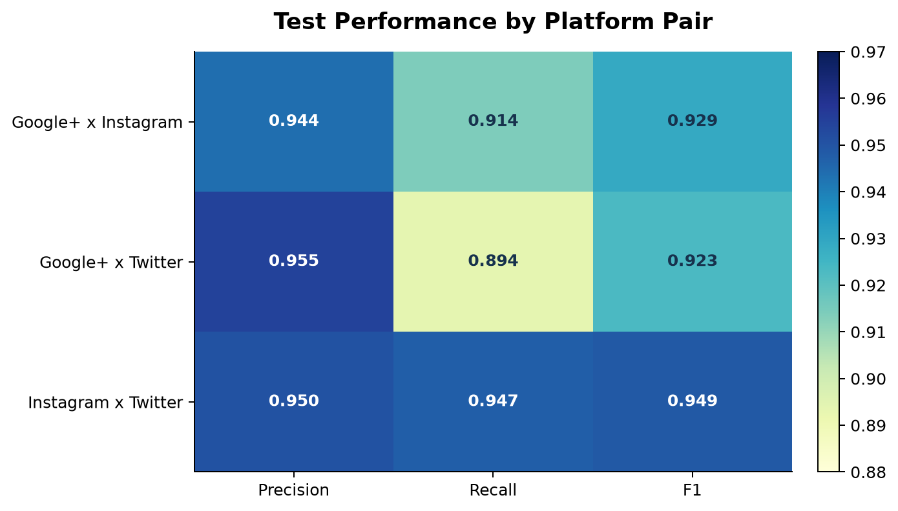

**รูปที่ 4** ผลบน test แยกตามคู่แพลตฟอร์ม

| Platform pair | Precision | Recall | F1 | Positive pairs |
|---|---:|---:|---:|---:|
| Google+ × Instagram | 0.9439 | 0.9138 | 0.9286 | 975 |
| Google+ × Twitter | 0.9548 | 0.8936 | 0.9232 | 1,795 |
| Instagram × Twitter | 0.9504 | 0.9474 | 0.9489 | 1,617 |

Google+ × Twitter มี recall ต่ำสุดและสร้าง FN 191 จาก FN ทั้งหมด 360 คู่ บ่งชี้ platform/domain shift ที่ควรตรวจแยก

## 8.2 Difficulty slices

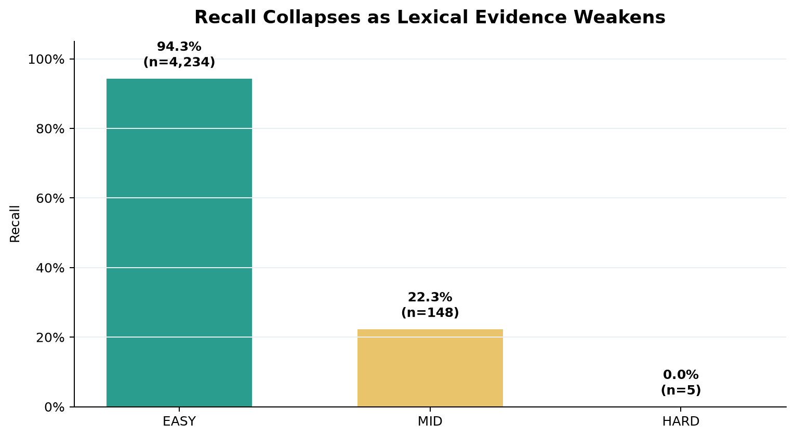

**รูปที่ 5** Recall ลดลงอย่างมากเมื่อ lexical name evidence อ่อน

| Slice | Positive pairs | Recall | FN |
|---|---:|---:|---:|
| EASY | 4,234 | 0.9433 | 240 |
| MID | 148 | 0.2230 | 115 |
| HARD | 5 | 0.0000 | 5 |

ผลนี้ชี้ว่า overall F1 สูงเกิดจาก easy slice เป็นสัดส่วนใหญ่ ขณะที่ hard cases ยังไม่ถูกแก้ การรายงานเฉพาะ overall metric จึงปิดบังจุดอ่อนสำคัญ

---

# 9. Full-Candidate Decision Pipeline

## 9.1 Decision tiers

production-oriented baseline ใช้ MATCH threshold 0.98 และ REVIEW threshold 0.95:

$$
decision(p)=\begin{cases}
MATCH,&p\ge0.98\\
REVIEW,&0.95\le p<0.98\\
NO\_MATCH,&p<0.95
\end{cases}
$$

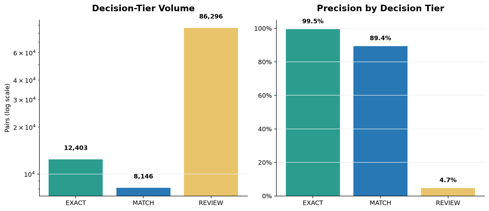

**รูปที่ 6** ปริมาณและ precision ของ exact, match และ review tiers

threshold `0.98/0.95` เป็น manual operational policy อีกชุดหนึ่ง ไม่ใช่ threshold `0.35` ของ binary model evaluation และไม่ใช่ GA genome เมื่อรัน GA ค่า `t_match` และ `t_review` จะถูกเลือกใหม่บน validation โดย calibrated probability ยังเป็นค่าจาก frozen scorer เดิม

| Tier | Count | True positive | Precision | Global recall contribution |
|---|---:|---:|---:|---:|
| Exact | 12,403 | 12,340 | 0.9949 | 0.4220 |
| Match | 8,146 | 7,284 | 0.8942 | 0.2491 |
| Review | 86,296 | 4,065 | 0.0471 | 0.1390 |

review queue มี precision เพียง 4.71% หมายความว่าผู้ตรวจต้องเปิดประมาณ 21 คู่เพื่อพบ true match หนึ่งคู่ เป็น operational bottleneck ที่ชัดเจน

## 9.2 End-to-end baseline

| Metric | Full baseline |
|---|---:|
| TP | 19,624 |
| FP | 925 |
| FN รวม blocking miss | 5,558 |
| REVIEW | 86,296 |
| Precision | 0.9550 |
| Recall | 0.6710 |
| F1 | 0.7882 |

## 9.3 เหตุผลที่ pair-model F1 0.934 ไม่เท่ากับ full F1 0.788

| ระดับ | สิ่งที่วัด | สิ่งที่ยังไม่รวม |
|---|---|---|
| Pair-model test | จำแนกคู่ใน labeled feature matrix | blocking misses และ workload เต็มระบบ |
| Retrieval | candidate generation ครอบคลุม true pairs | classifier/decision errors |
| Full decision | exact + scored + blocking miss + thresholds | entity-level transitive errors |
| Entity/CRM | ผลหลัง connected components และ canonicalization | ต้องมี entity-level output จริง |

ดังนั้น metric ทั้งสองถูกต้องในบริบทของตนเอง แต่ตอบคนละคำถาม

---

# 10. Error Analysis

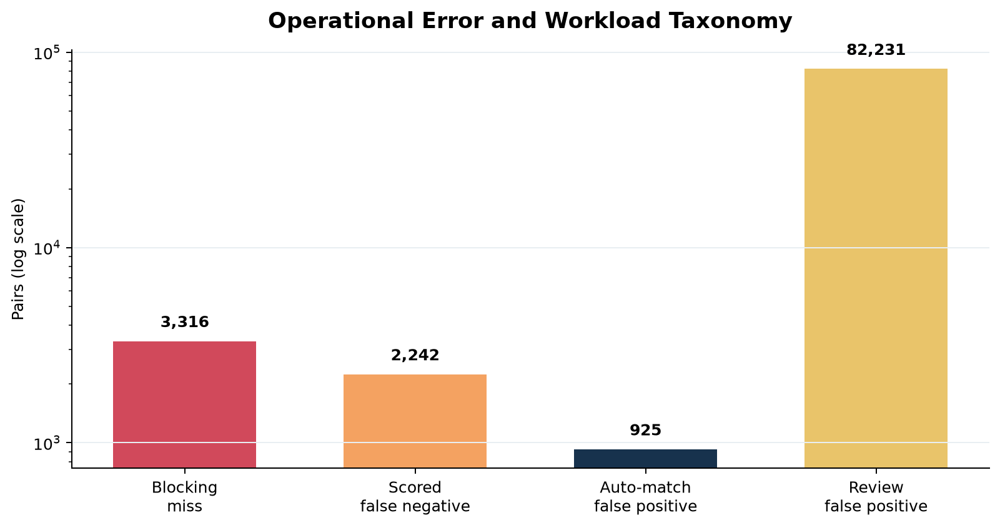

**รูปที่ 7** แหล่งความผิดพลาดและภาระงานในระดับ operational

## 10.1 False positives

พบ MATCH ที่ actual เป็น negative 925 คู่:

- 862 คู่มาจาก model `AUTO_HIGH`
- 63 คู่มาจาก `AUTO_EXACT`
- median score ของ FP เท่ากับ 0.9954 แสดงว่า tail calibration หรือ candidate composition ทำให้ model มั่นใจเกินในบางกรณี
- Google+ × Twitter มี FP มากที่สุด 431 คู่

False positive มีความเสี่ยงสูงเพราะทำให้ graph merge คนละคน และความผิดพลาดอาจแพร่ผ่าน transitive closure

## 10.2 Scored false negatives

มี true pairs 2,242 คู่ที่ผ่าน blocking และถูก score แต่ถูกตัดเป็น NO_MATCH:

- median score 0.8316
- 25th percentile 0.6061
- 75th percentile 0.9286
- Google+ × Twitter เป็นกลุ่มใหญ่สุด 993 คู่

คู่กลุ่มนี้แก้ได้ด้วย model representation, calibration หรือ re-decision policy เพราะมี candidate อยู่แล้ว

## 10.3 Blocking misses

research harness พบ 3,316 true pairs ที่ไม่เข้า candidate set จึงไม่มี score และไม่สามารถแก้ด้วย threshold/GA ที่ปลายทาง การแก้ต้องอยู่ที่ candidate retrieval เช่น semantic blocking, additional keys หรือ approximate-nearest-neighbor retrieval

## 10.4 Review burden

REVIEW มี 86,296 คู่ แต่เป็น positive เพียง 4,065 คู่ ขณะที่ negative 82,231 คู่ ช่วง score 0.95-0.98 จึงไม่ได้แยก identity ได้ดีพอใน population จริง การลด review queue เป็น business objective ที่สำคัญพอ ๆ กับ F1

---

# 11. Name-Similarity Ablation N0-N6

การทดลองนี้เปลี่ยนหรือเพิ่ม representation ของชื่อภายใต้ split และ training protocol เดียวกัน ผลทั้งหมดเป็น **validation result** และยังไม่ใช่ sealed-test ranking

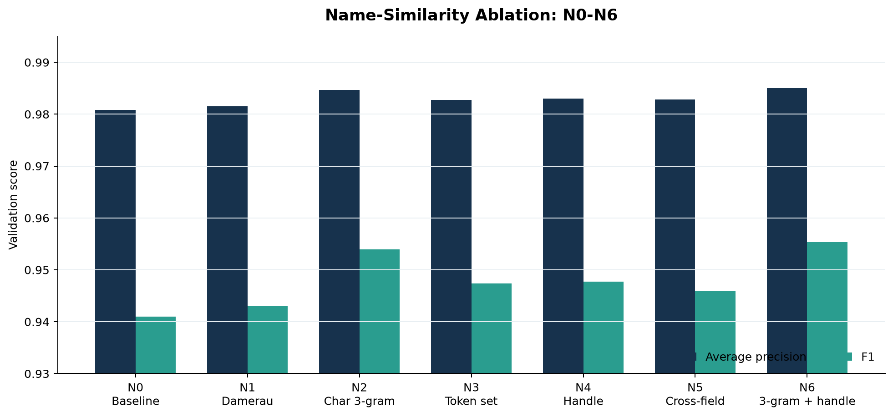

**รูปที่ 8** ผล validation ของ name-similarity variants

| Run | Feature change | AP | Precision | Recall | F1 |
|---|---|---:|---:|---:|---:|
| N0 | Baseline name features | 0.98086 | 0.9727 | 0.9113 | 0.9410 |
| N1 | Damerau-Levenshtein | 0.98152 | 0.9669 | 0.9202 | 0.9430 |
| N2 | Character 3-gram cosine | 0.98468 | 0.9847 | 0.9250 | 0.9539 |
| N3 | Token-set similarity | 0.98273 | 0.9793 | 0.9175 | 0.9474 |
| N4 | Handle-oriented features | 0.98300 | 0.9708 | 0.9257 | 0.9477 |
| N5 | Cross-field name matching | 0.98282 | 0.9725 | 0.9207 | 0.9459 |
| N6 | Character 3-gram + handle | **0.98501** | 0.9808 | **0.9311** | **0.9553** |

N6 เพิ่ม F1 จาก N0 ประมาณ 0.0143 และเพิ่ม AP ประมาณ 0.00415 หลักฐานนี้สนับสนุนการเพิ่ม char n-gram และ handle features เข้า candidate model แต่ต้องทำ sealed-test evaluation ก่อนประกาศเป็น production replacement

---

# 12. การทดลอง Representation × Decision: R0-R6

## 12.1 แนวคิดการทดลอง

R-series แยกคำถามสองแกน:

- **Representation:** feature เดิม, BERT cosine, privacy-preserving Bloom, BERT-ER
- **Decision:** threshold มือ หรือ GA re-decision

การแยกสองแกนนี้ทำให้เห็นว่า representation ใหม่อาจไม่ดีขึ้นหากใช้ threshold เดิมที่ไม่เข้ากับ probability scale ใหม่

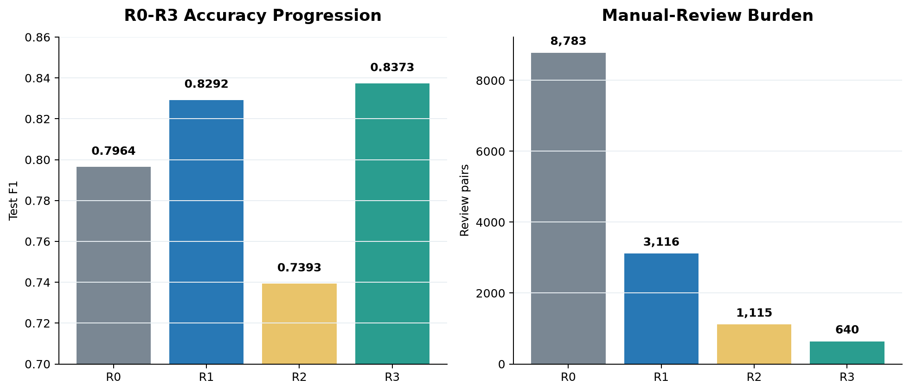

**รูปที่ 9** Test F1 และ manual-review burden ของ R0-R3

## 12.2 ผล test

| Exp | Representation | Decision | Precision | Recall | F1 | REVIEW |
|---|---|---|---:|---:|---:|---:|
| R0 | baseline score | 0.98/0.95 | 0.9852 | 0.6683 | 0.7964 | 8,783 |
| R1 | baseline score | GA | 0.9963 | 0.7101 | 0.8292 | 3,116 |
| R2 | + BERT cosine | manual | 0.9963 | 0.5877 | 0.7393 | 1,115 |
| R3 | + BERT cosine | GA | 0.9940 | 0.7233 | **0.8373** | **640** |
| R5 L=2000 | Bloom-Dice | GA | 0.9910 | 0.7183 | 0.8329 | 700 |
| R6 | frozen BERT-ER | manual | 0.9950 | 0.4350 | 0.6053 | 224 |
| R6-GA | frozen BERT-ER | GA | 0.9977 | 0.6405 | 0.7801 | 3,712 |

## 12.3 R3 full projection

| Metric | R0 baseline | R3 projection | Change |
|---|---:|---:|---:|
| Precision | 0.9550 | 0.9786 | +0.0236 |
| Recall | 0.6710 | 0.7274 | +0.0564 |
| F1 | 0.7882 | 0.8345 | +0.0463 |
| FP | 925 | 465 | -49.7% |
| REVIEW | 86,296 | 2,751 | -96.8% |

R3 เป็นผลดีที่สุดใน R-series แต่เป็น research projection บน frozen full scores ไม่ใช่ policy ที่ wire เข้า canonical production workflow แล้ว

## 12.4 FN recovery

จาก scored FN เดิม 2,242 คู่:

| Strategy | MATCH หรือ REVIEW | MATCH เท่านั้น |
|---|---:|---:|
| R2 | 282 (12.6%) | 37 |
| R3 | 728 (32.5%) | 214 |

GA ทำให้ representation BERT ถูกใช้งานได้ดีขึ้น เพราะ threshold เดิมไม่เหมาะกับ probability distribution ใหม่

## 12.5 Privacy-utility trade-off

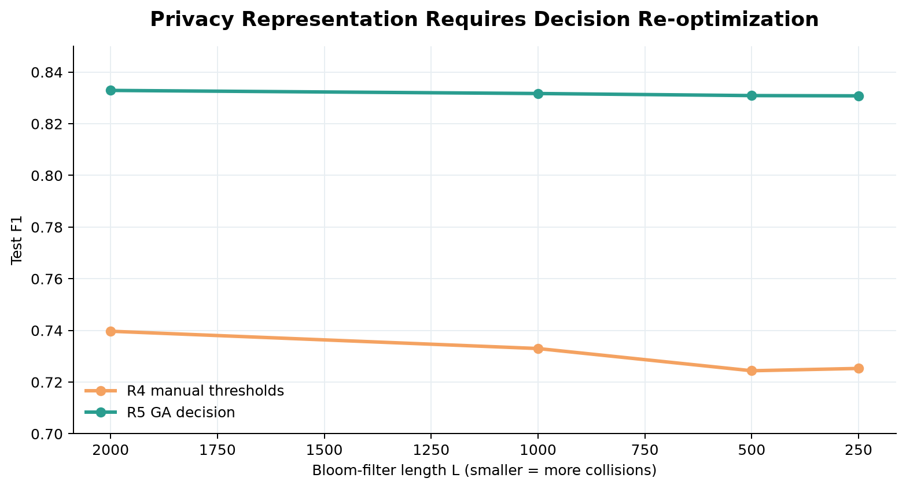

**รูปที่ 10** Bloom representation เมื่อใช้ manual threshold เทียบกับ GA

R5 ที่ Bloom length 2,000 ให้ Test F1 0.8329 ต่างจาก R3 เพียง 0.0044 จึงเป็นทางเลือกที่น่าสนใจเมื่อข้อกำหนด privacy สำคัญกว่าความแม่นยำสูงสุด แต่ Bloom filter ไม่ได้ให้ privacy guarantee แบบเข้ารหัสสมบูรณ์ ต้องมี threat model และ parameter governance เพิ่ม

## 12.6 R6 semantic blocking

R6 ใช้ frozen DistilBERT representation กับ learned hash/match heads เพื่อพยายามกู้ blocking-missed pairs:

| Hamming radius | Candidate recovered | End-to-end MATCH |
|---:|---:|---:|
| 0 | 0 / 3,316 | 0 |
| ≤1 | 4 / 3,316 (0.12%) | 3 |

ผลเป็น negative result: frozen encoder และ hash configuration ปัจจุบันยังไม่พร้อมใช้ การทดลองนี้มีคุณค่าเพราะระบุชัดว่า semantic blocking ต้องการ domain fine-tuning, hard-negative mining และ compute ที่มากกว่าเดิม

---

# 13. Genetic Algorithm และ Business-Cost Optimization

## 13.1 Objective function

CRM policy ปัจจุบัน derive จากค่าแรง 100 บาท/ชั่วโมง: REVIEW 1 นาที = 1.67 บาท, จัดการ FN 10 นาที = 16.67 บาท และแก้ FP 20 นาที = 33.33 บาท เมื่อ normalize ด้วยต้นทุน FN ได้:

$$
C_{crm}=2FP+FN+0.1REVIEW
$$

policy version คือ `crm_derived_v1` และ source of truth อยู่ที่ [`business_cost.py`](../src/identity_resolution/core/business_cost.py) ผล R1-R6 และ feature-aware artifacts ที่สร้างก่อนการเปลี่ยนนี้ optimize ด้วย historical cost $5FP+FN+0.02REVIEW$ จึงต้องเก็บผลเดิมไว้เพื่อ reproducibility แล้ว rerun policy selection ภายใต้ cost ใหม่ ห้ามเปลี่ยนตัวเลข artifact เก่าย้อนหลัง

## 13.2 Genome ของ R1/R3

$$
g=[t_{match},t_{review},c_{promote},c_{demote}]
$$

ใน implementation เดิม evidence guard เป็น `name_sim` แบบ hard-coded ดังนั้นคำว่า “GA เลือก name” ไม่ถูกต้อง ที่ถูกคือ “ผู้ออกแบบกำหนด name ให้ GA ล่วงหน้า แล้ว GA เลือกเพียง thresholds”

## 13.3 Feature-aware GA

การทดลองใหม่เปรียบเทียบ score-only กับ guard จาก name, bio, URL, image และ style โดยใช้ availability mask

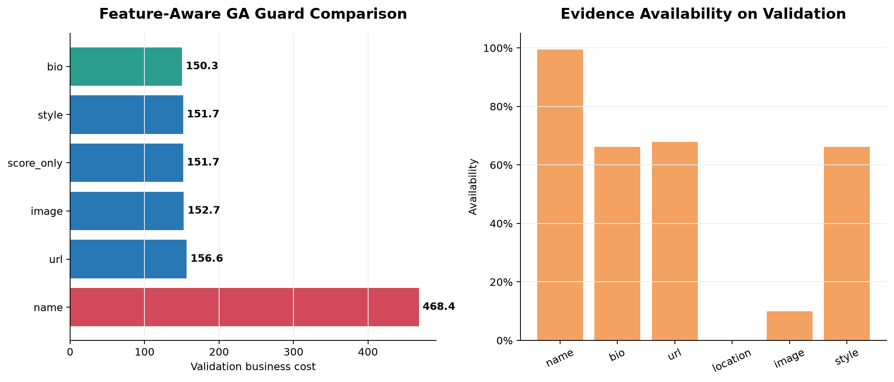

**รูปที่ 11** GA guard cost และ evidence coverage บน labeled validation population

| Guard | Validation cost | Precision | Recall | FP | FN | REVIEW |
|---|---:|---:|---:|---:|---:|---:|
| bio | **458.70** | 0.9989 | 0.6040 | 3 | 56 | 3,967 |
| style | 465.30 | 0.9988 | 0.5885 | 3 | 56 | 4,033 |
| score only | 465.60 | 0.9988 | 0.5882 | 3 | 56 | 4,036 |
| image | 466.40 | 0.9988 | 0.5882 | 3 | 57 | 4,034 |
| URL | 467.20 | 0.9985 | 0.5889 | 4 | 56 | 4,032 |
| name | 530.80 | 0.9787 | **0.7241** | **69** | 56 | 3,368 |

ตารางนี้ re-score policy counts เดิมด้วย `crm_derived_v1`; policy เหล่านี้ยังมาจาก search ภายใต้ objective เก่า จึงใช้วิเคราะห์ sensitivity เท่านั้น ไม่ใช่ผล optimization ใหม่ name guard ให้ recall สูงสุด แต่ false positives เพิ่มจาก 3 เป็น 69 และ cost สูงกว่า bio

## 13.4 Availability coverage

| Group | Validation availability | High-score positive rate |
|---|---:|---:|
| name | 99.42% | 0.596 |
| bio | 66.18% | 0.954 |
| URL | 67.93% | 0.941 |
| image | 10.02% | 1.000 |
| style | 66.18% | 0.533 |
| location | 0.00% | 0.000 |

image มี conditional precision สูงแต่ coverage ต่ำ จึงเหมาะเป็น availability-gated positive evidence มากกว่า global default

## 13.5 Model weights ไม่เท่ากับ GA weights

ต้องแยกสองความหมาย:

- **Model feature importance:** feature ช่วยจัดอันดับ pair probability มากเพียงใด
- **GA policy weight/guard:** evidence ช่วยลด decision cost ใน review band มากเพียงใด

name สำคัญต่อ model มากที่สุด แต่ “feature สำคัญ” ไม่เท่ากับ “policy พร้อม promote” ผล historical labeled-subset ทำให้ bio ชนะ scalar cost ขณะที่ CRM-cost full-population rerun ทำให้ name ชนะ scalar cost แต่ยังไม่ผ่าน Precision/Recall gates จึงต้องใช้ constrained policy ไม่ใช่สรุปจาก feature importance หรือ raw cost เพียงอย่างเดียว

### 13.5.1 Proof: feature มีผลต่อ model มากน้อยเพียงใด

ตารางนี้ใช้ **permutation importance บน validation** ของ Gradient Boosting feature-aware model: สลับค่าของ feature/group ทีละส่วนแล้ววัด Average Precision (AP) ที่ลดลง ค่า AP delta สูงหมายถึง model พึ่งพาสัญญาณนั้นมากกว่า ไม่ใช่ causal effect และไม่ใช่น้ำหนักที่ GA ต้องใช้

| Evidence group | Sum AP delta | Std. รวม | จำนวน feature | ความหมาย |
|---|---:|---:|---:|---|
| Name | **0.277651** | 0.008046 | 6 | สัญญาณหลักของ pair score อย่างชัดเจน |
| Bio | 0.011153 | 0.000999 | 3 | มีประโยชน์เสริมเมื่อมีข้อมูลครบทั้งสองฝั่ง |
| Platform/availability/other | 0.004224 | 0.000498 | 4 | บอก distribution และ missingness เล็กน้อย |
| Style | 0.001577 | 0.000600 | 5 | ผลเสริมขนาดเล็ก |
| URL | 0.001100 | 0.000181 | 3 | มีผลต่ำใน validation ชุดนี้ |
| Image | 0.000908 | 0.000405 | 19 | coverage จำกัด จึงยังไม่ใช่สัญญาณหลัก |
| Location | 0.000000 | 0.000000 | 3 | ไม่มี usable pair evidence ใน run นี้ |

Top features ที่พิสูจน์ได้จาก run เดียวกันคือ `username_token_sort` (0.127410), `fullname_token_sort` (0.071982), `fullname_jaro` (0.041630), `username_jaro` (0.021471), `fullname_lev` (0.009836), `bio_tfidf_cosine` (0.006717) และ `username_lev` (0.005322) ดังนั้น **name token/character similarities มีผลต่อ model score สูงสุด**; Bio เป็น feature รองที่มีผลจริง ส่วน URL/style/image/location ยังไม่มีหลักฐานพอให้แทน name ใน pair scorer

หลักฐาน raw อยู่ที่ [`feature_permutation_importance_validation.csv`](../artifacts/decisioning/feature_aware_ga/automated_20260831_final/feature_permutation_importance_validation.csv) และ [`grouped_permutation_importance_validation.csv`](../artifacts/decisioning/feature_aware_ga/automated_20260831_final/grouped_permutation_importance_validation.csv) ควรอ่านร่วมกับ coverage: full validation มี name 100%, bio/style 65.70%, URL 70.41%, image 11.16% และ location 0% จึงไม่ตีความ AP delta ต่ำว่า feature ไม่มีคุณค่าทางธุรกิจในข้อมูลที่สมบูรณ์กว่า

แผนปิดข้อสงสัยเรื่อง replacement โดยใช้ canonical experiment เดียวอยู่ที่ [`NAME_SIM_GA_PROOF_CLOSURE_PLAN_TH.md`](../docs/plans/NAME_SIM_GA_PROOF_CLOSURE_PLAN_TH.md)

## 13.6 Weighted GA result

| Group | Learned weight |
|---|---:|
| name | 0.3939 |
| style | 0.3043 |
| image | 0.1833 |
| URL | 0.1186 |
| bio | 0.0000 |

weighted policy เดิมมี counts FP=28, FN=56, REVIEW=3,892 ซึ่งคิดเป็น CRM-derived cost 501.20 และยังแพ้ bio selector ที่ 458.70 เหตุผลที่ bio weight เป็นศูนย์แต่ bio guard ชนะไม่ใช่ contradiction: weighted aggregate และ one-guard policy เป็น hypothesis class คนละแบบ และ optimization landscape ต่างกัน

### 13.6.1 One-stage weighted GA: 2 thresholds + 8 policy weights

เพื่อทดสอบข้อเสนอให้ `name_sim` ไม่ต้องมีทั้ง `c_promote/c_demote` งานนี้เพิ่ม policy v2 ที่ใช้ genome คงที่ 10 ค่า:

$$
g=[t_{match},t_{review},w_{probability},w_{name},w_{bio},w_{url},w_{location},w_{social},w_{image},w_{style}]
$$

GA รวม frozen probability และ evidence ที่ available เป็นคะแนนเดียว แล้วใช้เพียง `t_match/t_review` ตัดสิน MATCH/REVIEW/NO_MATCH รันบน labeled validation 8,580 คู่ จำนวน 10 seeds (population 128, 100 generations) ด้วย cost `crm_derived_v1`; held-out test ไม่ถูกอ่านหรือประเมิน

| Policy | Median cost | Best cost | Worst cost | Median Precision | Median Recall | Median F1 | ผ่าน P≥0.99, R≥0.70 |
|---|---:|---:|---:|---:|---:|---:|---:|
| One-stage 10 genes | **380.00** | **378.50** | 414.60 | 0.9932 | 0.8174 | 0.8968 | 9/10 seeds |
| Score-only 2 thresholds | 385.90 | 385.90 | 385.90 | 0.9930 | 0.8114 | 0.8931 | 10/10 seeds |
| Legacy name guard 4 thresholds | 475.00 | 475.00 | 475.00 | 0.9790 | **0.8411** | **0.9048** | 0/10 seeds |

best one-stage seed 50 ได้ thresholds `[0.929269, 0.113674]`, FP=24, FN=127, REVIEW=2,035, Precision 0.9933, Recall 0.8144, F1 0.8950 และ cost 378.50 ลดจาก score-only 7.40 หน่วย (1.92%) และลดจาก legacy name guard 96.50 หน่วย (20.32%) ทุก platform pair มี Precision 0.9913–0.9948 และ Recall 0.7629–0.8771 บน validation นี้ Bootstrap 95% CI ของ best seed คือ Precision [0.9905, 0.9961], Recall [0.8030, 0.8267], F1 [0.8879, 0.9027] และ cost [347.60, 407.62]

| Policy input | Best-seed weight | Median weight จาก 10 seeds | Coverage | สถานะ |
|---|---:|---:|---:|---|
| frozen probability | **0.9222** | **0.9240** | 100.00% | active |
| name | 0.0272 | 0.0000 | 99.42% | active |
| bio | 0.0000 | 0.0225 | 66.18% | active |
| URL | 0.0176 | 0.0000 | 67.93% | active |
| location | 0.0000 | 0.0000 | 0.00% | inactive |
| social | 0.0000 | 0.0000 | 2.52% | inactive |
| image | 0.0330 | 0.0207 | 10.02% | active |
| style | 0.0000 | 0.0000 | 66.18% | active |

ผลนี้สนับสนุนว่า decision rule แบบขยักเดียวทำงานได้และลด validation cost เล็กน้อยเมื่อเทียบ score-only แต่ไม่ได้พิสูจน์ว่า name feature ไม่จำเป็น เพราะ `probability` ซึ่งรับน้ำหนักมากกว่า 92% ถูกสร้างจาก pair model ที่เรียน name features อยู่แล้ว น้ำหนัก location/social เป็นศูนย์จาก coverage gate 5%/positive support 100 ไม่ใช่หลักฐานว่า feature ไม่มีประโยชน์ และน้ำหนักรองยังแปรผันข้าม seed จึงสรุปได้เพียง validation proof บน labeled subset ยังไม่ใช่ full-population หรือ production result Artifact อยู่ที่ `artifacts/decisioning/feature_aware_ga/one_stage_weighted_v1_gated_20260901/`

## 13.7 Sealed-test result

หลังเลือก `bio` บน validation แล้วจึงประเมิน test หนึ่งครั้ง:

| Metric | Value |
|---|---:|
| Precision | 0.9973 |
| Recall | 0.5924 |
| F1 | 0.7433 |
| FP | 7 |
| FN | 63 |
| REVIEW | 3,812 |
| CRM-derived cost | 458.20 |

ผลนี้มาจาก labeled feature population 58,696 คู่ ซึ่ง overlap กับ full 2,073,842 scored candidates เพียง 20,757 คู่ หรือ 1.00% จึงเป็น proof of mechanism ไม่ใช่ production promotion result

## 13.8 ผลรันเต็ม 2.07 ล้าน scored candidates

หลังสร้าง evidence และ availability masks ครบ 2,073,842 คู่ใน 42 parquet chunks แล้ว historical-cost run เลือก `style` ก่อนเปิด test หนึ่งครั้ง Counts ด้านล่างเป็นผลของ policy เดิม แต่ cost ถูก re-score ด้วย `crm_derived_v1` เพื่อให้เทียบกับ policy ปัจจุบันได้

| Evaluation | Precision | Recall | F1 | FP | FN | REVIEW | Cost |
|---|---:|---:|---:|---:|---:|---:|---:|
| Scored sealed test | 0.9985 | 0.1604 | 0.2764 | 1 | 879 | 4,975 | 1,378.50 |
| System sealed test | 0.9973 | 0.4995 | 0.6656 | 12 | 1,885 | 4,975 | 2,406.50 |
| Full system projection | 0.9937 | 0.4949 | 0.6607 | 92 | 6,284 | 34,955 | 9,963.50 |

system metrics รวม exact tier และ blocking-missed FN ส่วน scored metrics วัดเฉพาะ model-scored pairs ความต่างระหว่างสองแถวจึงเกิดจาก evaluation boundary ไม่ใช่การคำนวณขัดกัน

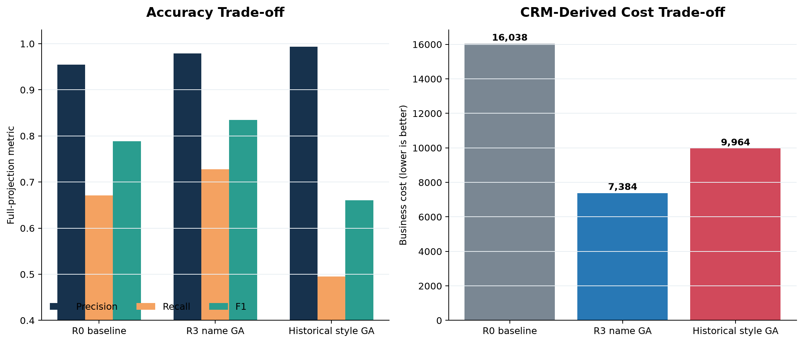

**รูปที่ 12** Full projection re-score ด้วย CRM-derived cost แสดงว่า historical style GA เพิ่ม precision แต่เสีย recall/F1 และมี cost สูงกว่า R3

| Full projection | Precision | Recall | F1 | FP | REVIEW | Cost |
|---|---:|---:|---:|---:|---:|---:|
| R0 baseline | 0.9550 | 0.6710 | 0.7882 | 925 | 86,296 | 16,037.60 |
| R3 name GA | 0.9786 | 0.7274 | 0.8345 | 465 | 2,751 | **7,384.10** |
| Historical-cost style GA | **0.9937** | 0.4949 | 0.6607 | **92** | 34,955 | 9,963.50 |

เมื่อ re-score ด้วยต้นทุน CRM ใหม่ R3 มี cost ต่ำกว่า historical-cost style GA เพราะ REVIEW แพงขึ้นจาก 0.02 เป็น 0.1 ต่อคู่ ผลนี้ยืนยันว่า policy winner ขึ้นกับ business weights และต้อง rerun search ไม่ใช่เพียงคำนวณ cost ใหม่ แนวทางต่อไปใช้ constrained optimization เช่น minimize cost ภายใต้ $Recall\ge0.70$ และ $Precision\ge0.99$

## 13.9 CRM-cost validation-only rerun

รอบ `crm_derived_v1` reuse feature cache เดิม 2,073,842 คู่ แต่ optimize ใหม่บน validation เท่านั้น ผล selector คือ:

| Guard | Validation cost | Precision | Recall | F1 | FP | FN | REVIEW |
|---|---:|---:|---:|---:|---:|---:|---:|
| name | **3,498.60** | 0.9853 | **0.6240** | **0.7641** | 89 | 2,189 | 11,316 |
| bio | 3,761.40 | 0.9837 | 0.2396 | 0.3853 | 38 | 2,202 | 14,834 |
| style | 3,808.70 | 0.9887 | 0.1556 | 0.2688 | **17** | 2,189 | 15,857 |
| score only | 3,810.30 | 0.9886 | 0.1545 | 0.2673 | **17** | 2,189 | 15,873 |
| image | 3,975.50 | 0.9580 | 0.4347 | 0.5981 | 182 | 2,488 | 11,235 |
| URL | 4,943.20 | 0.9274 | 0.5398 | 0.6824 | 404 | 3,704 | 4,312 |

weighted GA ได้ cost 4,897.10, Precision 0.9293, Recall 0.5691 และ F1 0.7059 จึงแพ้ `name` selector Artifact ระบุ `test_evaluated=false` และ freeze policy ก่อน test อย่างไรก็ตาม winner ยังต่ำกว่า gates ที่เสนอทั้ง Precision 0.99 และ Recall 0.70 จึงเป็นผลสำหรับพัฒนา constrained objective เท่านั้น ไม่ใช่ production candidate

---

# 14. Entity Resolution และ CRM Layer

คู่ที่ตัดสินเป็น MATCH จะถูกมองเป็น edge ของ graph และรวม connected components ด้วย Union-Find:

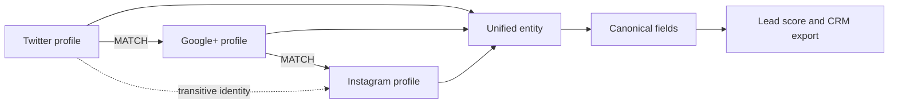

จุดเสี่ยงคือ FP เพียง edge เดียวอาจเชื่อมสอง component และทำให้หลาย profile ถูก merge ผิดพร้อมกัน จึงสมเหตุผลที่ business cost ให้น้ำหนัก FP สูง อย่างไรก็ตาม workspace ปัจจุบันไม่มี final unified-profile/lead-score artifact ที่พร้อมยืนยัน entity-level metrics รายงานจึงอธิบาย architecture แต่ไม่อ้างผล deployment หรือจำนวนลูกค้าหลัง merge

---

# 15. Reproducibility และ Engineering Controls

## 15.1 Environment

- Python 3.11 ผ่าน `.venv/bin/python`
- dependencies หลัก: NumPy, pandas, PyArrow, RapidFuzz, SciPy, scikit-learn
- training extras: PyTorch, sentence-transformers, Pillow, imagehash
- report figures: Matplotlib

## 15.2 Artifact lineage

ทุกผลควรมี:

1. source data path และ checksum
2. feature schema/version
3. split manifest และ seed
4. model parameters และ calibrator
5. threshold/GA genome
6. validation selection record
7. sealed-test report
8. environment/package versions

## 15.3 Known reproducibility risk

historical review re-decision บางสายเคยเปลี่ยน similarity implementation ตามว่ามี `jellyfish` ติดตั้งหรือไม่ ทำให้ SequenceMatcher และ Jaro-Winkler ให้ผลต่างกันมาก โค้ดใหม่ควรระบุ metric แบบ explicit, pin dependency และห้าม silent fallback

## 15.4 Figure reproducibility

กราฟในรายงานนี้สร้างจาก [`generate_report_figures.py`](generate_report_figures.py):

```bash
.venv/bin/python manuscript/generate_report_figures.py
```

script จะ fail หาก artifact ต้นทางหาย แทนการสร้างภาพจาก default หรือค่าจำลอง

---

# 16. ข้อจำกัดของงาน

1. **Retrieval ceiling:** blocking miss จำกัด recall สูงสุดของ R0-R5 ราว 0.8866
2. **Evidence-version mismatch:** full candidate run แก้ population mismatch แล้ว แต่ image evidence ใช้ pHash/caption-token เพราะ legacy caption embedding cache ไม่มีและ dimension ไม่สอดคล้องกัน
3. **Data age:** Google+ และ URL รูปจำนวนมากเป็น archival data
4. **Image coverage:** download ใหม่ล้มเหลว 998/998; image contribution ต่ำใน model ปัจจุบัน
5. **Sparse hard cases:** hard test slice มี positive เพียง 5 คู่ จึงมี uncertainty สูง
6. **Ground-truth proxy:** `user_folder` เป็น operational ground truth แต่ไม่ใช่ independently adjudicated identity label
7. **Pair metric ไม่ใช่ entity metric:** F1 ระดับคู่ไม่วัด cluster purity, over-merge หรือ under-merge โดยตรง
8. **GA objective dependency:** policy ที่ดีที่สุดเปลี่ยนได้เมื่อ business weights เปลี่ยน
9. **Full projection ไม่ใช่ sealed test:** การ apply policy บน full cache ใช้เพื่อประมาณ operational effect แต่ unbiased metric ต้องยึด held-out test
10. **ไม่มี deployment evidence:** ไม่มีหลักฐาน production traffic, latency SLA, human-review outcome หรือ post-deployment drift

Implementation plan สำหรับแก้ข้อจำกัดทั้งสิบอยู่ที่ [`LIMITATIONS_REMEDIATION_IMPLEMENTATION_PLAN_TH.md`](../docs/plans/LIMITATIONS_REMEDIATION_IMPLEMENTATION_PLAN_TH.md)

---

# 17. ข้อเสนอแนะเชิงระบบ

## 17.1 Priority 1: สร้าง full feature-aware cache

**สถานะ: เสร็จแล้ว** คำนวณ feature values และ availability masks ครบ 2,073,842 scored candidates แบบ chunked/resumable historical-cost run เคยเลือก `style` แต่เมื่อ re-optimize ด้วย `crm_derived_v1` บน validation-only `name` ชนะที่ cost 3,498.60 อย่างไรก็ตาม Precision 0.9853 และ Recall 0.6240 ยังไม่ผ่าน promotion gates จึงไม่ promote policy ใดจาก scalar-cost search นี้

งานนี้มี executable runner และ WezTerm runbook แล้วที่ [`run_full_feature_aware_ga_pipeline.py`](../experiments/code/run_full_feature_aware_ga_pipeline.py) และ [`FULL_2M_FEATURE_AWARE_WEZTERM_PLAN_TH.md`](../docs/plans/FULL_2M_FEATURE_AWARE_WEZTERM_PLAN_TH.md) ผล full run ต้องถูกบันทึกแยกจากผล labeled subset ในรายงานฉบับนี้

งานถัดไปคือดำเนินตาม [`LIMITATIONS_REMEDIATION_IMPLEMENTATION_PLAN_TH.md`](../docs/plans/LIMITATIONS_REMEDIATION_IMPLEMENTATION_PLAN_TH.md): เพิ่ม constraint ของ recall/precision เข้า GA objective, สร้าง fresh audit test, แก้ blocking misses และเพิ่ม entity-level/shadow evaluation

**เกณฑ์ผ่าน:**

- row count และ pair keys ตรงกับ frozen scored cache 100%
- ไม่มี duplicate pair
- availability audit ครบทุก group
- validation winner ถูก freeze ก่อน test
- test เปิด policy เดียว

## 17.2 Priority 2: ลด false auto-merge

- ตรวจ tail calibration ของ score ≥0.98
- เพิ่ม secondary-evidence guard ให้ exact username collisions
- รายงาน cluster-level over-merge หลัง Union-Find
- ใช้ expected cost หรือ constrained optimization เช่น maximize recall เมื่อ precision ≥0.99

## 17.3 Priority 3: แก้ blocking misses

- เพิ่ม semantic nearest-neighbor blocking เป็น union กับ blocking เดิม ไม่ใช่ replacement
- fine-tune encoder ด้วย hard negatives บน GPU
- ทดลอง hash bits/radius และวัด candidate inflation
- gate ด้วย recall gain, added candidate count และ downstream precision

## 17.4 Priority 4: ปรับ name representation

นำ N6 char 3-gram + handle ไปทำ sealed test และ full-candidate scoring หาก validation gain ยังคงอยู่ โดยไม่ลบ token-sort/Jaro เดิมก่อนมี ablation ยืนยัน

## 17.5 Priority 5: Data enrichment

- snapshot รูปและ URL ในเวลาที่เก็บข้อมูล
- normalize location ด้วย geocoding/country hierarchy
- เพิ่ม temporal metadata เพื่อป้องกันการเทียบข้อมูลคนละช่วงเวลา
- ทำ label audit แบบ stratified โดยเน้น exact FP, high-confidence FP และ weak-name FN

## 17.6 Priority 6: Monitoring

ควรติดตาม:

- candidate coverage และ candidate count ต่อ profile
- score distribution drift แยก platform pair
- exact collision rate
- MATCH precision จาก sampled review
- REVIEW yield และ reviewer agreement
- entity component size เพื่อจับ over-merge
- field availability drift

---

# 18. Roadmap การนำไปใช้

| Phase | งาน | Output | Promotion gate |
|---|---|---|---|
| A | Freeze data/split manifests | checksums, entity split | entity overlap = 0 |
| B | Build full feature cache | chunked parquet + masks | 2,073,842 rowsครบ |
| C | Run coverage audit | coverage/reliability table | no silent missing→zero |
| D | GA validation | selector + weighted leaderboard | validation only |
| E | Freeze winner | policy JSON | deterministic replay |
| F | Sealed test | one test report | precision/cost gate |
| G | Full projection | operational counts | review capacity gate |
| H | Shadow CRM | entity-level audit | no unacceptable over-merge |
| I | Controlled deployment | monitored decisions | rollback available |

---

# 19. สรุปผล

โครงการประสบความสำเร็จในการสร้าง pipeline ที่ครอบคลุมตั้งแต่ profile normalization, candidate retrieval, feature engineering, machine-learning scoring, probability calibration, decision policy ไปจนถึง entity resolution architecture ผล pair-model แสดงความสามารถสูงบน test set โดย F1 0.9340 แต่ full workflow ชี้ว่าคอขวดหลักอยู่ที่ candidate coverage, threshold policy และ review workload

หลักฐานจาก R-series แสดงว่า GA ช่วยใช้ probability ได้เหมาะกว่าการยึด threshold เดิม และ R3 ให้สมดุลดีที่สุดในชุดทดลอง ขณะที่ privacy-preserving Bloom representation มีศักยภาพเมื่อใช้ GA ร่วมกัน ส่วน R6 ยืนยันอย่างตรงไปตรงมาว่า frozen semantic encoder ยังไม่พอสำหรับแก้ blocking misses

ผล feature-aware analysis ตอบคำถามสำคัญว่า feature ที่สำคัญต่อ model ไม่จำเป็นต้องเพียงพอสำหรับ decision guard: permutation importance ยืนยันว่า name token/character features มีผลต่อ pair scoring สูงสุด ขณะที่ bio มีประโยชน์เสริมเมื่อข้อมูลพร้อม Historical labeled-subset เลือก bio, historical full run เลือก style และ CRM-cost full rerun เลือก name; winner เปลี่ยนตาม population และ cost policy ผล CRM run ยังต่ำกว่า Precision/Recall gates จึงปฏิเสธการ promote ทุก scalar-cost policy ในรูปปัจจุบัน

ข้อเสนอสุดท้ายคือรักษา Gradient Boosting + calibrated score เป็น baseline, ทดสอบ N6 ใน sealed protocol, ใช้ R3 เป็น research comparator และปรับ GA เป็น constrained multi-objective ที่มี availability masks พร้อมให้ความสำคัญกับ blocking misses/false merges มากกว่าการเพิ่ม model complexity โดยไม่มีข้อมูลรองรับ

---

# 20. Evidence Index

| หัวข้อ | Artifact/Source |
|---|---|
| Canonical architecture | [`ARCHITECTURE_TH.md`](../docs/ARCHITECTURE_TH.md), [`GETTING_STARTED_TH.md`](../docs/GETTING_STARTED_TH.md) |
| Production code | [`src/identity_resolution/`](../src/identity_resolution/) |
| Pair-model evaluation | [`current_model_evaluation.json`](../artifacts/evaluation/current_model_evaluation.json) |
| Full blocking statistics | [`blocking.csv`](../pub_multi/res/blocking.csv) |
| Decision tiers | [`tiers.csv`](../pub_multi/res/tiers.csv) |
| Error analysis | [`summary.json`](../artifacts/decisioning/analysis_decision_matrix/summary.json) |
| Model comparison | [`model_cmp.csv`](../pub_multi/res/model_cmp.csv) |
| Production feature importance | [`feat_imp.csv`](../pub_multi/res/feat_imp.csv) |
| R0-R6 report | [`REPORT_R0_R5.md`](../experiments/REPORT_R0_R5.md) |
| R-series table | [`r0_r5_summary_tidy.csv`](../experiments/r0_r5_summary_tidy.csv) |
| FN recovery | [`r2_r3_fn_recovery.json`](../experiments/r2_r3_fn_recovery.json) |
| R6 blocking recovery | [`r6_blocking_recovery.json`](../experiments/r6_blocking_recovery.json) |
| Name ablations | [`artifacts/evaluation/name_similarity/`](../artifacts/evaluation/name_similarity/) |
| Feature-aware GA | [`DETAILED_REPORT_TH.md`](../artifacts/decisioning/feature_aware_ga/automated_20260831_final/DETAILED_REPORT_TH.md) |
| Full 2M feature-aware result | [`FULL_2M_REPORT_TH.md`](../artifacts/decisioning/feature_aware_ga/full_2m/FULL_2M_REPORT_TH.md), [`sealed_test_and_projection.json`](../artifacts/decisioning/feature_aware_ga/full_2m/sealed_test_and_projection.json) |
| Image acquisition status | [`download_report.json`](../image_process/download_report.json) |
| Data-quality audit generated for this report | [`report_data_audit.json`](report_data_audit.json) |
| Figure generator | [`generate_report_figures.py`](generate_report_figures.py) |
| Full 2M runner และ WezTerm plan | [`run_full_feature_aware_ga_pipeline.py`](../experiments/code/run_full_feature_aware_ga_pipeline.py), [`FULL_2M_FEATURE_AWARE_WEZTERM_PLAN_TH.md`](../docs/plans/FULL_2M_FEATURE_AWARE_WEZTERM_PLAN_TH.md) |
| Limitations remediation plan | [`LIMITATIONS_REMEDIATION_IMPLEMENTATION_PLAN_TH.md`](../docs/plans/LIMITATIONS_REMEDIATION_IMPLEMENTATION_PLAN_TH.md) |
| Name-sim GA proof closure plan | [`NAME_SIM_GA_PROOF_CLOSURE_PLAN_TH.md`](../docs/plans/NAME_SIM_GA_PROOF_CLOSURE_PLAN_TH.md) |

---

## Appendix A: สถานะคำกล่าวสำคัญ

| คำกล่าว | สถานะ |
|---|---|
| ระบบมี pair-model test F1 0.9340 | ยืนยันจาก artifact |
| ระบบ full baseline มี F1 0.7882 | ยืนยันจาก R-series full evaluation |
| R3 เป็นผลดีที่สุดใน R0-R6 | ยืนยันบน common test harness |
| R3 ถูก deploy แล้ว | **ไม่จริง/ยังไม่มีหลักฐาน** |
| image context เพิ่ม performance มาก | **ไม่รองรับ**; gain ประมาณ 0.001 F1 |
| name เป็น feature group สำคัญที่สุด | รองรับโดย production importance และ permutation importance |
| name เป็น GA guard ที่ดีที่สุด | **ขึ้นกับ scope/objective**; labeled historical validation เป็น bio, historical full run เป็น style, CRM-cost full validation เป็น name |
| feature-aware bio policy พร้อม production | **ไม่พร้อม**; เป็น historical labeled-subset winner และไม่ผ่าน full-population proof |
| full 2M style policy ควรถูก promote | **ไม่ควร**; เป็น historical-cost winner, full F1 ต่ำ และ CRM-cost rerun ไม่เลือก policy นี้ |
| CRM-cost full `name` policy ควรถูก promote | **ไม่ควร**; Precision 0.9853 < 0.99 และ Recall 0.6240 < 0.70 |
| semantic blocking แก้ blocking miss แล้ว | **ไม่จริง**; R6 กู้ candidate ได้ 0.12% ที่ radius ≤1 |
| final CRM deployment สำเร็จ | **ยังไม่มี artifact ยืนยัน** |

## Appendix B: คำสั่งทำซ้ำรูป

```bash
.venv/bin/python manuscript/generate_report_figures.py
```

ผลลัพธ์อยู่ใน [`manuscript/figures/`](figures/)
