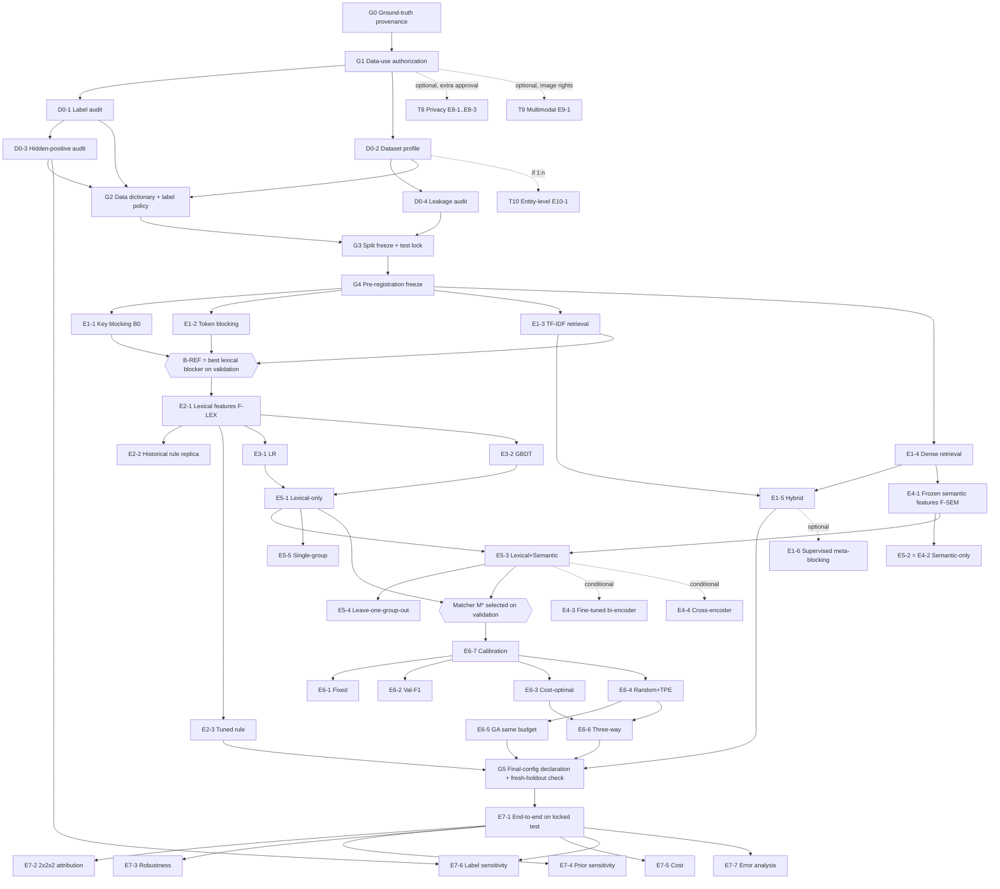

# Experiment Dependency Graph — Research V2

ลำดับการทดลองถูกออกแบบให้ **ทุกขั้นใช้เฉพาะ artifact ที่ freeze แล้วจากขั้นก่อนหน้า** และ test ถูกเปิดเพียงครั้งเดียวที่ปลายทาง

## 1. แผนภาพ (Mermaid)

## 2. ลำดับการทำงาน (topological order)

| ขั้น | รายการ | เข้าได้เมื่อ | ทำขนานกันได้ |
|---|---|---|---|
| 0 | G0 → G1 | — | — |
| 1 | D0-1, D0-2 | G1 | ได้ |
| 2 | D0-3, D0-4 | D0-1 / D0-2 | ได้ |
| 3 | G2 → G3 → G4 | D0 ครบ | — |
| 4 | E1-1…E1-4 | G4 | ได้ทั้งหมด |
| 5 | E1-5; เลือก B-REF; E2-1; E4-1 | ขั้น 4 | E2-1 ∥ E4-1 |
| 6 | E2-2, E2-3, E3-1, E3-2 | E2-1 | ได้ |
| 7 | E5-1, E5-2, E5-3 → E5-4, E5-5 | ขั้น 6 + E4-1 | ablations ขนานกัน |
| 8 | เลือก M*; E6-7 → E6-1…E6-6 | ขั้น 7 | E6-1…E6-4 ขนานกัน; E6-5 หลังตั้ง budget จาก E6-4 |
| 9 | G5 (ประกาศ final configs, ตรวจ holdout) | ขั้น 5–8 | — |
| 10 | E7-1 → E7-2…E7-7 | G5 | E7-2…E7-7 ขนานกัน |
| 11 | Conditional/optional | ตาม inclusion rule | — |

## 3. จุดเสี่ยงของลำดับ (critical path)

- **G0/G1 เป็นคอขวดหลัก** — ไม่มีขั้นใดเริ่มได้ก่อน
- **การเลือก B-REF** ส่งผลต่อทุก Track ถัดไป → ต้อง freeze และห้ามเปลี่ยนหลังเริ่ม T2 (ถ้าเปลี่ยน ต้องรัน T2–T6 ใหม่ทั้งหมด)
- **การเลือก M*** ส่งผลต่อ T6 → T6 ต้องใช้ score จาก M* ที่ freeze
- **E7-2 factorial** ต้องการ component ทั้ง 8 cells พร้อม — วางแผนเก็บ model artifacts ของ B0, E2-3, E6-1 ไว้ด้วย
- **E7-6** ต้องการ π_hidden จาก D0-3 — ถ้า D0-3 ไม่ได้ทำ E7-6 ทำได้แค่ S1/S2

## 4. งานที่ทำได้ **ก่อน** gate ผ่าน (ไม่ใช่การทดลองทางวิทยาศาสตร์)

- เขียน/ทบทวนโค้ด pipeline, unit tests, evaluation harness (grouped bootstrap, metrics)
- Smoke test บนข้อมูลสังเคราะห์หรือ benchmark สาธารณะที่ไม่มีข้อมูลส่วนบุคคล เพื่อวัด throughput (`COMPUTE_AND_COST_PLAN.md`)
- ตรวจ repository เดิมเพื่อเติม `history/` (เป็นการอ่านโค้ด ไม่ใช่การรันบนข้อมูลจริง — แต่ถ้า repo มีข้อมูลส่วนบุคคลฝังอยู่ ต้องผ่าน G1 ก่อนเปิด)
- เตรียมเอกสาร pre-registration
