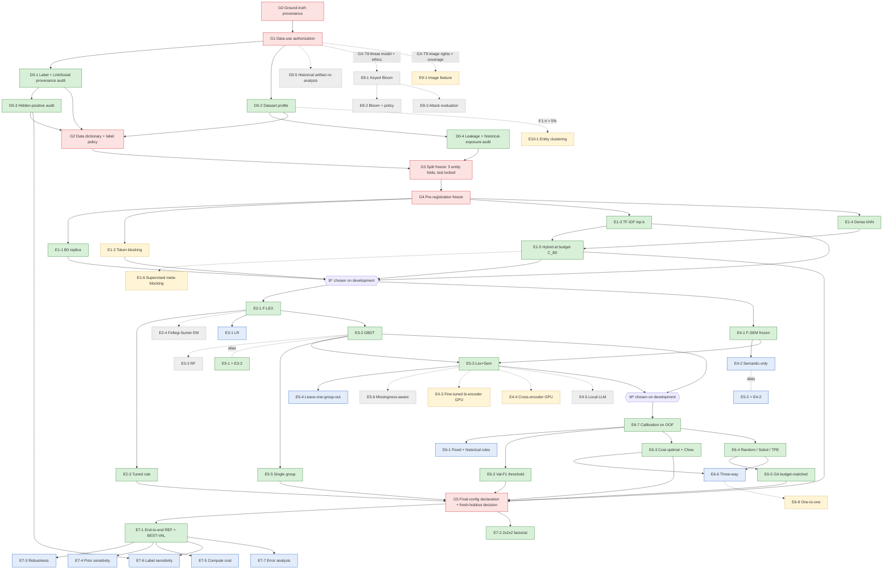

# Experiment Dependency Graph — Research V2 (v2 reconciled)

## Changes vs v1

| # | การเปลี่ยนแปลง | เหตุผล/หลักฐาน |
|---|---|---|
| G1 | ลบ node E2-2 (RETIRED → E6-1) | `review/ID_CHANGELOG.md` |
| G2 | E5-1 และ E5-2 แสดงเป็น alias (เส้นประ) ของ E3-2 และ E4-2 — ไม่มี job ใหม่ | `review/EXPERIMENT_REDUNDANCY_REVIEW.md` |
| G3 | เพิ่ม D0-5 (OPTIONAL) และเส้น D0-4 → G3 ที่ครอบคลุม historical exposure ของ test เดิม | test เดิมถูกใช้ ≥15 ครั้ง (`review/HISTORICAL_EXPERIMENT_AUDIT.md` A6) |
| G4 | B-REF → **B\*** เลือกจาก {E1-1, E1-3, E1-5} บน development ที่ budget = \|C_B0\| | `EXPERIMENTAL_MASTER_PLAN_TH.md` M5 |
| G5 | T6 ใช้ OOF scores ของ M* จาก cross-fitting (ไม่ใช่ validation fold เล็ก) | M9 (calibration prior shift CONFIRMED_DEFECT) |
| G6 | ทุก node มีป้าย priority; MVP critical path ระบุ | prompt §4 |
| G7 | G5 ระบุว่า **fresh-holdout ทำไม่ได้ด้วยข้อมูลเดิม** → ต้องข้อมูลใหม่หรือลดระดับข้อสรุป | `RESEARCH_GATES.md` G5 |

ลำดับการทดลองถูกออกแบบให้ **ทุกขั้นใช้เฉพาะ artifact ที่ freeze แล้วจากขั้นก่อนหน้า** และ test fold ถูกเปิดเพียงครั้งเดียวที่ปลายทาง

## 1. แผนภาพ (Mermaid)

## 2. ลำดับการทำงาน (topological order)

| ขั้น | รายการ (priority) | เข้าได้เมื่อ | ทำขนานกันได้ |
|---|---|---|---|
| 0 | G0 → G1 | — | — |
| 1 | D0-1, D0-2 (ESSENTIAL) | G1 | ได้ |
| 2 | D0-3, D0-4 (ESSENTIAL); D0-5 (OPTIONAL) | D0-1 / D0-2 | ได้ |
| 3 | G2 → G3 → G4 | D0-1…D0-4 | — |
| 4 | E1-1, E1-3, E1-4 (ESSENTIAL); E1-2 (CONDITIONAL) | G4 | ได้ทั้งหมด |
| 5 | E1-5 → เลือก B*; E2-1 ∥ E4-1 | ขั้น 4 | E2-1 ∥ E4-1 |
| 6 | E2-3, E3-2 (= E5-1) (ESSENTIAL); E3-1 (SUPPORTING) | E2-1 | ได้ |
| 7 | E5-3, E5-5 (ESSENTIAL); E4-2 (= E5-2), E5-4 (SUPPORTING) | ขั้น 6 + E4-1 | ได้ |
| 8 | เลือก M*; E6-7 → E6-2, E6-3, E6-4 → E6-5 (ESSENTIAL); E6-1, E6-6 (SUPPORTING) | ขั้น 7 | E6-1…E6-4 ขนานกัน; E6-5 หลังตรวจ budget audit ของ E6-4 |
| 9 | G5 (ประกาศ 19 test configurations + hash; ตัดสิน fresh-holdout) | ขั้น 5–8 | — |
| 10 | E7-1, E7-2 (ESSENTIAL) → E7-3…E7-7 (SUPPORTING) | G5 | E7-3…E7-7 ขนานกัน |
| 11 | CONDITIONAL/OPTIONAL ของ T1–T6: E1-6, E2-4, E3-3, E4-3, E4-4, E4-5, E5-6, E6-8 | ตาม inclusion rule (ตัดสินบน development ก่อน G5; ถ้าตัดสินหลัง G5 ต้องเป็น exploratory) | — |
| 12 | T8 (E8-1, E8-2, E8-3), T9 (E9-1), T10 (E10-1) | GX gates | — |

## 3. จุดเสี่ยงของลำดับ (critical path)

- **G0/G1 เป็นคอขวดหลัก** — repo ไม่มีเอกสาร G1 ใด ๆ และ G0 ยัง PARTIAL (`RESEARCH_GATES.md`)
- **G5 fresh-holdout** — entity ทุกตัวเคยถูกใช้ในงานเดิม → ต้องตัดสินก่อนเปิด test ว่าจะ (a) หาข้อมูลใหม่ หรือ (b) ลดระดับเป็น exploratory
- **การเลือก B\*** ส่งผลต่อทุก Track ถัดไป → freeze ก่อนเริ่มขั้น 5; ถ้าเปลี่ยน ต้องรันขั้น 5–8 ใหม่
- **การเลือก M\*** ส่งผลต่อ T6 → T6 ใช้ OOF score ของ M* ที่ freeze
- **E7-2 factorial** ต้องการ artifacts ของ B0 (E1-1), rule (E2-3) และ fixed policy (E6-1 R0 rule) — เก็บไว้แม้ไม่ใช่ตัวเลือกที่ดีที่สุด
- **E7-6** ต้องการ π_hidden จาก D0-3 — ถ้าไม่ได้ทำ D0-3 ทำได้แค่ S1/S2

## 4. งานที่ทำได้ **ก่อน** gate ผ่าน (ไม่ใช่การทดลองทางวิทยาศาสตร์)

- แก้ privacy exposure ของ repo สาธารณะ (การตัดสินใจของเจ้าของข้อมูล — ดู `review/METHODOLOGICAL_RISKS.md` §P)
- เขียน/ทบทวน evaluation harness, cluster bootstrap, budget audit, sealed-label store (ใช้ซ้ำจาก ICSEC v2 หลังตรวจ)
- Smoke test บนข้อมูลสังเคราะห์เพื่อวัด throughput (`COMPUTE_AND_COST_PLAN.md`)
- เตรียมเอกสาร G0/G1 และ pre-registration (G4)
