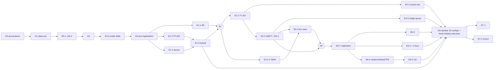

# FINAL HANDOFF — Research V2: Repository Evidence Review, Literature Verification & Plan Reconciliation

วันที่: 2026-10-25 · สถานะการทดลองทางวิทยาศาสตร์: **NO-GO** (G0 = PARTIAL/NOT VERIFIED, G1 = BLOCKED — ไม่พบหลักฐานที่ปลดล็อก)
GO เฉพาะ: งานเอกสาร, การตัดสินใจเรื่อง privacy exposure โดยเจ้าของข้อมูล, การเขียน harness และ smoke test บนข้อมูลสังเคราะห์

ขอบเขตรอบนี้: อ่านโค้ด/เอกสาร/aggregate artifacts ของ MAIN (`1e0a2db`, `50d95e9`, `08f4c5e`) และ BACKUP (`903246c`, `ab93b36`); ตรวจ literature 49 รายการ; ไม่มีการ train, ไม่รัน pipeline, ไม่คำนวณ metric ใหม่บนข้อมูลจริง (มีเพียงสถิติ schema: row count, missingness, ขนาดกลุ่ม entity, และการนับคู่จริงเพื่อตรวจตัวเลขที่ documented), ไม่ commit/push, ไม่แก้ repo

เอกสารหลักที่อ้างถึง: `review/HISTORICAL_EXPERIMENT_AUDIT.md` (A1–A9, F01–F18) · `review/METHODOLOGICAL_RISKS.md` (R-01…R-21, §P) · `design/EXPERIMENTAL_MASTER_PLAN_TH.md` · `design/HYPOTHESIS_EXPERIMENT_MATRIX.csv`

---

## ส่วนที่ 1 — คำตอบ 15 คำถาม

### Q1. งานวิจัยที่ทำจริงในประวัติศาสตร์ แยกตาม lifecycle

- **CODE + EXECUTION + RESULT + ARTIFACT_CONSISTENT:** R0–R6 (ตัวเลขใน `REPORT_R0_R5.md` ตรงกับ JSON ทุกแถว) [MAIN@1e0a2db:experiments/r1_results.json … r6_results.json]; nested GA automation (5 seeds, sensitivity 2 runs); GB-17/18/18-GA (primary = repro); ICSEC v2/v2r1 (paper = artifacts); reviewer revision (Chow, e2e metrics)
- **CODE + EXECUTION + RESULT (ความสอดคล้องไม่ทราบ/บางส่วน):** bigram retrieval, notebook pipeline IdentityMLP (AUC ตรง CLAUDE.md, confidence LOW), leak-safe multimodal suite/pub_multi, feature-aware GA, name-sim N0–N6 (validation only), CRM pipeline
- **ARTIFACT_INCONSISTENT:** IEEE draft ของ ICSEC v1 vs authoritative_run (GB-18-GA .8603 vs 0.860406); FN full 5,554 (plan) vs 5,558 (JSON); คู่จริง 29,247 (documented) vs 29,243 (canonical)
- **CODE เท่านั้น / execution UNKNOWN:** lexical matching ม.ค. 2026
- **PROPOSED_NEVER_EXECUTED:** R6 GPU fine-tuning plan; name-sim N7 + feature attribution; Gate 9 protocol (P0–P5)
- **INDEPENDENTLY_VERIFIED:** ไม่มี (ไม่ได้รันซ้ำ)

### Q2. Literature ที่สนับสนุนแต่ละทิศทาง

| ทิศทาง | Papers |
|---|---|
| Realistic e2e evaluation, open entities, prior | P07, P46, P47, P18, P23 |
| Blocking sparse/dense/hybrid ที่ budget เท่ากัน | P12, P13, P14, P45 (+P10/P11 meta-blocking) |
| Semantic/PLM | P15, P14, P04, P05, P06, P08, P37 |
| Learned vs rule | P48, P47, P16, P17 |
| Decision policy: cost/calibration/reject | P24, P26, P25, P16, P43, P44 |
| GA vs non-GA | P39, P40 (GA/GP ใน linkage), P41, P42 (baseline) — **ไม่พบงานเทียบที่ budget เท่ากันสำหรับ linkage threshold** |
| Leakage / selection bias / CI | P20, P21, P22, P49, P27 |
| Provenance / datasheet | P38, P33, P46 |
| Privacy | P29–P32, P35, P34, P36 |

### Q3. งานเดิมกับ literature สอดคล้อง/ขัดแย้งตรงไหน

สอดคล้อง: e2e harness นับ blocking miss [P07, P12]; undersample เฉพาะ train; GA ไม่แตะ test (R-13) · ขัดแย้ง: ใช้ GA โดยไม่มี closed-form baseline [P24] จนถึง reviewer revision; อ้าง privacy ของ Bloom โดยไม่มี attack [P30, P31, P35]; ไม่มี cluster-aware CI [P49]; ประเมินบนคู่ sample (F05/F06/F15) ซึ่ง literature ระบุว่าทำให้เกินจริง [P07, P47] — รายละเอียด `review/LITERATURE_VS_IMPLEMENTATION.md`

### Q4. ผลใดทำซ้ำได้ และด้วยหลักฐานอะไร

ไม่มีผลใดถูกทำซ้ำในรอบนี้. หลักฐานที่ดีที่สุดสำหรับความสามารถในการทำซ้ำ: GB-transformer primary = repro ทุกหลัก [MAIN@1e0a2db:experiments/automation/gb_transformer_{primary,repro}_20260809/test_results.csv]; reviewer revision "REPLAY VERIFIED" และ 102 tests passed [BACKUP@ab93b36:experiments/icsec_final/reviewer_revision/execution_final.log]; ICSEC v2 = v2r1 ทุกค่า. แต่ input หลักของ R0/R1 (`match_decisions.parquet`) และ production checkpoint **ไม่ถูก commit** → R0/R1 ทำซ้ำจาก repo ไม่ได้; R-series automation รันบนเครื่อง Windows โดยไม่บันทึก source hash

### Q5. หลักฐานสำคัญที่ขาด

(1) วิธีสร้าง ground truth ของ LinkSocial และ license (G0/G1) · (2) เอกสารอนุญาตใช้ข้อมูล/จริยธรรม (G1) · (3) holdout ที่ไม่เคยถูกใช้ (G5) · (4) CI ระดับ entity สำหรับผลประวัติศาสตร์ใด ๆ · (5) non-GA optimizer แบบ random/TPE · (6) tuned rule baseline · (7) cost model ที่เจ้าของโจทย์ลงนาม · (8) ภาษาของข้อมูล

### Q6. V2 ควรคงกี่ track

**7 core tracks (T1–T7) + D0**; T8 OPTIONAL; T9, T10 CONDITIONAL (คาดว่าไม่ผ่านเงื่อนไข: ภาพครอบคลุมเฉพาะ Twitter; 1:n = 0.03%)

### Q7. การทดลอง ESSENTIAL กี่ตัว (จำนวนแน่นอน)

**21 distinct experiments** = 4 diagnostics (D0-1…D0-4) + 17 (E1-1, E1-3, E1-4, E1-5, E2-1, E2-3, E3-2, E4-1, E5-3, E5-5, E6-7, E6-2, E6-3, E6-4, E6-5, E7-1, E7-2) + alias E5-1 (ใช้ E3-2) · 49 variants · 217 training jobs · 2,400 tuning fits · 869 model/rule validation evaluations · 82,025 policy objective evaluations · **19 final test evaluations** (test เปิดครั้งเดียว)
ทั้งแผน: 46 distinct (5 D0 + 41), 669 training jobs, 21 final test evaluations — ดู Table 3/4 และ `_work/consistency_check.txt`

### Q8. การทดลองที่ซ้ำซ้อน

E5-2 ≡ E4-2 (alias); E5-1 ≡ E3-2/E3-1 (alias, ใหม่); E2-2 ซ้ำกับ T6 และตั้งอยู่บนความเข้าใจผิดว่า R0 เป็น lexical rule (retired → E6-1); E1-2 อาจซ้ำ E1-3 (CONDITIONAL)

### Q9. โมเดลที่ต้อง retrain

ทุก classifier ที่ให้ผล V2: GBDT (E3-2, E5-3, E5-4, E5-5), LR (E3-1 และ robustness), semantic-only (E4-2); CONDITIONAL: fine-tuned bi-/cross-encoder (E4-3/E4-4, GPU). โมเดลประวัติศาสตร์ทั้งหมด → EXCLUDE จากผล (เหตุผล: split ไม่ตรง, name_sim gated, test ถูกใช้ซ้ำ, calibration prior shift)

### Q10. implementation ใดใช้ซ้ำได้ ด้วย label อะไร

REUSE_AFTER_VERIFICATION: B0 blocking (E1-1), 17 hand features เวอร์ชัน ICSEC v2 (name_sim ไม่ gate), MiniLM cosine code, GA 4 ยีน, Sobol + budget audit, Chow rule, e2e harness, entity nested split + overlap assert, sealed-label store + prediction freeze, run manifest, leakage feature lists, Phase 1.5 gate code · REIMPLEMENT: Bloom encoder (keyed), cluster bootstrap (resample entity), train_base split/TF-IDF · REPLICATE: R1/R3/ICSEC-B3 GA (E6-5), R0/stage18 rules (E6-1), ICSEC v2 results · REFERENCE_ONLY: lexical ม.ค., bigram, SBERT bio, notebook pipeline, R6, feature-aware GA, name-sim results · EXCLUDE: ICSEC v1 results, historical caches/predictions/models, privacy claims ของ R5, strict operating point ของ pub_multi · BLOCKED: image features, raw data

### Q11. สมมติฐานใดมีการออกแบบที่ป้องกันได้

ทั้ง H1–H5 มี ESSENTIAL experiment + fair baseline + primary metric + SESOI + กฎตัดสิน (`review/HYPOTHESIS_COVERAGE_REVIEW.md`) — **แต่** ข้อสรุปจะเป็น confirmatory ได้ก็ต่อเมื่อ G0/G1 ผ่าน **และ** มี fresh holdout; มิฉะนั้นทุก H เป็น exploratory. H3 และ H4b มีหลักฐานประวัติศาสตร์ชี้ล่วงหน้าว่าน่าจะ "เทียบเท่า" → ออกแบบให้ TOST ตอบได้

### Q12. Minimum scientific program

ลำดับ: G0 → G1 → D0-1, D0-2 → D0-3, D0-4 → G2 → G3 (5 entity folds) → G4 → E1-1, E1-3, E1-4 → E1-5 (B*) → E2-1 ∥ E4-1 → E2-3, E3-2 (=E5-1) → E5-3, E5-5 → (M*) E6-7 → E6-2, E6-3, E6-4 → E6-5 → G5 → E7-1, E7-2 · ไม่มี GPU · compute ≈ 30–80 CPU-ชม. (ASSUMPTION)

### Q13. ความเสี่ยงเชิงระเบียบวิธีหลัก

1. **Privacy exposure** — repo ทั้งสอง PUBLIC พร้อมข้อมูลโปรไฟล์ดิบและภาพ 4,248 ไฟล์ (§P)
2. **Label provenance/label proxy** — GT ของ LinkSocial ไม่ทราบวิธีสร้าง; exact URL/username tier อาจวนกลับหา label (R-14b)
3. **Test contamination** — test ถูกใช้ซ้ำ ≥15 ครั้ง (R-15) → G5
4. **name_sim gated by predecessor score** (CONFIRMED_DEFECT R-08) กระทบผล R2–R5, GB, ICSEC v1
5. **Calibration prior shift** (CONFIRMED_DEFECT R-10) จากขนาด role ไม่เท่ากัน
6. ไม่มี CI (MAIN) / pair-level bootstrap (BACKUP) (R-17)
7. Baseline อ่อน: threshold มือ 0.98/0.95 กับ score scale ใหม่ (R-12); selective reporting "R3 best" (R-20)
8. Evaluation population within-role (64% ของคู่ถูก drop) (R-19)

### Q14. Gate ที่ยัง blocked และหลักฐานที่จะปลดล็อก

| Gate | สถานะ | หลักฐานที่ต้องได้ |
|---|---|---|
| G0 | PARTIAL / NOT VERIFIED | เอกสารวิธีสร้าง label ของ LinkSocial (paper เต็ม P38 หรือคำยืนยันจากผู้เขียน); snapshot ที่ระบุ commit จริง (fe67dd1 ไม่พบ upstream); การตัดสิน label-proxy; record ลงนาม (Gate 3) |
| G1 | BLOCKED | license/permission จากผู้สร้าง dataset (repo ไม่มี license); ethics/IRB หรือหนังสือยกเว้น; PDPA assessment; **การตัดสินใจของเจ้าของเรื่องข้อมูลส่วนบุคคลใน repo PUBLIC** |
| G2 | NOT STARTED | D0-1 κ ≥ 0.80, D0-3 π_hidden, datasheet |
| G3 | NOT STARTED | split manifest 5 folds + hash; overlap 0; prior check |
| G4 | NOT STARTED | เอกสาร pre-registration + cost model ลงนาม |
| G5 | **จะไม่ผ่านด้วยข้อมูลเดิม** | holdout ใหม่ที่ไม่เคยใช้ หรือคำประกาศลดระดับเป็น exploratory |

### Q15. สิ่งที่ควรทำต่อ (ตามลำดับ)

1. **เจ้าของข้อมูล + ที่ปรึกษา ตัดสินเรื่อง privacy exposure** ของ repo PUBLIC ทั้งสอง (ไม่ใช่งานที่ทำในรอบนี้)
2. G0: หา paper เต็ม P38 / ติดต่อผู้เขียน LinkSocial เรื่องวิธีสร้าง GT และ license; บันทึก snapshot commit ที่ถูกต้อง
3. G1: ยื่นจริยธรรม/IRB + PDPA assessment; บันทึกใน Gate 8 record เดิม
4. ตัดสิน G5: แสวงหา holdout ใหม่ (เช่น ชุดเก็บใหม่/out-of-time) หรือประกาศ exploratory
5. ระหว่างรอ: เขียน harness (entity cluster bootstrap, budget audit, random/TPE, tuned rule) + smoke test บนข้อมูลสังเคราะห์; (synthetic tests ของ BACKUP รันแล้ว: 96 passed — B13)
6. ให้เจ้าของโจทย์ยืนยัน cost model (crm_derived_v1 หรืออื่น)
7. หลัง G1: D0-1…D0-4 → G2 → G3 → G4 (freeze เอกสาร design/ ทั้งหมดพร้อม hash)
8. รัน MVP ตามลำดับ Q12 → G5 → E7-1/E7-2 → SUPPORTING ตามเวลา
9. ก่อนเขียนเล่ม: ค้น GA-vs-RS/TPE แบบ systematic (B12); เติมเลขหน้าใน bib (B10)

---

## ส่วนที่ 2 — ตาราง 7 ตาราง

### Table 1 — Historical-to-V2 Experiment Mapping (ย่อ; ฉบับเต็ม 9 คอลัมน์: `history/HISTORICAL_EXPERIMENT_MAPPING.md` §2)

| Historical | Lifecycle | V2 | Reuse | Training | Confidence |
|---|---|---|---|---|---|
| R0 (41-feature production score + 0.98/0.95) | CODE·EXEC·RESULT·CONSISTENT | E6-1, E7-2 (policy factor) | REPLICATE (policy) / EXCLUDE (score) | ไม่ | HIGH |
| R1 (GA 4 ยีน) | CODE·EXEC·RESULT·CONSISTENT | E6-5 vs E6-2/3/4 | REPLICATE | ไม่ | HIGH |
| R2 (MLP 17 + MiniLM) | CODE·EXEC·RESULT·CONSISTENT | E5-3 vs E5-1 | REIMPLEMENT | ใช่ | HIGH |
| R3 (R2 + GA) | CODE·EXEC·RESULT·CONSISTENT | E5-3 + E6-5 + E7-2 | REPLICATE (แยกองค์ประกอบ) | ใช่ | HIGH |
| R4/R5 (Bloom) | CODE·EXEC·RESULT·CONSISTENT; privacy claim ไม่มีหลักฐาน | E8-1, E8-2, E8-3 | REIMPLEMENT | ใช่ | HIGH |
| R6 (hash blocking) | CODE·EXEC·RESULT·CONSISTENT; GPU plan PROPOSED_NEVER_EXECUTED | E1-4, E1-5 (E4-3 conditional) | REFERENCE_ONLY | ไม่ (E4-3 ใช่) | HIGH |
| B0 full-candidate | CODE·EXEC; input NOT_FOUND | E1-1 | REUSE_AFTER_VERIFICATION | ไม่ | HIGH |
| GB-17/18/18-GA | CODE·EXEC·RESULT·CONSISTENT | E3-2, E5-3, E6-5 | REUSE_AFTER_VERIFICATION / REPLICATE | ใช่ | HIGH |
| ICSEC v1 | CODE·EXEC·RESULT; IEEE draft INCONSISTENT | — | EXCLUDE | — | HIGH |
| ICSEC v2/v2r1 | CODE·EXEC·RESULT·CONSISTENT | E6-2/E6-4/E6-5 | REPLICATE / REUSE harness | ใช่ | HIGH |
| Reviewer revision | CODE·EXEC·RESULT·CONSISTENT | E6-3 (Chow), metric M1 | REUSE_AFTER_VERIFICATION | ไม่ | HIGH |
| Feature-aware GA | CODE·EXEC·RESULT | E5-4, E6-5 (แนวคิด) | REFERENCE_ONLY / EXCLUDE (full-2M) | — | MEDIUM |
| Name-sim N0–N6 | CODE·EXEC·RESULT (val) | E2-1, E5-4 | REFERENCE_ONLY | — | MEDIUM |
| Bigram / SBERT bio / lexical ม.ค. / notebook IdentityMLP / multimodal suite | ดู HISTORICAL_EXPERIMENT_AUDIT F01–F06 | E1-3, E4-1, E2-1 (แนวคิด) | REFERENCE_ONLY | — | MEDIUM |
| Image | CODE·EXEC·RESULT | E9-1 | BLOCKED | ใช่ | HIGH |
| Phase 1/1.5 gates | CODE·EXEC (synthetic); Gate 9 PROPOSED_NEVER_EXECUTED | G0–G5 | REUSE_AFTER_VERIFICATION | — | HIGH |

### Table 2 — Literature-to-Hypothesis Matrix

| H | Papers (บทบาท) |
|---|---|
| H1 attribute complementarity | P01, P02, P03, P46 (availability/missingness), P08 (missing-value robustness), P17 |
| H2 learned vs rule | P48, P47, P16, P17, P21 |
| H3 semantic | P15, P14, P13, P04, P05, P06, P08, P37, P09 (optional) |
| H4 decision / GA | P24, P26, P25, P16, P18, P43, P44, P39, P40, P41, P42, P28 |
| H5 candidate generation | P12, P13, P14, P45, P10, P11, P37 |
| ทุก H (protocol) | P07, P20, P21, P22, P23, P27, P49, P33, P38 |
| T8 privacy (extension) | P29, P30, P31, P32, P35, P34, P36 |

แหล่งรายการเต็ม: `literature/PAPER_EVIDENCE_MATRIX.csv` (คอลัมน์ hypotheses, experiments_motivated, gap_filled)

### Table 3 — Hypothesis-to-Experiment Matrix

| H | Primary contrast (Holm) | Baseline | Primary metric | SESOI | Supporting | Conditional/Optional |
|---|---|---|---|---|---|---|
| H1 | C1: E5-1 (=E3-2) vs best E5-5 | best single lexical group | PR-AUC | 0.02 | E5-4 | E5-6 |
| H2 | C2: E3-2 vs E2-3 | tuned rule (200 configs) | PR-AUC | 0.02 | E3-1, learning curves | E2-4, E3-3 |
| H3 | C3: E5-3 vs E5-1 | E5-1 (=E3-2) | PR-AUC | 0.01 (+ cost ratio) | E4-2, E7-3 (H3a) | E4-3, E4-4 (H3b), E4-5 |
| H4 | C4: E6-5 vs best{E6-2, E6-3, E6-4} | best non-GA, 2,048 evals | expected cost / pair | 5% relative | E6-1 (H4a ref), E6-6 (H4c) | E6-8 |
| H5 | C5: E1-5 vs best{E1-1, E1-3} | best lexical at |C_B0| | PC@|C_B0| | 0.02 | E7-2 (e2e) | E1-2, E1-6 |
| DQ0–DQ7 | — | — | — | — | D0-1…D0-4, E7-4…E7-7 | D0-5 |

### Table 4 — Training Requirements Matrix (ESSENTIAL + SUPPORTING; ทั้งหมด: `design/TRAINING_REQUIREMENTS.md`)

| ID | Training | Type | Jobs | Tuning fits | GPU |
|---|---|---|---:|---:|---|
| E1-1, E1-3, E1-4, E1-5 | ไม่ | rule / unsupervised / frozen | 0 | 0 | ไม่ |
| E2-1 | ไม่ | feature extraction (TF-IDF fit บน train fold) | 0 | 0 | ไม่ |
| E2-3 | ไม่ | parameter search (200 configs) | 0 | 0 | ไม่ |
| E3-1 | ใช่ | LR | 17 | 800 | ไม่ |
| E3-2 (=E5-1) | ใช่ | GBDT | 37 | 800 | ไม่ |
| E4-1 | ไม่ | frozen encoder inference | 0 | 0 | ไม่ (optional) |
| E4-2 (=E5-2) | ใช่ | LR + GBDT | 30 | 1,600 | ไม่ |
| E5-3 | ใช่ | LR + GBDT | 30 | 1,600 | ไม่ |
| E5-4, E5-5 | ใช่ | GBDT ×5 seeds + LR, 5 groups | 150 + 150 | 0 | ไม่ |
| E6-7 | fit 1–2 params | calibration | 0 | 0 | ไม่ |
| E6-1…E6-6 | ไม่ | policy optimisation / analytic | 0 | 0 | ไม่ |
| E7-* | ไม่ | evaluation | 0 | 0 | ไม่ |
| **รวม MVP** | | | **217** | **2,400** | **0** |

### Table 5 — Experiment Dependency Graph (Mermaid, MVP critical path; ฉบับเต็ม `design/EXPERIMENT_DEPENDENCY_GRAPH.md`)



### Table 6 — Evidence Confidence & Blocker Register

| ID | Item | Status | Confidence / เหตุผล | Unblock action |
|---|---|---|---|---|
| B01 | G0 provenance | BLOCKED | HIGH ว่าข้อมูลคือ LinkSocial (จำนวนตรงกัน 1–2 บัญชี/แพลตฟอร์ม); LOW เรื่องวิธีสร้าง GT | paper เต็ม P38 / ผู้เขียน |
| B02 | G1 data-use | BLOCKED | HIGH (ค้นทั้งสอง repo ไม่พบเอกสาร) | ethics, license, PDPA |
| B03 | Public PII exposure | BLOCKED | HIGH (`gh repo view` = PUBLIC) | การตัดสินใจของเจ้าของข้อมูล |
| B04 | G5 fresh holdout | BLOCKED | HIGH (test reuse ใน artifacts) | ข้อมูลใหม่ / ประกาศ exploratory |
| B05 | Label proxy | UNKNOWN | — ขึ้นกับ B01 | D0-1/D0-4 |
| B06 | Cost model sign-off | UNKNOWN | MEDIUM (มีเอกสาร crm_derived_v1 แต่ไม่ลงนาม) | เจ้าของโจทย์ |
| B07 | ภาษา | UNKNOWN | — | D0-2 |
| B08 | R0/R1 inputs missing | BLOCKED (เฉพาะ historical replication) | HIGH | ไม่จำเป็นต่อ V2 |
| B09 | 29,247 vs 29,243 | PARTIALLY_RESOLVED | HIGH (canonical ใน BACKUP Phase 1) | ใช้ canonical |
| B10 | เลขหน้าใน bib | RESOLVED (เหลือ TPE ที่ยืนยันเลขหน้าไม่ได้) | HIGH | — |
| B11–B12 | P36/P28 content; systematic GA-literature search | UNKNOWN/OPEN | — | ดู `BLOCKER_REGISTER.csv` |
| B13 | synthetic tests ของ BACKUP | RESOLVED: 96 passed, 1 skipped, 1 failed (test ตรวจว่ามีไฟล์โปรไฟล์จริง — ไม่มีโดยเจตนาใน copy แยก); ไม่รัน test ที่อ่านข้อมูลจริง | HIGH | — |

ระดับความมั่นใจของข้อค้นพบหลัก: A1, A3, A4, A6, A7, R-08, R-10 = **HIGH** (มีทั้ง source และ artifact); R0/R1 leakage (R-14) = **MEDIUM** (STATIC_RISK; ขนาดผลไม่ทราบ); label proxy = **LOW** (UNKNOWN)

### Table 7 — Final Recommended Experimental Roadmap

| ขั้น | งาน | Priority | ผู้ทำ/ผู้ตัดสิน | ต้องการ |
|---|---|---|---|---|
| 0 | ตัดสิน privacy exposure ของ repo PUBLIC | — (ก่อนทุกอย่าง) | เจ้าของข้อมูล + ที่ปรึกษา | — |
| 1 | G0 + G1 | gate | ผู้วิจัย, ที่ปรึกษา, คณะกรรมการจริยธรรม/DPO | เอกสาร |
| 1′ | (ขนาน) harness + synthetic smoke test; รัน synthetic tests ของ BACKUP | engineering | ผู้วิจัย | ไม่แตะข้อมูลจริง |
| 2 | D0-1…D0-4 → G2 → G3 → G4 (+ ตัดสิน G5) | ESSENTIAL | ผู้วิจัย + ผู้ตรวจอิสระ | G1 |
| 3 | T1: E1-1, E1-3, E1-4 → E1-5 → B* | ESSENTIAL | ผู้วิจัย | G4 |
| 4 | E2-1 ∥ E4-1 → E2-3, E3-2 → E5-3, E5-5 → M* | ESSENTIAL | ผู้วิจัย | B* |
| 5 | E6-7 → E6-2, E6-3, E6-4 → E6-5 | ESSENTIAL | ผู้วิจัย | M* |
| 6 | G5 → E7-1, E7-2 (test เปิดครั้งเดียว) | ESSENTIAL | ผู้วิจัย + ผู้ตรวจอิสระ | G5 |
| 7 | SUPPORTING: E3-1, E4-2, E5-4, E6-1, E6-6, E7-3…E7-7 | SUPPORTING | ผู้วิจัย | ขั้น 4–6 |
| 8 | CONDITIONAL ตาม inclusion rule (E1-2, E1-6, E4-3/E4-4 GPU, E6-8, E9-1, E10-1) | CONDITIONAL | ผู้วิจัย | rule ที่ประกาศใน G4 |
| 9 | OPTIONAL (D0-5, E2-4, E3-3, E4-5, E5-6, T8) | OPTIONAL | ผู้วิจัย | GX gates |

---

## ส่วนที่ 3 — สถานะ K1–K6

| K | สถานะ | เหตุผล |
|---|---|---|
| K1 (ไม่มี repo evidence ใน v1) | **RESOLVED** | ทุกแถว R0–R6 และ family อื่นมี lifecycle labels + citation หรือ UNKNOWN (`HISTORICAL_EXPERIMENT_AUDIT.md`, `HISTORICAL_EXPERIMENT_MAPPING.md`) |
| K2 (จำนวน 31/30/4/13/27) | **RESOLVED** | ยืนยันว่า v1 สอดคล้องภายใน (matrix 48 แถว; MVP 28 แถว = 27 unique) [`_work/v1_counts.json`]; v2 นับใหม่: 46 distinct + 2 alias + 1 retired; MVP 21 — ทุกเอกสารใช้ตัวเลขจาก matrix (consistency check) |
| K3 (budget 500 vs 200) | **RESOLVED** | consistency check: ไม่พบ "500 configs" ใน design/ (ดูผลด้านล่าง); budget = 200 configs (rule/learner) และ 2,048 evals (policy) |
| K4 (literature) | **RESOLVED** | ทุกข้อใน `LITERATURE_VERIFICATION_REPORT.md` §1; P34 reinstated; เหลือ P28 abstract/P36 content UNCONFIRMED (จำกัดการใช้) |
| K5 (compute assumptions) | **PARTIALLY RESOLVED** | ขนาดข้อมูลแทนด้วยค่าจาก repo (36,807 โปรไฟล์, 15,297 entities, ≈2.09M / ≈0.60M คู่); ตัวเลขเวลายังเป็น ASSUMPTION จนกว่าจะ smoke test |
| K6 (17/18 features, GA, split, level) | **RESOLVED** | 17 features [MAIN@1e0a2db:exp_r2_bert_feature.py#L53-L61]; R0 = 41-feature model; GA genome/fitness/budget [MAIN@1e0a2db:exp_r1_ga_redecision.py#L15-L156]; split md5 70/30 + nested; level = e2e เทียบ B0 |

---

## ส่วนที่ 4 — ผลการตรวจ Definition of Done (script: `_work/scripts/consistency_check.py`; ผลเต็ม `_work/consistency_check.txt`)

```
PASS checks: 123 · FAIL checks: 0
COUNTS MVP {"n_variants": 49, "n_training_jobs": 217, "n_tuning_fits": 2400, "n_validation_evals": 82894, "n_test_evals": 19, "policy_objective_evals": 82025, "model_rule_validation_evals": 869, "distinct": 21, "diagnostics": 4}
COUNTS MVP+SUPPORTING {"n_variants": 61, "n_training_jobs": 414, "n_tuning_fits": 4800, "n_validation_evals": 104008, "n_test_evals": 21, "policy_objective_evals": 102508, "model_rule_validation_evals": 1500, "distinct": 31, "diagnostics": 4}
COUNTS ALL {"n_variants": 92, "n_training_jobs": 669, "n_tuning_fits": 5600, "n_validation_evals": 104254, "n_test_evals": 21, "policy_objective_evals": 102513, "model_rule_validation_evals": 1741, "distinct": 46, "diagnostics": 5}
GPU training jobs 30
PRIVACY SCAN: 56 distinct hits (review each)
COMPUTE lines with time estimates lacking inline ASSUMPTION tag: 21 (doc-level banner applies)
SUMMARY: 0 FAIL
```

| DoD item | ผล |
|---|---|
| 10 review reports + BLOCKER_REGISTER.csv + ID_CHANGELOG.md + FINAL_HANDOFF_TH.md มีและไม่ว่าง | PASS |
| 9 working copies ที่บังคับ (+5 ที่เปลี่ยน) ขึ้นต้นด้วย "Changes vs v1" | PASS (CSV ใช้บรรทัด `#` นำหน้า — parse โดยข้ามบรรทัดที่ขึ้นต้นด้วย `#`) |
| `_input_v1/` checksum ไม่เปลี่ยน (เทียบ `_work/input_manifest.json`) | PASS (16 ไฟล์) |
| CSV parse ได้; ID ใน matrix = master plan = dependency graph = TRAINING_REQUIREMENTS | PASS |
| ทุก H มี ESSENTIAL experiment + baseline + primary metric | PASS (H1–H5) |
| ทุก paper ลิงก์กับ experiment/gap หรือถูก exclude | PASS (49/49) |
| R0–R6 และ family อื่นมี lifecycle labels + citation หรือ UNKNOWN | PASS (ตรวจด้วยมือ: `HISTORICAL_EXPERIMENT_AUDIT.md` §D) |
| ไม่มีข้อมูลส่วนบุคคลดิบใน output | PASS — regex scan พบ 56 hits ทั้งหมดเป็น URL ของ literature (DOI/Crossref/publisher/GitHub repo ของ dataset) และ `@article/@book/@inproceedings` ใน BibTeX; ตรวจทุก hit แล้ว ไม่มี handle/อีเมล/URL ของโปรไฟล์ (scan ไม่รวม `_work/` ซึ่งเก็บ raw literature pages และสำเนาโค้ดเท่านั้น; `PRIVACY_FINDINGS.csv` ไม่ระบุชื่อไฟล์ภาพ) |
| ไม่มีค่าประมาณที่นำเสนอเป็นการวัด | PASS — ตัวเลขเวลาใน compute plan อยู่ใต้ banner ASSUMPTION ระดับเอกสาร (21 บรรทัดไม่มีแท็ก inline แต่อยู่ในตาราง v1 ที่มีคำเตือนหัวเอกสาร); ค่า "HIST measured" ระบุแหล่ง |
| NO-GO คงไว้ | PASS |
| K1–K6 มีสถานะ | PASS (ส่วนที่ 3) |


---

## สรุปหนึ่งย่อหน้า (สำหรับนักวิจัยที่ไม่เคยเห็นโครงการ)

โครงการนี้จับคู่บัญชีโซเชียลมีเดียข้าม Twitter, Google+ และ Instagram (36,807 โปรไฟล์, 15,297 คน) โดยข้อมูลแทบแน่นอนว่ามาจากชุดข้อมูลสาธารณะ LinkSocial ซึ่งยังไม่ทราบวิธีสร้าง label และไม่มี license ชัดเจน งานเดิม (R0–R6, GB-17/18, ICSEC) ทำงานจริงและตัวเลขในรายงาน/paper ตรงกับ artifact ที่เก็บไว้ แต่มีข้อบกพร่องที่ยืนยันแล้ว เช่น feature ชื่อที่ขึ้นกับโมเดลเก่า, calibration ที่ fit ภายใต้ prior ต่างจาก test, test ชุดเดียวกันถูกใช้ซ้ำหลายสิบครั้ง และไม่มีช่วงความเชื่อมั่นระดับ entity; หลักฐานที่ดีที่สุด (ICSEC v2) ชี้ว่า GA ไม่ได้ดีกว่าการค้นหาแบบ Sobol ที่ budget เท่ากัน และ semantic feature จาก MiniLM แทบไม่เพิ่มคุณภาพ. แผน V2 ที่ปรับแล้วคง 7 track หลัก ทดสอบสมมติฐาน 5 ข้อด้วย 21 การทดลองที่จำเป็น (ไม่ต้องใช้ GPU) โดยแยก 5 ขั้นของ pipeline อย่างเคร่งครัด ใช้ baseline ที่ tune ด้วย budget เท่ากัน และ cluster bootstrap — แต่ **ยังเริ่มการทดลองไม่ได้ (NO-GO)** จนกว่าจะได้หลักฐานที่มาของ ground truth (G0) และสิทธิ์ใช้ข้อมูล (G1), จนกว่าเจ้าของข้อมูลจะตัดสินเรื่องข้อมูลส่วนบุคคลที่อยู่ใน repository สาธารณะ, และต้องยอมรับว่าหากไม่มีข้อมูล holdout ใหม่ ข้อสรุปบนข้อมูลชุดนี้จะเป็นเพียงเชิงสำรวจ (exploratory)


## Thesis reconciliation addendum — Round 3
สถานะ: NO-GO; สร้างรายงานใหม่5ไฟล์ โดยไม่แก้ design/ และไม่รัน training/inference/GA.
Ledger171แถว: VERIFIED107, CONFLICT12, HISTORICAL_ONLY6, UNKNOWN46; UNKNOWNเป็นresidual numeric registers ไม่ใช่ผลที่ยืนยันแล้ว.
TC-01/02: พบtracked deletionsในPDF70–71;oldsplit162,442pairsมีnotebookoutputจริง แต่SyntheticclaimยังขัดprovenanceและHITLไม่มีannotationledger.
TC-03:4.06Mpositivesมีในpair_statsที่JSONไม่สมบูรณ์;canonicaleligible15,297groups/max4ให้29,243pairs;massive-noisetrainingของfinalGBยังUNKNOWN.
TC-04/06:36,807→36,804เป็นeligibilityfilter;full_reportเดียวกันยืนยัน29,243total/25,931covered/3,312missedและcoverage88.67%;B09ยังpartial.
TC-07/08:finalsuiteAP.9789/F1.9340ตรงartifact;testboth-imagepairs0;ห้ามเทียบกับproductionP.9550/R3e2eF1.8373ตรง ๆ.
TC-10/11:surveyauthorsผิดและLeadScoringDOIชี้landslide;leadtiersเป็นheuristicไม่มีoutcomevalidationที่พบ.
ข้อเสนอ:T9currentimage-to-imageEXCLUDE;LeadScoringนอกproofscope;คง21essential/217trainingjobs/19finalevaluationsเป็นplanningcountsแต่ทั้งหมดON HOLD.
Confirmatoryroute:แนะนำLinkSocialexploratoryตอนนี้;MAUILWDเป็นcandidateexternalที่ยังติดdata-rights/schema/labelproxy;newconsentedcollectionเป็นfutureconfirmation.
ลำดับต่อไป:dispositionTC-01/02/03+privacy→G0/G1→ตัดสินG5route→D0/G2/G3/G4→จึงพิจารณารันแผน.
รายละเอียด: THESIS_EVIDENCE_RECONCILIATION.md, METRIC_POPULATION_MAP.md, THESIS_ERRATA_TH.md, PLAN_IMPACT_FROM_THESIS.md, CONFIRMATORY_EVIDENCE_OPTIONS.md.
Validation output: PASS=80 FAIL=0; ledger=171; TC01–TC12=12; PII_unclassified=0; design_unchanged=True; input_hashes_unchanged=True; NO-GO; numeric_coverage=PARTIAL — ผลเต็ม `_work/v3_consistency_check.txt`.
